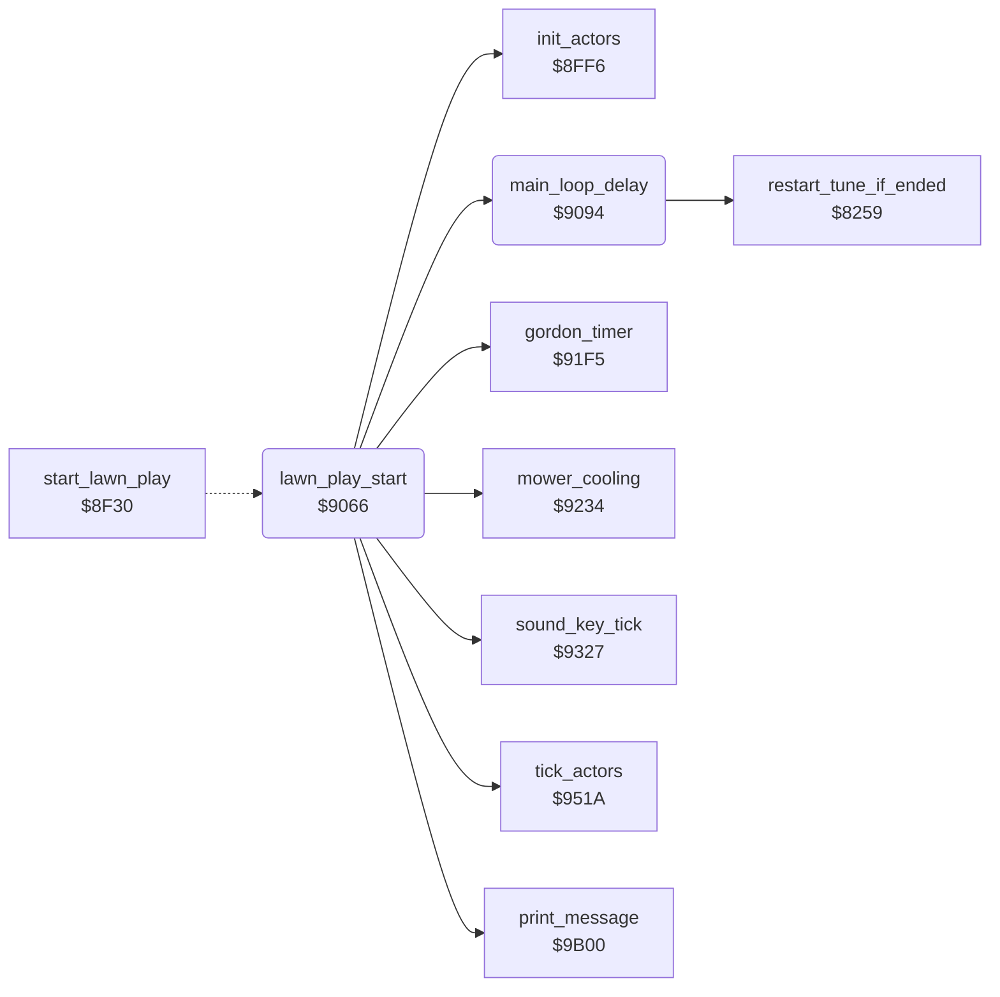

<!-- Generated by c64-docs from knowledge revision 20261024T102038.431-pgzet3 and .c64-re-tools/local/generated/src/source-map.json. Do not edit: change the knowledge, generate the source again, then run docs.ts generate. -->
# game/main_loop.asm: Start of the play and the main loop

Range `$9066-$909C`. Source: [game/main_loop.asm](../../../../src/game/main_loop.asm). Index: [the reference](../../index.md).

## Call graph

A solid arrow is a call, a thick arrow a table entry, a dotted arrow a jump. Rounded nodes are in this file.

## Names

### [`lawn_play_start`](../../../../src/game/main_loop.asm#L6) `$9066`

*routine*

Starts the play of a lawn. It stops Gordon and clears the flags $3d, $3e and $5e. The DOG LOYALTY and DOG TOLERANCE columns $2a and $2b go to $1e (full). The MOWER OVERLOAD column $2c goes to $10 (empty). Then it sets up the actors at $8ff6, shows message 3 ('COME BACK HERE WITH MY LAWNMOWER!!') and goes into the main loop.

- **Jumped to from:** [`start_lawn_play`](start_lawn_play.md#start_lawn_play) [`$8F8B`](../../../../src/game/start_lawn_play.asm#L49)
- **Calls:** [`init_actors`](../actors/init_actors.md#init_actors), [`print_message`](../text/messages.md#print_message), [`main_loop_delay`](main_loop.md#main_loop_delay), [`gordon_timer`](../player/gordon_timer.md#gordon_timer), [`mower_cooling`](../status/mower_cooling.md#mower_cooling), [`sound_key_tick`](../sound/sound_tick.md#sound_key_tick), [`tick_actors`](../actors/tick_actors.md#tick_actors)
- **Writes:** [`gordon_dir`](../../memory-map.md#gordon_dir), [`mow_sound_on`](../../memory-map.md#mow_sound_on), [`mower_overheated`](../../memory-map.md#mower_overheated), [`dog_bit_gordon`](../../memory-map.md#dog_bit_gordon), [`loyalty_bar`](../../memory-map.md#loyalty_bar), [`tolerance_bar`](../../memory-map.md#tolerance_bar), [`overload_bar`](../../memory-map.md#overload_bar)

### [`main_loop`](../../../../src/game/main_loop.asm#L21) `$9082`

*label*

The main loop: the delay, the timer of Gordon, the mower cooling, the sound and key tick, and the actor timer.

- **Jumped to from:** [`lawn_play_start`](main_loop.md#lawn_play_start) [`$9091`](../../../../src/game/main_loop.asm#L37)

### [`main_loop_delay`](../../../../src/game/main_loop.asm#L39) `$9094`

*routine*

Waits 128 DEY loops. Then it calls $8259.

- **Called from:** [`lawn_play_start`](main_loop.md#lawn_play_start) [`$9082`](../../../../src/game/main_loop.asm#L30)
- **Calls:** [`restart_tune_if_ended`](../music/tune_start.md#restart_tune_if_ended)

### [`main_delay_loop`](../../../../src/game/main_loop.asm#L41) `$9096`

*label*

- **Jumped to from:** [`main_loop_delay`](main_loop.md#main_loop_delay) [`$9097`](../../../../src/game/main_loop.asm#L43)
