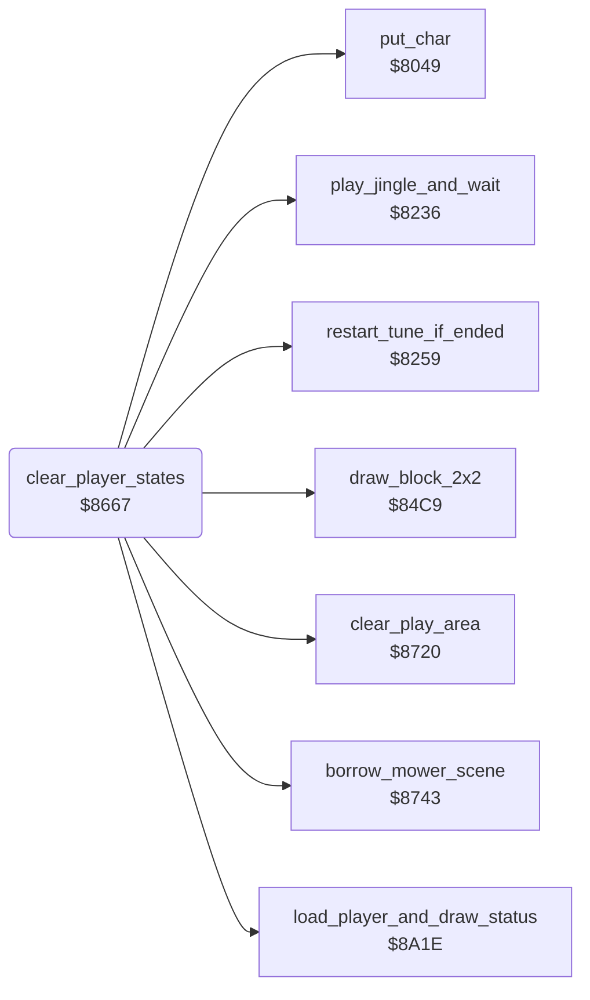

<!-- Generated by c64-docs from knowledge revision 20261025T214622.637-xq1idr and .c64-re-tools/local/generated/src/source-map.json. Do not edit: change the knowledge, generate the source again, then run docs.ts generate. -->
# game/player_turn.asm: Start of the turn of a player

Range `$8667-$871F`. Source: [game/player_turn.asm](../../../../src/game/player_turn.asm). Index: [the reference](../../index.md).

## Routines

| Routine | Address | Reached from | Summary |
|---|---|---|---|
| [`clear_player_states`](player_turn.md#clear_player_states) | `$8667` | [`$8289`](../../../../src/game/start_game.asm#L13) | Clears the state of both players at $4f00-$4f1f. |
| [`player_turn_intro`](player_turn.md#player_turn_intro) | `$8672` | [`$829C`](../../../../src/game/start_game.asm#L20), [`save_player_state`](../player/player_state.md#save_player_state) | Starts the turn of the current player $1c. |

## Data

| Range | Type | Name | Read by | Written by |
|---|---|---|---|---|
| [`$870C`](../../../../src/game/player_turn.asm#L94)-`$8715` | bytes | [`text_player_one`](../../../../src/game/player_turn.asm#L93) | [`clear_player_states`](player_turn.md#clear_player_states) |  |
| [`$8716`](../../../../src/game/player_turn.asm#L98)-`$871F` | bytes | [`text_player_two`](../../../../src/game/player_turn.asm#L97) | [`clear_player_states`](player_turn.md#clear_player_states) |  |

## Call graph

A solid arrow is a call, a thick arrow a table entry. Rounded nodes are in this file.

## Details

### [`clear_player_states`](../../../../src/game/player_turn.asm#L6) `$8667`

*routine*

Clears the state of both players at $4f00-$4f1f.

- **Called from:** [`$8289`](../../../../src/game/start_game.asm#L13)
- **Calls:** [`clear_play_area`](../screen/clear_play_area.md#clear_play_area), [`load_player_and_draw_status`](../status/draw_status.md#load_player_and_draw_status), [`put_char`](../screen/screen_chars.md#put_char), [`draw_block_2x2`](../screen/draw_block.md#draw_block_2x2), [`play_jingle_and_wait`](../music/tune_start.md#play_jingle_and_wait), [`restart_tune_if_ended`](../music/tune_start.md#restart_tune_if_ended), [`borrow_mower_scene`](borrow_mower_scene.md#borrow_mower_scene)
- **Jumps to:** [`setup_lawn`](../lawn/setup_lawn.md#setup_lawn)
- **Reads:** [`cursor_col`](../../memory-map.md#cursor_col), [`work_count`](../../memory-map.md#work_count), [`current_player`](../../memory-map.md#current_player), [`work_ptr`](../../memory-map.md#work_ptr)
- **Writes:** [`player_states_m1`](../../memory-map.md#player_states_m1), [`cursor_colour`](../../memory-map.md#cursor_colour), [`cursor_char`](../../memory-map.md#cursor_char), [`cursor_col`](../../memory-map.md#cursor_col), [`cursor_row`](../../memory-map.md#cursor_row), [`work_count`](../../memory-map.md#work_count), [`work_ptr`](../../memory-map.md#work_ptr)

| Label | Address | Comment |
|---|---|---|
| [`clear_player_states_loop`](../../../../src/game/player_turn.asm#L9) | `$866B` |  |
| [`turn_intro_lines`](../../../../src/game/player_turn.asm#L24) | `$8684` | Line of character $6a on the rows 8 and 13 |
| [`turn_intro_left_blocks`](../../../../src/game/player_turn.asm#L39) | `$86A2` | Blocks $6b-$6e at the columns 0, 3 and 6 of row 10 |
| [`turn_intro_right_blocks`](../../../../src/game/player_turn.asm#L53) | `$86BD` | Blocks $6f-$72 at the columns 32, 35 and 38 of row 10 |
| [`turn_intro_name_loop`](../../../../src/game/player_turn.asm#L70) | `$86DE` |  |
| [`turn_intro_put_name_char`](../../../../src/game/player_turn.asm#L80) | `$86F2` |  |

### [`player_turn_intro`](../../../../src/game/player_turn.asm#L15) `$8672`

*label*

Starts the turn of the current player $1c. Clears the play area and loads the state of the player (JSR $8a1e). Shows "PLAYER ONE" or "PLAYER TWO" between two lines, with three blocks at each side. Plays the jingle and starts the main tune. Then shows the borrow scene and continues at $8ac2.

- **Jumped to from:** [`$829C`](../../../../src/game/start_game.asm#L20), [`save_player_state`](../player/player_state.md#save_player_state)

### [`text_player_one`](../../../../src/game/player_turn.asm#L93) `$870C-$8715`

*data*

Text: "PLAYER ONE".

- **Read by:** [`clear_player_states`](player_turn.md#clear_player_states)

### [`text_player_two`](../../../../src/game/player_turn.asm#L97) `$8716-$871F`

*data*

Text: "PLAYER TWO".

- **Read by:** [`clear_player_states`](player_turn.md#clear_player_states)
