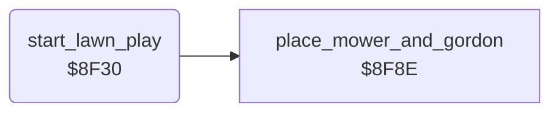

<!-- Generated by c64-docs from knowledge revision 20261025T214622.637-xq1idr and .c64-re-tools/local/generated/src/source-map.json. Do not edit: change the knowledge, generate the source again, then run docs.ts generate. -->
# game/start_lawn_play.asm: Start of play on a lawn

Range `$8F30-$8F8D`. Source: [game/start_lawn_play.asm](../../../../src/game/start_lawn_play.asm). Index: [the reference](../../index.md).

## Routines

| Routine | Address | Reached from | Summary |
|---|---|---|---|
| [`start_lawn_play`](start_lawn_play.md#start_lawn_play) | `$8F30` | [`setup_lawn`](../lawn/setup_lawn.md#setup_lawn), [`save_lawn_scroll_out`](../neighbour/neighbour_catch.md#save_lawn_scroll_out) | It sets Gordon's start state ($30 = 8, right, mower at $35/$36 = $51/$cd, $33/$34 = $12/$14), places the sprites ($8f8e) and jumps to $9066. |

## Call graph

A solid arrow is a call, a thick arrow a table entry. Rounded nodes are in this file.

## Details

### [`start_lawn_play`](../../../../src/game/start_lawn_play.asm#L6) `$8F30`

*routine*

It sets Gordon's start state ($30 = 8, right, mower at $35/$36 = $51/$cd, $33/$34 = $12/$14), places the sprites ($8f8e) and jumps to $9066.

- **Jumped to from:** [`setup_lawn`](../lawn/setup_lawn.md#setup_lawn), [`save_lawn_scroll_out`](../neighbour/neighbour_catch.md#save_lawn_scroll_out)
- **Calls:** [`place_mower_and_gordon`](../player/place_mower.md#place_mower_and_gordon)
- **Jumps to:** [`lawn_play_start`](main_loop.md#lawn_play_start)
- **Writes:** [`SPMC0`](../../memory-map.md#SPMC0), [`SPMC1`](../../memory-map.md#SPMC1), [`SP0COL`](../../memory-map.md#SP0COL), [`SP1COL`](../../memory-map.md#SP1COL), [`SPMC`](../../memory-map.md#SPMC), [`BGCOL1`](../../memory-map.md#BGCOL1), [`BGCOL2`](../../memory-map.md#BGCOL2), `$CFFF`, [`SPENA`](../../memory-map.md#SPENA), [`gordon_steps`](../../memory-map.md#gordon_steps), [`gordon_spare`](../../memory-map.md#gordon_spare), [`gordon_walk_frame`](../../memory-map.md#gordon_walk_frame) and 8 more

| Label | Address | Comment |
|---|---|---|
| [`start_play_clear_sprites`](../../../../src/game/start_lawn_play.asm#L23) | `$8F57` | Clears $d000-$d00f, the sprite positions. |
