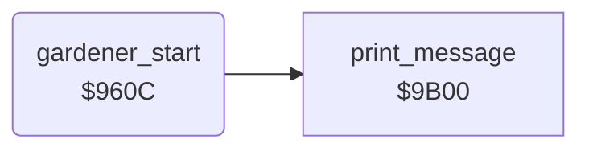

<!-- Generated by c64-docs from knowledge revision 20261025T214622.637-xq1idr and .c64-re-tools/local/generated/src/source-map.json. Do not edit: change the knowledge, generate the source again, then run docs.ts generate. -->
# gardener/gardener_start.asm: Start of the gardener

Range `$960C-$9623`. Source: [gardener/gardener_start.asm](../../../../src/gardener/gardener_start.asm). Index: [the reference](../../index.md).

## Routines

| Routine | Address | Reached from | Summary |
|---|---|---|---|
| [`gardener_start`](gardener_start.md#gardener_start) | `$960C` | [`mow_square`](../lawn/mow_square.md#mow_square) | Starts the gardener: $57 = 3 actors, message 7 ('OI! |
| [`gardener_start_return`](gardener_start.md#gardener_start_return) | `$9623` | [`dog_command`](../dog/dog_command.md#dog_command), [`dog_tolerance_step_down`](../dog/dog_tolerance.md#dog_tolerance_step_down) |  |

## Call graph

A solid arrow is a call, a thick arrow a table entry. Rounded nodes are in this file.

## Details

### [`gardener_start`](../../../../src/gardener/gardener_start.asm#L6) `$960C`

*routine*

Starts the gardener: $57 = 3 actors, message 7 ('OI! OFF MY FLOWERS, YOU LUNATIC!') and sprite 4 on. It returns A = $77, the mown flower character. It keeps X.

- **Jumped to from:** [`mow_square`](../lawn/mow_square.md#mow_square)
- **Calls:** [`print_message`](../text/messages.md#print_message)
- **Reads:** [`SPENA`](../../memory-map.md#SPENA)
- **Writes:** [`actor_count`](../../memory-map.md#actor_count), [`SPENA`](../../memory-map.md#SPENA)

### [`gardener_start_return`](../../../../src/gardener/gardener_start.asm#L19) `$9623`

*label*

- **Jumped to from:** [`dog_command`](../dog/dog_command.md#dog_command), [`dog_tolerance_step_down`](../dog/dog_tolerance.md#dog_tolerance_step_down)
