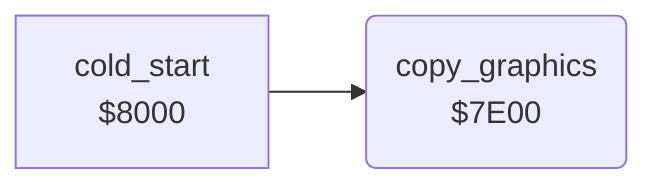

<!-- Generated by c64-docs from knowledge revision 20261024T102038.431-pgzet3 and .c64-re-tools/local/generated/src/source-map.json. Do not edit: change the knowledge, generate the source again, then run docs.ts generate. -->
# init/copy_graphics.asm: Copy of the charset and the sprites

Range `$7E00-$7E62`. Source: [init/copy_graphics.asm](../../../../src/init/copy_graphics.asm). Index: [the reference](../../index.md).

## Call graph

A solid arrow is a call, a thick arrow a table entry, a dotted arrow a jump. Rounded nodes are in this file.

## Names

### [`copy_graphics`](../../../../src/init/copy_graphics.asm#L6) `$7E00`

*routine*

$6c00-$7bff goes to the sprites at $3000-$3fff. Then it stops the case change with SHIFT and C=. No inputs.

- **Called from:** [`cold_start`](cold_start.md#cold_start) [`$8002`](../../../../src/init/cold_start.asm#L23)
- **Reads:** [`charset_image_2000`](../graphics/charset.md#charset_image_2000), [`charset_image_2100`](../graphics/charset.md#charset_image_2100), [`charset_image_2200`](../graphics/charset.md#charset_image_2200), [`charset_image_2300`](../graphics/charset.md#charset_image_2300), [`asm_leftover_2400`](../data/assembler_leftover.md#asm_leftover_2400), [`asm_leftover_2500`](../data/assembler_leftover.md#asm_leftover_2500), [`asm_leftover_2600`](../data/assembler_leftover.md#asm_leftover_2600), [`asm_leftover_2700`](../data/assembler_leftover.md#asm_leftover_2700), [`work_ptr`](../../memory-map.md#work_ptr), [`work_ptr2`](../../memory-map.md#work_ptr2), [`work_ptr_hi`](../../memory-map.md#work_ptr_hi), [`work_ptr2_hi`](../../memory-map.md#work_ptr2_hi)
- **Writes:** [`charset`](../../memory-map.md#charset), [`charset+256`](../../memory-map.md#charset), [`charset+512`](../../memory-map.md#charset), [`charset+768`](../../memory-map.md#charset), [`charset+1024`](../../memory-map.md#charset), [`charset+1280`](../../memory-map.md#charset), [`charset+1536`](../../memory-map.md#charset), [`charset+1792`](../../memory-map.md#charset), [`work_ptr_hi`](../../memory-map.md#work_ptr_hi), [`work_ptr`](../../memory-map.md#work_ptr), [`work_ptr2_hi`](../../memory-map.md#work_ptr2_hi), [`work_ptr2`](../../memory-map.md#work_ptr2), [`MODE`](../../memory-map.md#MODE)

### [`unpack_charset_loop`](../../../../src/init/copy_graphics.asm#L7) `$7E02`

*label*

8 pages in one loop with X.

- **Jumped to from:** [`copy_graphics`](copy_graphics.md#copy_graphics) [`$7E33`](../../../../src/init/copy_graphics.asm#L72)

### [`unpack_sprites_loop`](../../../../src/init/copy_graphics.asm#L55) `$7E47`

*label*

- **Jumped to from:** [`copy_graphics`](copy_graphics.md#copy_graphics) [`$7E5B`](../../../../src/init/copy_graphics.asm#L92)

### [`unpack_sprites_next`](../../../../src/init/copy_graphics.asm#L56) `$7E51`

*label*

- **Jumped to from:** [`copy_graphics`](copy_graphics.md#copy_graphics) [`$7E4D`](../../../../src/init/copy_graphics.asm#L85)

### [`unpack_sprites_test_end`](../../../../src/init/copy_graphics.asm#L57) `$7E57`

*label*

- **Jumped to from:** [`copy_graphics`](copy_graphics.md#copy_graphics) [`$7E53`](../../../../src/init/copy_graphics.asm#L88)
