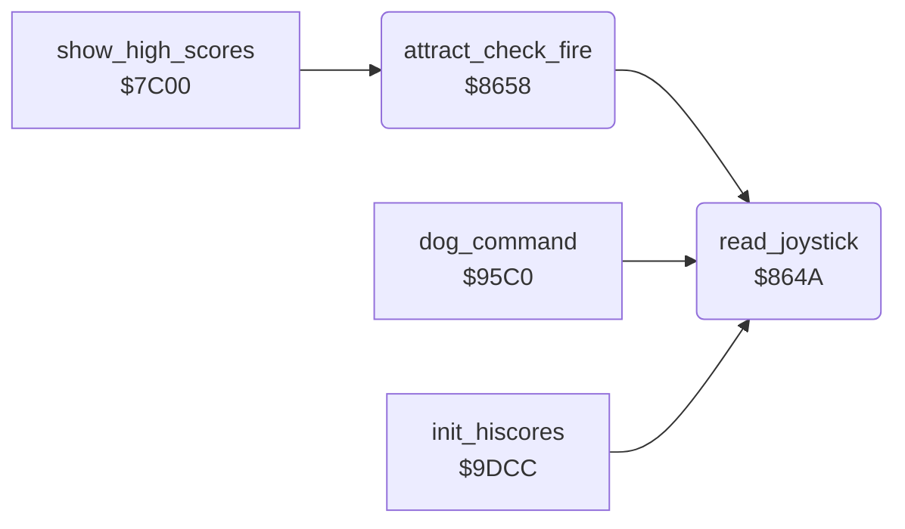

<!-- Generated by c64-docs from knowledge revision 20261025T214622.637-xq1idr and .c64-re-tools/local/generated/src/source-map.json. Do not edit: change the knowledge, generate the source again, then run docs.ts generate. -->
# input/joystick.asm: Joystick

Range `$864A-$8666`. Source: [input/joystick.asm](../../../../src/input/joystick.asm). Index: [the reference](../../index.md).

## Routines

| Routine | Address | Reached from | Summary |
|---|---|---|---|
| [`read_joystick`](joystick.md#read_joystick) | `$864A` | [`attract_check_fire`](joystick.md#attract_check_fire), [`dog_command`](../dog/dog_command.md#dog_command), [`init_hiscores`](../scores/hiscores.md#init_hiscores), [`$917A`](../../../../src/player/gordon_joystick.asm#L15) | Reads the joystick port that $1d selects ($dc00 + $1d: 0 = port 2, 1 = port 1). |
| [`attract_check_fire`](joystick.md#attract_check_fire) | `$8658` | [`show_high_scores`](../scores/high_score_screen.md#show_high_scores), [`$8444`](../../../../src/title/title_mower.asm#L61), [`$854A`](../../../../src/title/title_walk.asm#L34), [`$8582`](../../../../src/title/title_walk.asm#L62), [`$8598`](../../../../src/title/title_walk.asm#L74), [`$85B6`](../../../../src/title/title_walk.asm#L89), [`$85E5`](../../../../src/title/title_walk.asm#L113), [`$8635`](../../../../src/title/title_walk.asm#L154) | One delay step of the title and the attract screens. |

## Call graph

A solid arrow is a call, a thick arrow a table entry. Rounded nodes are in this file.

## Details

### [`read_joystick`](../../../../src/input/joystick.asm#L6) `$864A`

*routine*

Reads the joystick port that $1d selects ($dc00 + $1d: 0 = port 2, 1 = port 1). Stores the inverted bits in $1b: 1 = pressed, bit 4 = fire. Keeps X.

- **Called from:** [`attract_check_fire`](joystick.md#attract_check_fire), [`$917A`](../../../../src/player/gordon_joystick.asm#L15), [`dog_command`](../dog/dog_command.md#dog_command), [`init_hiscores`](../scores/hiscores.md#init_hiscores)
- **Reads:** [`joy_port`](../../memory-map.md#joy_port), [`CIAPRA`](../../memory-map.md#CIAPRA)
- **Writes:** [`joy_bits`](../../memory-map.md#joy_bits)

### [`attract_check_fire`](../../../../src/input/joystick.asm#L17) `$8658`

*routine*

One delay step of the title and the attract screens. When fire is pressed, it jumps to the setup screen at $7cde and does not return. Else it starts the main tune again when it has ended.

- **Called from:** [`show_high_scores`](../scores/high_score_screen.md#show_high_scores), [`$8444`](../../../../src/title/title_mower.asm#L61), [`$854A`](../../../../src/title/title_walk.asm#L34), [`$8582`](../../../../src/title/title_walk.asm#L62), [`$8598`](../../../../src/title/title_walk.asm#L74), [`$85B6`](../../../../src/title/title_walk.asm#L89), [`$85E5`](../../../../src/title/title_walk.asm#L113), [`$8635`](../../../../src/title/title_walk.asm#L154)
- **Calls:** [`read_joystick`](joystick.md#read_joystick)
- **Jumps to:** [`restart_tune_if_ended`](../music/tune_start.md#restart_tune_if_ended), [`setup_screen`](../setup/setup_screen.md#setup_screen)
- **Reads:** [`joy_bits`](../../memory-map.md#joy_bits)

| Label | Address | Comment |
|---|---|---|
| [`attract_go_setup`](../../../../src/input/joystick.asm#L23) | `$8664` |  |
