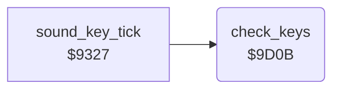

<!-- Generated by c64-docs from knowledge revision 20261024T102038.431-pgzet3 and .c64-re-tools/local/generated/src/source-map.json. Do not edit: change the knowledge, generate the source again, then run docs.ts generate. -->
# input/keys.asm: C= key commands: music on or off, pause

Range `$9D0B-$9D36`. Source: [input/keys.asm](../../../../src/input/keys.asm). Index: [the reference](../../index.md).

## Call graph

A solid arrow is a call, a thick arrow a table entry, a dotted arrow a jump. Rounded nodes are in this file.

## Names

### [`check_keys`](../../../../src/input/keys.asm#L6) `$9D0B`

*routine*

Each command waits until the key is released. Uses $028d and the key code $c5.

- **Called from:** [`sound_key_tick`](../sound/sound_tick.md#sound_key_tick) [`$932F`](../../../../src/sound/sound_tick.asm#L11)
- **Reads:** [`SHFLAG`](../../memory-map.md#SHFLAG), [`LSTX`](../../memory-map.md#LSTX), [`music_off`](../../memory-map.md#music_off)
- **Writes:** [`music_off`](../../memory-map.md#music_off)

### [`check_keys_m`](../../../../src/input/keys.asm#L11) `$9D13`

*label*

- **Jumped to from:** [`check_keys`](keys.md#check_keys) [`$9D10`](../../../../src/input/keys.asm#L9)

### [`check_keys_wait_release`](../../../../src/input/keys.asm#L18) `$9D1F`

*label*

- **Jumped to from:** [`check_keys`](keys.md#check_keys) [`$9D23`](../../../../src/input/keys.asm#L21)

### [`check_keys_done`](../../../../src/input/keys.asm#L22) `$9D25`

*label*

- **Jumped to from:** [`check_keys`](keys.md#check_keys) [`$9D28`](../../../../src/input/keys.asm#L26)

### [`check_keys_p`](../../../../src/input/keys.asm#L24) `$9D26`

*label*

Key P.

- **Jumped to from:** [`check_keys`](keys.md#check_keys) [`$9D17`](../../../../src/input/keys.asm#L14)

### [`pause_wait_release`](../../../../src/input/keys.asm#L27) `$9D2A`

*label*

- **Jumped to from:** [`check_keys`](keys.md#check_keys) [`$9D2E`](../../../../src/input/keys.asm#L30)

### [`pause_wait_key`](../../../../src/input/keys.asm#L31) `$9D30`

*label*

Waits for any key.

- **Jumped to from:** [`check_keys`](keys.md#check_keys) [`$9D34`](../../../../src/input/keys.asm#L34)
