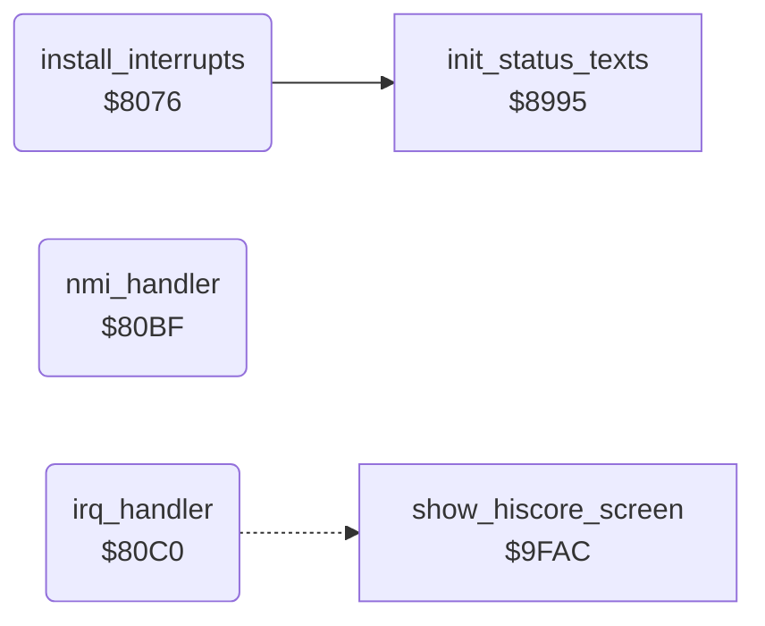

<!-- Generated by c64-docs from knowledge revision 20261024T102038.431-pgzet3 and .c64-re-tools/local/generated/src/source-map.json. Do not edit: change the knowledge, generate the source again, then run docs.ts generate. -->
# irq/interrupts.asm: Interrupt setup, handlers and tune player

Range `$8076-$8183`. Source: [irq/interrupts.asm](../../../../src/irq/interrupts.asm). Index: [the reference](../../index.md).

## Call graph

A solid arrow is a call, a thick arrow a table entry, a dotted arrow a jump. Rounded nodes are in this file.

## Names

### [`install_interrupts`](../../../../src/irq/interrupts.asm#L6) `$8076`

*routine*

Sets the IRQ vector $0314 to irq_handler and the NMI vector $0318 to nmi_handler. Clears the message timer $2f. Starts the raster interrupt at line 0. Stops the tune ($1a = 0), sets the tune tempo $10/$11 to 3 and the SID volume to 15. Then copies the status texts (JSR $8995).
X is not used

- **Called from:** [`$8205`](../../../../src/init/game_init.asm#L9)
- **Calls:** [`init_status_texts`](../status/status_texts.md#init_status_texts)
- **Reads:** [`SCROLY`](../../memory-map.md#SCROLY)
- **Writes:** [`CINV`](../../memory-map.md#CINV), [`CINV+1`](../../memory-map.md#CINV), [`NMINV`](../../memory-map.md#NMINV), [`NMINV+1`](../../memory-map.md#NMINV), [`message_timer`](../../memory-map.md#message_timer), [`IRQMSK`](../../memory-map.md#IRQMSK), [`RASTER`](../../memory-map.md#RASTER), [`VCREG3`](../../memory-map.md#VCREG3), [`SCROLY`](../../memory-map.md#SCROLY), [`music_playing`](../../memory-map.md#music_playing), [`music_tick`](../../memory-map.md#music_tick), [`music_speed`](../../memory-map.md#music_speed), [`SIGVOL`](../../memory-map.md#SIGVOL)

### [`install_nmi_vector`](../../../../src/irq/interrupts.asm#L14) `$8086`

*label*

- **Jumped to from:** [`install_interrupts`](interrupts.md#install_interrupts) [`$8083`](../../../../src/irq/interrupts.asm#L13)

### [`nmi_handler`](../../../../src/irq/interrupts.asm#L41) `$80BF`

*routine*

NMI handler: RTI only. The RESTORE key does nothing.

### [`irq_handler`](../../../../src/irq/interrupts.asm#L44) `$80C0`

*routine*

IRQ handler. An interrupt that is not the raster interrupt goes to the KERNAL at $ea31. On the raster interrupt (line 0, each frame), when the tune flag $1a is not 0, it counts down the tempo counter $10. When it gets to 0, it reloads it from $11 and does one tune step: the message timer and the two voices of the tune. Then it goes to the KERNAL at $ea31.

- **Jumps to:** `$EA31`
- **Reads:** [`VICIRQ`](../../memory-map.md#VICIRQ), [`SCROLY`](../../memory-map.md#SCROLY), [`music_playing`](../../memory-map.md#music_playing), [`music_tick`](../../memory-map.md#music_tick), [`music_speed`](../../memory-map.md#music_speed), [`message_timer`](../../memory-map.md#message_timer), [`voice1_duration`](../../memory-map.md#voice1_duration), [`voice1_ptr`](../../memory-map.md#voice1_ptr), [`voice1_ptr_hi`](../../memory-map.md#voice1_ptr_hi), [`note_freq_lo`](../music/note_frequencies.md#note_freq_lo), [`note_freq_hi`](../music/note_frequencies_81c2.md#note_freq_hi), [`music_off`](../../memory-map.md#music_off), [`voice2_duration`](../../memory-map.md#voice2_duration), [`voice2_ptr`](../../memory-map.md#voice2_ptr), [`voice2_ptr_hi`](../../memory-map.md#voice2_ptr_hi)
- **Writes:** [`RASTER`](../../memory-map.md#RASTER), [`SCROLY`](../../memory-map.md#SCROLY), [`VICIRQ`](../../memory-map.md#VICIRQ), [`IRQMSK`](../../memory-map.md#IRQMSK), [`music_tick`](../../memory-map.md#music_tick), [`message_timer`](../../memory-map.md#message_timer), [`message_row_m1`](../../memory-map.md#message_row_m1), [`voice1_duration`](../../memory-map.md#voice1_duration), [`voice1_ptr`](../../memory-map.md#voice1_ptr), [`voice1_ptr_hi`](../../memory-map.md#voice1_ptr_hi), [`VCREG1`](../../memory-map.md#VCREG1), [`FRELO1`](../../memory-map.md#FRELO1), [`FREHI1`](../../memory-map.md#FREHI1), [`voice2_duration`](../../memory-map.md#voice2_duration), [`voice2_ptr`](../../memory-map.md#voice2_ptr), [`voice2_ptr_hi`](../../memory-map.md#voice2_ptr_hi), [`VCREG2`](../../memory-map.md#VCREG2), [`music_playing`](../../memory-map.md#music_playing), [`FRELO2`](../../memory-map.md#FRELO2), [`FREHI2`](../../memory-map.md#FREHI2)

### [`irq_raster`](../../../../src/irq/interrupts.asm#L49) `$80CA`

*label*

- **Jumped to from:** [`irq_handler`](interrupts.md#irq_handler) [`$80C5`](../../../../src/irq/interrupts.asm#L47)

### [`irq_check_tune`](../../../../src/irq/interrupts.asm#L59) `$80E2`

*label*

Tune flag: 0 = no tune

- **Jumped to from:** [`irq_handler`](interrupts.md#irq_handler) [`$80DF`](../../../../src/irq/interrupts.asm#L58)

### [`irq_exit`](../../../../src/irq/interrupts.asm#L62) `$80E6`

*label*

- **Jumped to from:** [`irq_handler`](interrupts.md#irq_handler) [`$80EB`](../../../../src/irq/interrupts.asm#L66), [`irq_handler`](interrupts.md#irq_handler) [`$8141`](../../../../src/irq/interrupts.asm#L112), [`irq_handler`](interrupts.md#irq_handler) [`$815E`](../../../../src/irq/interrupts.asm#L127), [`irq_handler`](interrupts.md#irq_handler) [`$8168`](../../../../src/irq/interrupts.asm#L132), [`irq_handler`](interrupts.md#irq_handler) [`$8181`](../../../../src/irq/interrupts.asm#L144)

### [`irq_tempo_tick`](../../../../src/irq/interrupts.asm#L64) `$80E9`

*label*

- **Jumped to from:** [`irq_handler`](interrupts.md#irq_handler) [`$80E4`](../../../../src/irq/interrupts.asm#L61)

### [`irq_clear_message_loop`](../../../../src/irq/interrupts.asm#L75) `$80FD`

*label*

- **Jumped to from:** [`irq_handler`](interrupts.md#irq_handler) [`$8101`](../../../../src/irq/interrupts.asm#L78)

### [`tune_voice1`](../../../../src/irq/interrupts.asm#L80) `$8103`

*label*

Voice 1: counts down the duration $17. At 0, the pointer $13/$14 moves on by 2 and the next note starts. A note is 2 bytes: the duration in tune steps, and the note number. Note $f0 is a rest.

- **Jumped to from:** [`irq_handler`](interrupts.md#irq_handler) [`$80F3`](../../../../src/irq/interrupts.asm#L70), [`irq_handler`](interrupts.md#irq_handler) [`$80F7`](../../../../src/irq/interrupts.asm#L72)

### [`tune_voice2`](../../../../src/irq/interrupts.asm#L110) `$813F`

*label*

Voice 2: counts down the duration $19. At 0, the pointer $15/$16 moves on by 2 and the next note starts. Note $f0 is a rest. Note $ff ends the tune: the tune flag $1a becomes 0.

- **Jumped to from:** [`irq_handler`](interrupts.md#irq_handler) [`$8105`](../../../../src/irq/interrupts.asm#L82), [`irq_handler`](interrupts.md#irq_handler) [`$8122`](../../../../src/irq/interrupts.asm#L97), [`irq_handler`](interrupts.md#irq_handler) [`$8138`](../../../../src/irq/interrupts.asm#L106)

### [`tune_voice2_note`](../../../../src/irq/interrupts.asm#L133) `$816B`

*label*

- **Jumped to from:** [`irq_handler`](interrupts.md#irq_handler) [`$8162`](../../../../src/irq/interrupts.asm#L129)

### [`tune_voice2_done`](../../../../src/irq/interrupts.asm#L143) `$8181`

*label*

- **Jumped to from:** [`irq_handler`](interrupts.md#irq_handler) [`$817A`](../../../../src/irq/interrupts.asm#L140)
