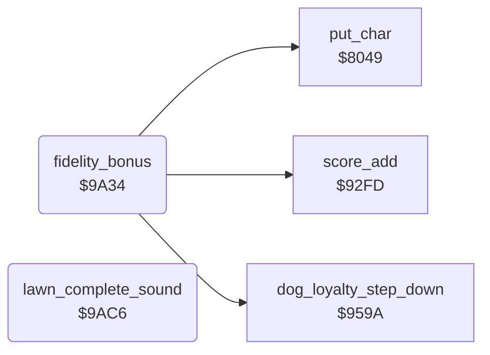

<!-- Generated by c64-docs from knowledge revision 20261025T214622.637-xq1idr and .c64-re-tools/local/generated/src/source-map.json. Do not edit: change the knowledge, generate the source again, then run docs.ts generate. -->
# lawn/lawn_complete.asm: End of a lawn: WELL DONE! and the canine fidelity bonus

Range `$99C5-$9AFF`. Source: [lawn/lawn_complete.asm](../../../../src/lawn/lawn_complete.asm). Index: [the reference](../../index.md).

## Routines

| Routine | Address | Reached from | Summary |
|---|---|---|---|
| [`lawn_complete`](lawn_complete.md#lawn_complete) | `$99C5` | [`gordon_move`](../player/gordon_move.md#gordon_move) | "WELL DONE!" flashes in all colours with a falling tone. |
| [`fidelity_bonus`](lawn_complete.md#fidelity_bonus) | `$9A34` |  | It plays a rising tone and calls $959a to make the scale one step shorter. |
| [`lawn_complete_sound`](lawn_complete.md#lawn_complete_sound) | `$9AC6` |  | Plays 6 rising sawtooth sweeps on voice 3. |

## Data

| Range | Type | Name | Read by | Written by |
|---|---|---|---|---|
| [`$9A8C`](../../../../src/lawn/lawn_complete.asm#L127)-`$9AB0` | bytes | [`well_done_text`](../../../../src/lawn/lawn_complete.asm#L118) | `$99D5` |  |
| [`$9AB1`](../../../../src/lawn/lawn_complete.asm#L144)-`$9AC5` | bytes | [`fidelity_bonus_text`](../../../../src/lawn/lawn_complete.asm#L135) | [`fidelity_bonus`](lawn_complete.md#fidelity_bonus) |  |

## Call graph

A solid arrow is a call, a thick arrow a table entry. Rounded nodes are in this file.

## Details

### [`lawn_complete`](../../../../src/lawn/lawn_complete.asm#L6) `$99C5`

*label*

"WELL DONE!" flashes in all colours with a falling tone. The bonus follows when the DOG LOYALTY scale is not empty.

- **Jumped to from:** [`gordon_move`](../player/gordon_move.md#gordon_move)

### [`fidelity_bonus`](../../../../src/lawn/lawn_complete.asm#L68) `$9A34`

*routine*

It plays a rising tone and calls $959a to make the scale one step shorter. When the scale is empty, it jumps to next_lawn and does not return.

- **Called from:** [`$9A23`](../../../../src/lawn/lawn_complete.asm#L58)
- **Calls:** [`put_char`](../screen/screen_chars.md#put_char), [`score_add`](../scores/score_add.md#score_add), [`dog_loyalty_step_down`](../dog/dog_loyalty.md#dog_loyalty_step_down)
- **Jumps to:** [`next_lawn`](lawn_complete.md#next_lawn)
- **Reads:** [`cursor_col`](../../memory-map.md#cursor_col), [`lawn_number`](../../memory-map.md#lawn_number), [`sfx_pitch`](../../memory-map.md#sfx_pitch), [`loyalty_bar`](../../memory-map.md#loyalty_bar)
- **Writes:** [`cursor_col`](../../memory-map.md#cursor_col), [`cursor_row`](../../memory-map.md#cursor_row), [`cursor_colour`](../../memory-map.md#cursor_colour), [`cursor_char`](../../memory-map.md#cursor_char), [`sfx_pitch`](../../memory-map.md#sfx_pitch), [`VCREG3`](../../memory-map.md#VCREG3), [`FREHI3`](../../memory-map.md#FREHI3)

| Label | Address | Comment |
|---|---|---|
| [`bonus_text_loop`](../../../../src/lawn/lawn_complete.asm#L76) | `$9A42` |  |
| [`bonus_step`](../../../../src/lawn/lawn_complete.asm#L89) | `$9A57` | Adds Y to score digit 6, the tens. |
| [`bonus_tone_loop`](../../../../src/lawn/lawn_complete.asm#L98) | `$9A6A` |  |
| [`bonus_delay`](../../../../src/lawn/lawn_complete.asm#L105) | `$9A77` |  |
| [`bonus_shrink_scale`](../../../../src/lawn/lawn_complete.asm#L111) | `$9A80` | Makes the DOG LOYALTY scale one step shorter. |

### [`well_done_text`](../../../../src/lawn/lawn_complete.asm#L118) `$9A8C-$9AB0`

*data*

"WELL DONE!   PREPARE FOR MORE MOWING!": 37 characters for lawn_complete. The code ANDs each byte with #$3f to get the screen code.

- **Read by:** [`$99D5`](../../../../src/lawn/lawn_complete.asm#L15)

### [`fidelity_bonus_text`](../../../../src/lawn/lawn_complete.asm#L135) `$9AB1-$9AC5`

*data*

"CANINE FIDELITY BONUS": 21 characters for fidelity_bonus.

- **Read by:** [`fidelity_bonus`](lawn_complete.md#fidelity_bonus)

### [`lawn_complete_sound`](../../../../src/lawn/lawn_complete.asm#L150) `$9AC6`

*routine*

Plays 6 rising sawtooth sweeps on voice 3. At each step, background colour 2 ($d023) changes. At the end, voice 3 is off.

- **Called from:** [`$99C5`](../../../../src/lawn/lawn_complete.asm#L7)
- **Reads:** [`BGCOL2`](../../memory-map.md#BGCOL2), [`sfx_pitch`](../../memory-map.md#sfx_pitch), [`work_temp`](../../memory-map.md#work_temp)
- **Writes:** [`ATDCY3`](../../memory-map.md#ATDCY3), [`work_temp`](../../memory-map.md#work_temp), [`sfx_pitch`](../../memory-map.md#sfx_pitch), [`VCREG3`](../../memory-map.md#VCREG3), [`BGCOL2`](../../memory-map.md#BGCOL2), [`FREHI3`](../../memory-map.md#FREHI3)

| Label | Address | Comment |
|---|---|---|
| [`lawn_sound_sweep`](../../../../src/lawn/lawn_complete.asm#L161) | `$9ADD` |  |
| [`lawn_sound_delay`](../../../../src/lawn/lawn_complete.asm#L168) | `$9AEB` |  |
| [`lawn_sound_next_sweep`](../../../../src/lawn/lawn_complete.asm#L172) | `$9AF1` |  |

## Labels

| Label | Address | Comment |
|---|---|---|
| [`lawn_complete_text_loop`](../../../../src/lawn/lawn_complete.asm#L14) | `$99D5` |  |
| [`well_done_flash_loop`](../../../../src/lawn/lawn_complete.asm#L33) | `$99F6` |  |
| [`well_done_colour_loop`](../../../../src/lawn/lawn_complete.asm#L36) | `$99FA` | Gives the colour to the 10 characters of "WELL DONE!". |
| [`well_done_delay`](../../../../src/lawn/lawn_complete.asm#L48) | `$9A12` |  |
| [`next_lawn`](../../../../src/lawn/lawn_complete.asm#L60) | `$9A26` | Starts the next lawn: it increments the lawn number $21, saves and loads the player state, resets the stack and jumps to $8ac2. |
