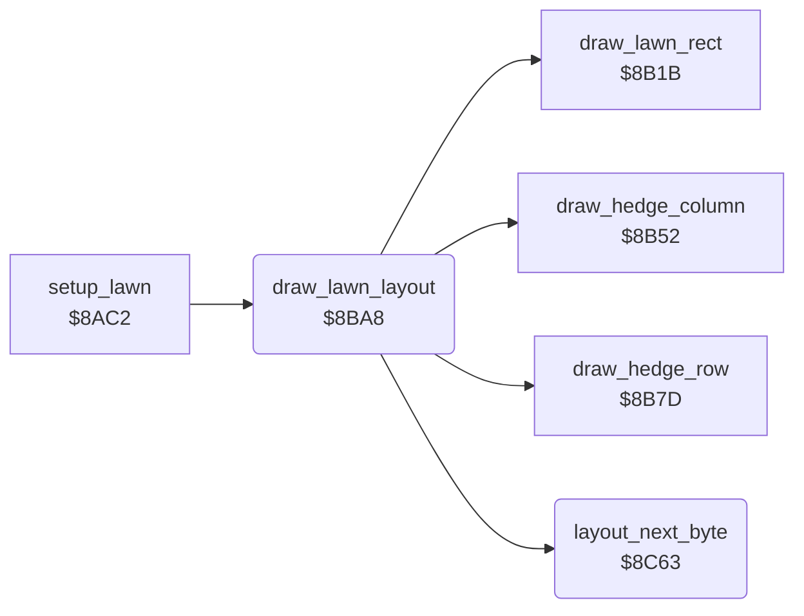

<!-- Generated by c64-docs from knowledge revision 20261024T102038.431-pgzet3 and .c64-re-tools/local/generated/src/source-map.json. Do not edit: change the knowledge, generate the source again, then run docs.ts generate. -->
# lawn/lawn_layout_reader.asm: Lawn layout reader

Range `$8BA8-$8C6D`. Source: [lawn/lawn_layout_reader.asm](../../../../src/lawn/lawn_layout_reader.asm). Index: [the reference](../../index.md).

## Call graph

A solid arrow is a call, a thick arrow a table entry, a dotted arrow a jump. Rounded nodes are in this file.

## Names

### [`draw_lawn_layout`](../../../../src/lawn/lawn_layout_reader.asm#L6) `$8BA8`

*routine*

Records: $7c column,row,length (vertical strip), $7e column,row,length (horizontal strip), $ff end. Other bytes: char,column,row,width,height,colour (rectangle).

- **Called from:** [`setup_lawn`](setup_lawn.md#setup_lawn) [`$8B0A`](../../../../src/lawn/setup_lawn.asm#L44)
- **Calls:** [`layout_next_byte`](lawn_layout_reader.md#layout_next_byte), [`draw_lawn_rect`](lawn_shapes.md#draw_lawn_rect), [`draw_hedge_column`](lawn_shapes.md#draw_hedge_column), [`draw_hedge_row`](lawn_shapes.md#draw_hedge_row)
- **Reads:** [`lawn_number`](../../memory-map.md#lawn_number), [`work_ptr3`](../../memory-map.md#work_ptr3), [`work_ptr3_hi`](../../memory-map.md#work_ptr3_hi), [`work_temp`](../../memory-map.md#work_temp), [`work_ptr`](../../memory-map.md#work_ptr), [`work_ptr2_hi`](../../memory-map.md#work_ptr2_hi), [`work_count`](../../memory-map.md#work_count), [`work_ptr_hi`](../../memory-map.md#work_ptr_hi), [`work_ptr2`](../../memory-map.md#work_ptr2)
- **Writes:** [`work_ptr3`](../../memory-map.md#work_ptr3), [`work_ptr3_hi`](../../memory-map.md#work_ptr3_hi), [`work_ptr`](../../memory-map.md#work_ptr), [`work_ptr_hi`](../../memory-map.md#work_ptr_hi), [`work_ptr2`](../../memory-map.md#work_ptr2), [`work_ptr2_hi`](../../memory-map.md#work_ptr2_hi), [`work_count`](../../memory-map.md#work_count), [`work_temp`](../../memory-map.md#work_temp)

### [`layout_find_lawn`](../../../../src/lawn/lawn_layout_reader.asm#L18) `$8BBA`

*label*

- **Jumped to from:** [`draw_lawn_layout`](lawn_layout_reader.md#draw_lawn_layout) [`$8BC2`](../../../../src/lawn/lawn_layout_reader.asm#L23), [`draw_lawn_layout`](lawn_layout_reader.md#draw_lawn_layout) [`$8BC6`](../../../../src/lawn/lawn_layout_reader.asm#L25), [`draw_lawn_layout`](lawn_layout_reader.md#draw_lawn_layout) [`$8BCF`](../../../../src/lawn/lawn_layout_reader.asm#L33)

### [`layout_skip_end_mark`](../../../../src/lawn/lawn_layout_reader.asm#L26) `$8BC8`

*label*

- **Jumped to from:** [`draw_lawn_layout`](lawn_layout_reader.md#draw_lawn_layout) [`$8BBE`](../../../../src/lawn/lawn_layout_reader.asm#L21)

### [`layout_count_lawn`](../../../../src/lawn/lawn_layout_reader.asm#L31) `$8BCE`

*label*

- **Jumped to from:** [`draw_lawn_layout`](lawn_layout_reader.md#draw_lawn_layout) [`$8BCA`](../../../../src/lawn/lawn_layout_reader.asm#L28)

### [`layout_next_record`](../../../../src/lawn/lawn_layout_reader.asm#L34) `$8BD1`

*label*

- **Jumped to from:** [`draw_lawn_layout`](lawn_layout_reader.md#draw_lawn_layout) [`$8C0B`](../../../../src/lawn/lawn_layout_reader.asm#L64), [`draw_lawn_layout`](lawn_layout_reader.md#draw_lawn_layout) [`$8C17`](../../../../src/lawn/lawn_layout_reader.asm#L71), [`draw_lawn_layout`](lawn_layout_reader.md#draw_lawn_layout) [`$8C1B`](../../../../src/lawn/lawn_layout_reader.asm#L73), [`draw_lawn_layout`](lawn_layout_reader.md#draw_lawn_layout) [`$8C1F`](../../../../src/lawn/lawn_layout_reader.asm#L75), [`draw_lawn_layout`](lawn_layout_reader.md#draw_lawn_layout) [`$8C23`](../../../../src/lawn/lawn_layout_reader.asm#L77), [`draw_lawn_layout`](lawn_layout_reader.md#draw_lawn_layout) [`$8C46`](../../../../src/lawn/lawn_layout_reader.asm#L92), [`draw_lawn_layout`](lawn_layout_reader.md#draw_lawn_layout) [`$8C60`](../../../../src/lawn/lawn_layout_reader.asm#L103)

### [`layout_test_end`](../../../../src/lawn/lawn_layout_reader.asm#L43) `$8BE1`

*label*

- **Jumped to from:** [`draw_lawn_layout`](lawn_layout_reader.md#draw_lawn_layout) [`$8BDF`](../../../../src/lawn/lawn_layout_reader.asm#L42)

### [`layout_rectangle`](../../../../src/lawn/lawn_layout_reader.asm#L47) `$8BE6`

*label*

Rectangle record. $f6 = char $76 (flower) with bit 7: not counted as grass.

- **Jumped to from:** [`draw_lawn_layout`](lawn_layout_reader.md#draw_lawn_layout) [`$8BE3`](../../../../src/lawn/lawn_layout_reader.asm#L45)

### [`layout_ring`](../../../../src/lawn/lawn_layout_reader.asm#L68) `$8C13`

*label*

- **Jumped to from:** [`draw_lawn_layout`](lawn_layout_reader.md#draw_lawn_layout) [`$8C2C`](../../../../src/lawn/lawn_layout_reader.asm#L81)

### [`layout_vertical_strip`](../../../../src/lawn/lawn_layout_reader.asm#L82) `$8C2F`

*label*

- **Jumped to from:** [`draw_lawn_layout`](lawn_layout_reader.md#draw_lawn_layout) [`$8BD7`](../../../../src/lawn/lawn_layout_reader.asm#L38)

### [`layout_horizontal_strip`](../../../../src/lawn/lawn_layout_reader.asm#L93) `$8C49`

*label*

- **Jumped to from:** [`draw_lawn_layout`](lawn_layout_reader.md#draw_lawn_layout) [`$8BDB`](../../../../src/lawn/lawn_layout_reader.asm#L40)

### [`layout_next_byte`](../../../../src/lawn/lawn_layout_reader.asm#L105) `$8C63`

*routine*

Increments the layout pointer $0d/$0e and reads the byte there. Output: A = the byte, Y = 0.

- **Called from:** [`draw_lawn_layout`](lawn_layout_reader.md#draw_lawn_layout) [`$8BE8`](../../../../src/lawn/lawn_layout_reader.asm#L49), [`draw_lawn_layout`](lawn_layout_reader.md#draw_lawn_layout) [`$8BED`](../../../../src/lawn/lawn_layout_reader.asm#L51), [`draw_lawn_layout`](lawn_layout_reader.md#draw_lawn_layout) [`$8BF2`](../../../../src/lawn/lawn_layout_reader.asm#L53), [`draw_lawn_layout`](lawn_layout_reader.md#draw_lawn_layout) [`$8BF7`](../../../../src/lawn/lawn_layout_reader.asm#L55), [`draw_lawn_layout`](lawn_layout_reader.md#draw_lawn_layout) [`$8BFC`](../../../../src/lawn/lawn_layout_reader.asm#L57), [`draw_lawn_layout`](lawn_layout_reader.md#draw_lawn_layout) [`$8C01`](../../../../src/lawn/lawn_layout_reader.asm#L59), [`draw_lawn_layout`](lawn_layout_reader.md#draw_lawn_layout) [`$8C31`](../../../../src/lawn/lawn_layout_reader.asm#L84), [`draw_lawn_layout`](lawn_layout_reader.md#draw_lawn_layout) [`$8C36`](../../../../src/lawn/lawn_layout_reader.asm#L86), [`draw_lawn_layout`](lawn_layout_reader.md#draw_lawn_layout) [`$8C3B`](../../../../src/lawn/lawn_layout_reader.asm#L88), [`draw_lawn_layout`](lawn_layout_reader.md#draw_lawn_layout) [`$8C43`](../../../../src/lawn/lawn_layout_reader.asm#L91), [`draw_lawn_layout`](lawn_layout_reader.md#draw_lawn_layout) [`$8C4B`](../../../../src/lawn/lawn_layout_reader.asm#L95), [`draw_lawn_layout`](lawn_layout_reader.md#draw_lawn_layout) [`$8C50`](../../../../src/lawn/lawn_layout_reader.asm#L97), [`draw_lawn_layout`](lawn_layout_reader.md#draw_lawn_layout) [`$8C55`](../../../../src/lawn/lawn_layout_reader.asm#L99), [`draw_lawn_layout`](lawn_layout_reader.md#draw_lawn_layout) [`$8C5A`](../../../../src/lawn/lawn_layout_reader.asm#L101)
- **Reads:** [`work_ptr3`](../../memory-map.md#work_ptr3), [`work_ptr3_hi`](../../memory-map.md#work_ptr3_hi)
- **Writes:** [`work_ptr3`](../../memory-map.md#work_ptr3), [`work_ptr3_hi`](../../memory-map.md#work_ptr3_hi)

### [`layout_read_byte`](../../../../src/lawn/lawn_layout_reader.asm#L109) `$8C69`

*label*

- **Jumped to from:** [`layout_next_byte`](lawn_layout_reader.md#layout_next_byte) [`$8C65`](../../../../src/lawn/lawn_layout_reader.asm#L107)
