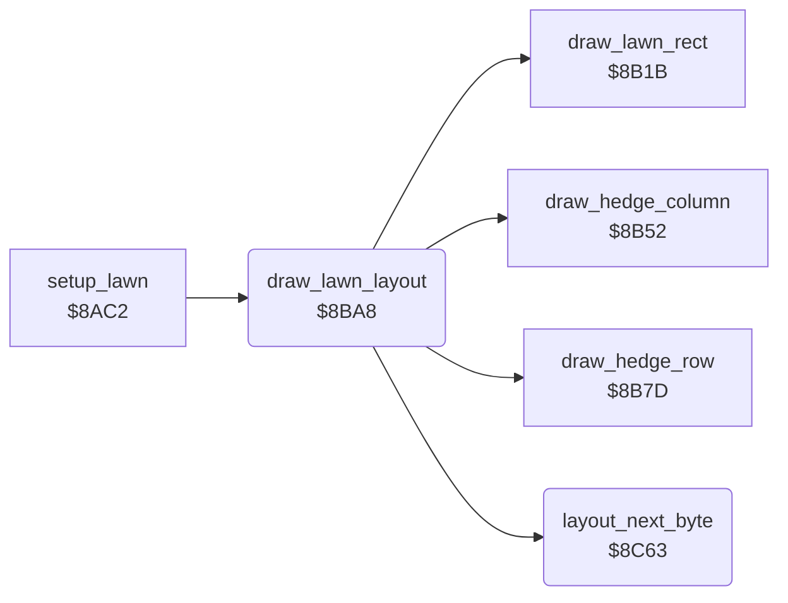

<!-- Generated by c64-docs from knowledge revision 20261025T214622.637-xq1idr and .c64-re-tools/local/generated/src/source-map.json. Do not edit: change the knowledge, generate the source again, then run docs.ts generate. -->
# lawn/lawn_layout_reader.asm: Lawn layout reader

Range `$8BA8-$8C6D`. Source: [lawn/lawn_layout_reader.asm](../../../../src/lawn/lawn_layout_reader.asm). Index: [the reference](../../index.md).

## Routines

| Routine | Address | Reached from | Summary |
|---|---|---|---|
| [`draw_lawn_layout`](lawn_layout_reader.md#draw_lawn_layout) | `$8BA8` | [`setup_lawn`](setup_lawn.md#setup_lawn) | Records: $7c column,row,length (vertical strip), $7e column,row,length (horizontal strip), $ff end. |
| [`layout_next_byte`](lawn_layout_reader.md#layout_next_byte) | `$8C63` | [`draw_lawn_layout`](lawn_layout_reader.md#draw_lawn_layout) | Increments the layout pointer $0d/$0e and reads the byte there. |

## Call graph

A solid arrow is a call, a thick arrow a table entry. Rounded nodes are in this file.

## Details

### [`draw_lawn_layout`](../../../../src/lawn/lawn_layout_reader.asm#L6) `$8BA8`

*routine*

Records: $7c column,row,length (vertical strip), $7e column,row,length (horizontal strip), $ff end. Other bytes: char,column,row,width,height,colour (rectangle).

- **Called from:** [`setup_lawn`](setup_lawn.md#setup_lawn)
- **Calls:** [`layout_next_byte`](lawn_layout_reader.md#layout_next_byte), [`draw_lawn_rect`](lawn_shapes.md#draw_lawn_rect), [`draw_hedge_column`](lawn_shapes.md#draw_hedge_column), [`draw_hedge_row`](lawn_shapes.md#draw_hedge_row)
- **Reads:** [`lawn_number`](../../memory-map.md#lawn_number), [`work_ptr3`](../../memory-map.md#work_ptr3), [`work_ptr3_hi`](../../memory-map.md#work_ptr3_hi), [`work_temp`](../../memory-map.md#work_temp), [`work_ptr`](../../memory-map.md#work_ptr), [`work_ptr2_hi`](../../memory-map.md#work_ptr2_hi), [`work_count`](../../memory-map.md#work_count), [`work_ptr_hi`](../../memory-map.md#work_ptr_hi), [`work_ptr2`](../../memory-map.md#work_ptr2)
- **Writes:** [`work_ptr3`](../../memory-map.md#work_ptr3), [`work_ptr3_hi`](../../memory-map.md#work_ptr3_hi), [`work_ptr`](../../memory-map.md#work_ptr), [`work_ptr_hi`](../../memory-map.md#work_ptr_hi), [`work_ptr2`](../../memory-map.md#work_ptr2), [`work_ptr2_hi`](../../memory-map.md#work_ptr2_hi), [`work_count`](../../memory-map.md#work_count), [`work_temp`](../../memory-map.md#work_temp)

| Label | Address | Comment |
|---|---|---|
| [`layout_find_lawn`](../../../../src/lawn/lawn_layout_reader.asm#L18) | `$8BBA` |  |
| [`layout_skip_end_mark`](../../../../src/lawn/lawn_layout_reader.asm#L26) | `$8BC8` |  |
| [`layout_count_lawn`](../../../../src/lawn/lawn_layout_reader.asm#L31) | `$8BCE` |  |
| [`layout_next_record`](../../../../src/lawn/lawn_layout_reader.asm#L34) | `$8BD1` |  |
| [`layout_test_end`](../../../../src/lawn/lawn_layout_reader.asm#L43) | `$8BE1` |  |
| [`layout_rectangle`](../../../../src/lawn/lawn_layout_reader.asm#L47) | `$8BE6` | Rectangle record. $f6 = char $76 (flower) with bit 7: not counted as grass. |
| [`layout_ring`](../../../../src/lawn/lawn_layout_reader.asm#L68) | `$8C13` |  |
| [`layout_vertical_strip`](../../../../src/lawn/lawn_layout_reader.asm#L82) | `$8C2F` |  |
| [`layout_horizontal_strip`](../../../../src/lawn/lawn_layout_reader.asm#L93) | `$8C49` |  |

### [`layout_next_byte`](../../../../src/lawn/lawn_layout_reader.asm#L105) `$8C63`

*routine*

Increments the layout pointer $0d/$0e and reads the byte there. Output: A = the byte, Y = 0.

- **Called from:** [`draw_lawn_layout`](lawn_layout_reader.md#draw_lawn_layout)
- **Reads:** [`work_ptr3`](../../memory-map.md#work_ptr3), [`work_ptr3_hi`](../../memory-map.md#work_ptr3_hi)
- **Writes:** [`work_ptr3`](../../memory-map.md#work_ptr3), [`work_ptr3_hi`](../../memory-map.md#work_ptr3_hi)

| Label | Address | Comment |
|---|---|---|
| [`layout_read_byte`](../../../../src/lawn/lawn_layout_reader.asm#L109) | `$8C69` |  |
