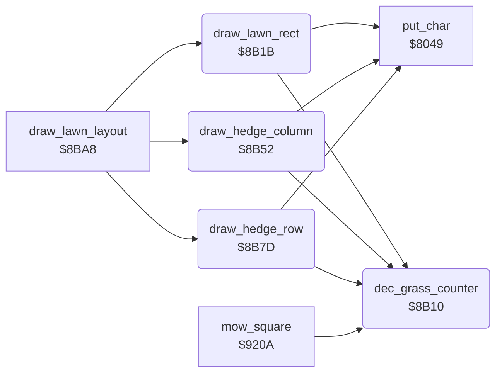

<!-- Generated by c64-docs from knowledge revision 20261025T214622.637-xq1idr and .c64-re-tools/local/generated/src/source-map.json. Do not edit: change the knowledge, generate the source again, then run docs.ts generate. -->
# lawn/lawn_shapes.asm: Grass counter and lawn shapes

Range `$8B10-$8BA7`. Source: [lawn/lawn_shapes.asm](../../../../src/lawn/lawn_shapes.asm). Index: [the reference](../../index.md).

## Routines

| Routine | Address | Reached from | Summary |
|---|---|---|---|
| [`dec_grass_counter`](lawn_shapes.md#dec_grass_counter) | `$8B10` | [`draw_lawn_rect`](lawn_shapes.md#draw_lawn_rect), [`draw_hedge_column`](lawn_shapes.md#draw_hedge_column), [`draw_hedge_row`](lawn_shapes.md#draw_hedge_row), [`mow_square`](mow_square.md#mow_square) | Decreases the grass counter $22/$23 (squares left to mow) by 1. |
| [`draw_lawn_rect`](lawn_shapes.md#draw_lawn_rect) | `$8B1B` | [`draw_lawn_layout`](lawn_layout_reader.md#draw_lawn_layout) | More inputs: $0a width, $0b height, $0c colour (the code adds 8 for multicolour). |
| [`draw_hedge_column`](lawn_shapes.md#draw_hedge_column) | `$8B52` | [`draw_lawn_layout`](lawn_layout_reader.md#draw_lawn_layout) | Decreases the grass counter by 2 for each row. |
| [`draw_hedge_row`](lawn_shapes.md#draw_hedge_row) | `$8B7D` | [`draw_lawn_layout`](lawn_layout_reader.md#draw_lawn_layout) | Decreases the grass counter by 2 for each column. |

## Call graph

A solid arrow is a call, a thick arrow a table entry. Rounded nodes are in this file.

## Details

### [`dec_grass_counter`](../../../../src/lawn/lawn_shapes.asm#L6) `$8B10`

*routine*

Decreases the grass counter $22/$23 (squares left to mow) by 1. The game calls it for each mown square and for each square that is not grass.

- **Called from:** [`draw_lawn_rect`](lawn_shapes.md#draw_lawn_rect), [`draw_hedge_column`](lawn_shapes.md#draw_hedge_column), [`draw_hedge_row`](lawn_shapes.md#draw_hedge_row), [`mow_square`](mow_square.md#mow_square)
- **Reads:** [`grass_count`](../../memory-map.md#grass_count), [`grass_count_hi`](../../memory-map.md#grass_count_hi)
- **Writes:** [`grass_count`](../../memory-map.md#grass_count), [`grass_count_hi`](../../memory-map.md#grass_count_hi)

| Label | Address | Comment |
|---|---|---|
| [`dec_grass_done`](../../../../src/lawn/lawn_shapes.asm#L12) | `$8B1A` |  |

### [`draw_lawn_rect`](../../../../src/lawn/lawn_shapes.asm#L15) `$8B1B`

*routine*

More inputs: $0a width, $0b height, $0c colour (the code adds 8 for multicolour). Columns from 40 up are not written.

- **Called from:** [`draw_lawn_layout`](lawn_layout_reader.md#draw_lawn_layout)
- **Calls:** [`put_char`](../screen/screen_chars.md#put_char), [`dec_grass_counter`](lawn_shapes.md#dec_grass_counter)
- **Reads:** [`work_ptr`](../../memory-map.md#work_ptr), [`work_temp`](../../memory-map.md#work_temp), [`work_ptr_hi`](../../memory-map.md#work_ptr_hi), [`work_ptr2_hi`](../../memory-map.md#work_ptr2_hi), [`work_count`](../../memory-map.md#work_count), [`work_ptr2`](../../memory-map.md#work_ptr2), [`cursor_row`](../../memory-map.md#cursor_row), [`cursor_col`](../../memory-map.md#cursor_col)
- **Writes:** [`cursor_char`](../../memory-map.md#cursor_char), [`cursor_colour`](../../memory-map.md#cursor_colour), [`cursor_col`](../../memory-map.md#cursor_col), [`cursor_row`](../../memory-map.md#cursor_row)

| Label | Address | Comment |
|---|---|---|
| [`draw_rect_column`](../../../../src/lawn/lawn_shapes.asm#L25) | `$8B2D` |  |
| [`draw_rect_cell`](../../../../src/lawn/lawn_shapes.asm#L29) | `$8B33` |  |
| [`draw_rect_next_cell`](../../../../src/lawn/lawn_shapes.asm#L39) | `$8B43` |  |

### [`draw_hedge_column`](../../../../src/lawn/lawn_shapes.asm#L52) `$8B52`

*routine*

Decreases the grass counter by 2 for each row. Changes $09 and $0a.

- **Called from:** [`draw_lawn_layout`](lawn_layout_reader.md#draw_lawn_layout)
- **Calls:** [`put_char`](../screen/screen_chars.md#put_char), [`dec_grass_counter`](lawn_shapes.md#dec_grass_counter)
- **Reads:** [`work_ptr`](../../memory-map.md#work_ptr), [`work_ptr_hi`](../../memory-map.md#work_ptr_hi), [`work_ptr2`](../../memory-map.md#work_ptr2), [`cursor_col`](../../memory-map.md#cursor_col), [`cursor_char`](../../memory-map.md#cursor_char), [`work_ptr2_hi`](../../memory-map.md#work_ptr2_hi)
- **Writes:** [`cursor_char`](../../memory-map.md#cursor_char), [`cursor_colour`](../../memory-map.md#cursor_colour), [`cursor_col`](../../memory-map.md#cursor_col), [`cursor_row`](../../memory-map.md#cursor_row), [`work_ptr2`](../../memory-map.md#work_ptr2), [`work_ptr2_hi`](../../memory-map.md#work_ptr2_hi)

| Label | Address | Comment |
|---|---|---|
| [`hedge_column_row`](../../../../src/lawn/lawn_shapes.asm#L57) | `$8B5A` |  |
| [`hedge_column_count`](../../../../src/lawn/lawn_shapes.asm#L68) | `$8B70` |  |

### [`draw_hedge_row`](../../../../src/lawn/lawn_shapes.asm#L77) `$8B7D`

*routine*

Decreases the grass counter by 2 for each column. Changes $08 and $0a.

- **Called from:** [`draw_lawn_layout`](lawn_layout_reader.md#draw_lawn_layout)
- **Calls:** [`put_char`](../screen/screen_chars.md#put_char), [`dec_grass_counter`](lawn_shapes.md#dec_grass_counter)
- **Reads:** [`work_ptr`](../../memory-map.md#work_ptr), [`work_ptr_hi`](../../memory-map.md#work_ptr_hi), [`work_ptr2`](../../memory-map.md#work_ptr2), [`cursor_row`](../../memory-map.md#cursor_row), [`cursor_char`](../../memory-map.md#cursor_char), [`work_ptr2_hi`](../../memory-map.md#work_ptr2_hi)
- **Writes:** [`cursor_char`](../../memory-map.md#cursor_char), [`cursor_colour`](../../memory-map.md#cursor_colour), [`cursor_col`](../../memory-map.md#cursor_col), [`cursor_row`](../../memory-map.md#cursor_row), [`work_ptr_hi`](../../memory-map.md#work_ptr_hi), [`work_ptr2_hi`](../../memory-map.md#work_ptr2_hi)

| Label | Address | Comment |
|---|---|---|
| [`hedge_row_column`](../../../../src/lawn/lawn_shapes.asm#L82) | `$8B85` |  |
| [`hedge_row_count`](../../../../src/lawn/lawn_shapes.asm#L93) | `$8B9B` |  |
