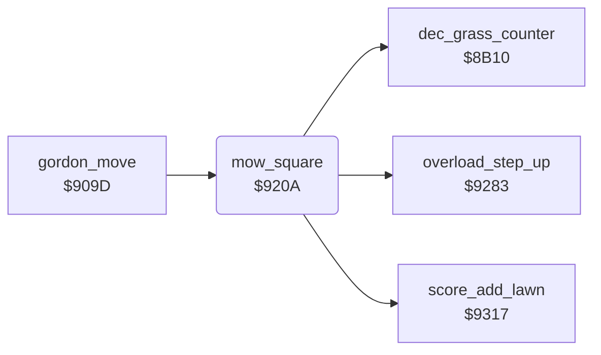

<!-- Generated by c64-docs from knowledge revision 20261025T214622.637-xq1idr and .c64-re-tools/local/generated/src/source-map.json. Do not edit: change the knowledge, generate the source again, then run docs.ts generate. -->
# lawn/mow_square.asm: Mowing of a square

Range `$920A-$922A`. Source: [lawn/mow_square.asm](../../../../src/lawn/mow_square.asm). Index: [the reference](../../index.md).

## Routines

| Routine | Address | Reached from | Summary |
|---|---|---|---|
| [`mow_square`](mow_square.md#mow_square) | `$920A` | [`gordon_move`](../player/gordon_move.md#gordon_move) | Mows the character in A and returns the new character in A. |
| [`mow_square_done`](mow_square.md#mow_square_done) | `$922A` | [`mower_cooling`](../status/mower_cooling.md#mower_cooling) | The byte before scale_chars. |

## Call graph

A solid arrow is a call, a thick arrow a table entry. Rounded nodes are in this file.

## Details

### [`mow_square`](../../../../src/lawn/mow_square.asm#L6) `$920A`

*routine*

Mows the character in A and returns the new character in A. Mown grass $7b and mown flowers $77 do not change. Flowers $76 add 2 steps to MOWER OVERLOAD and start the gardener. They give $77. Other characters give $7b.

- **Called from:** [`gordon_move`](../player/gordon_move.md#gordon_move)
- **Calls:** [`overload_step_up`](../status/mower_overload.md#overload_step_up), [`dec_grass_counter`](lawn_shapes.md#dec_grass_counter), [`score_add_lawn`](../scores/score_add.md#score_add_lawn)
- **Jumps to:** [`gardener_start`](../gardener/gardener_start.md#gardener_start)

| Label | Address | Comment |
|---|---|---|
| [`mow_grass`](../../../../src/lawn/mow_square.asm#L17) | `$921F` | Grass: $8b10 decreases the grass counter $22/$23. Then it adds one MOWER OVERLOAD step and adds the lawn number to the score. |

### [`mown_grass_operand`](../../../../src/lawn/mow_square.asm#L21) `$9229`

*data*

- **Read by:** [`mower_cooling`](../status/mower_cooling.md#mower_cooling), [`dog_loyalty_step_down`](../dog/dog_loyalty.md#dog_loyalty_step_down), [`dog_tolerance_step_down`](../dog/dog_tolerance.md#dog_tolerance_step_down)

### [`mow_square_done`](../../../../src/lawn/mow_square.asm#L23) `$922A`

*label*

The byte before scale_chars.

- **Jumped to from:** [`mow_square`](mow_square.md#mow_square), [`mower_cooling`](../status/mower_cooling.md#mower_cooling)
- **Read by:** [`mower_cooling`](../status/mower_cooling.md#mower_cooling), [`overload_step_up`](../status/mower_overload.md#overload_step_up), [`dog_loyalty_step_down`](../dog/dog_loyalty.md#dog_loyalty_step_down), [`dog_tolerance_step_down`](../dog/dog_tolerance.md#dog_tolerance_step_down)
