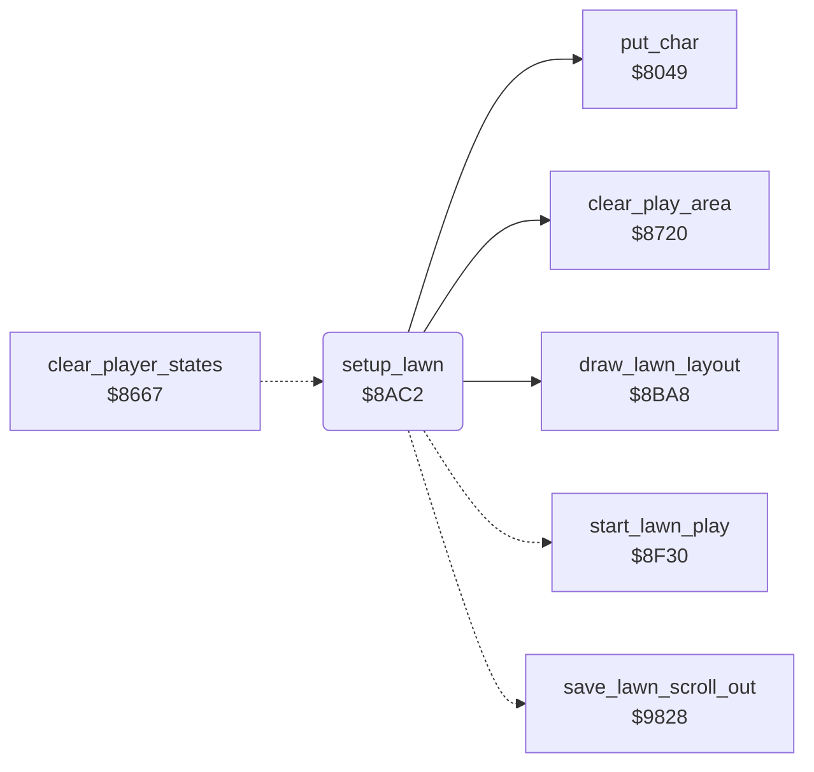

<!-- Generated by c64-docs from knowledge revision 20261024T102038.431-pgzet3 and .c64-re-tools/local/generated/src/source-map.json. Do not edit: change the knowledge, generate the source again, then run docs.ts generate. -->
# lawn/setup_lawn.asm: Lawn setup

Range `$8AC2-$8B0F`. Source: [lawn/setup_lawn.asm](../../../../src/lawn/setup_lawn.asm). Index: [the reference](../../index.md).

## Call graph

A solid arrow is a call, a thick arrow a table entry, a dotted arrow a jump. Rounded nodes are in this file.

## Names

### [`setup_lawn`](../../../../src/lawn/setup_lawn.asm#L6) `$8AC2`

*routine*

Else it fills rows 0-20 with grass (char $73), sets the grass counter to 840 and draws the layout of the lawn. Then it starts play at $8f30.
Clears rows 0-21 and disables the sprites.

- **Jumped to from:** [`clear_player_states`](../game/player_turn.md#clear_player_states) [`$8709`](../../../../src/game/player_turn.asm#L91), [`$9A31`](../../../../src/lawn/lawn_complete.asm#L66)
- **Calls:** [`clear_play_area`](../screen/clear_play_area.md#clear_play_area), [`put_char`](../screen/screen_chars.md#put_char), [`draw_lawn_layout`](lawn_layout_reader.md#draw_lawn_layout)
- **Jumps to:** [`restore_lawn`](../neighbour/neighbour_catch.md#restore_lawn), [`start_lawn_play`](../game/start_lawn_play.md#start_lawn_play)
- **Reads:** [`grass_count`](../../memory-map.md#grass_count), [`grass_count_hi`](../../memory-map.md#grass_count_hi), [`cursor_col`](../../memory-map.md#cursor_col), [`cursor_row`](../../memory-map.md#cursor_row)
- **Writes:** [`cursor_colour`](../../memory-map.md#cursor_colour), [`BGCOL1`](../../memory-map.md#BGCOL1), [`BGCOL2`](../../memory-map.md#BGCOL2), [`cursor_char`](../../memory-map.md#cursor_char), [`grass_count_hi`](../../memory-map.md#grass_count_hi), [`grass_count`](../../memory-map.md#grass_count), [`cursor_row`](../../memory-map.md#cursor_row), [`SPENA`](../../memory-map.md#SPENA), [`cursor_col`](../../memory-map.md#cursor_col)

### [`setup_lawn_restore`](../../../../src/lawn/setup_lawn.asm#L13) `$8ACF`

*label*

- **Jumped to from:** [`setup_lawn`](setup_lawn.md#setup_lawn) [`$8AC7`](../../../../src/lawn/setup_lawn.asm#L9), [`setup_lawn`](setup_lawn.md#setup_lawn) [`$8ACB`](../../../../src/lawn/setup_lawn.asm#L11)

### [`setup_lawn_new`](../../../../src/lawn/setup_lawn.asm#L15) `$8AD2`

*label*

- **Jumped to from:** [`setup_lawn`](setup_lawn.md#setup_lawn) [`$8ACD`](../../../../src/lawn/setup_lawn.asm#L12)

### [`setup_lawn_fill_row`](../../../../src/lawn/setup_lawn.asm#L31) `$8AF3`

*label*

- **Jumped to from:** [`setup_lawn`](setup_lawn.md#setup_lawn) [`$8B08`](../../../../src/lawn/setup_lawn.asm#L43)

### [`setup_lawn_fill_col`](../../../../src/lawn/setup_lawn.asm#L34) `$8AF7`

*label*

- **Jumped to from:** [`setup_lawn`](setup_lawn.md#setup_lawn) [`$8B00`](../../../../src/lawn/setup_lawn.asm#L39)
