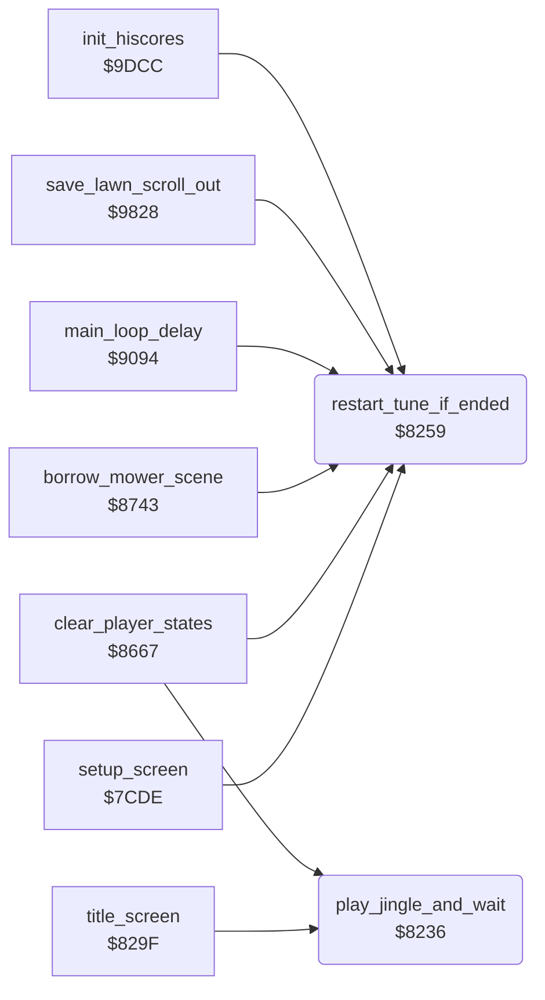

<!-- Generated by c64-docs from knowledge revision 20261025T214622.637-xq1idr and .c64-re-tools/local/generated/src/source-map.json. Do not edit: change the knowledge, generate the source again, then run docs.ts generate. -->
# music/tune_start.asm: Tune start

Range `$8236-$827B`. Source: [music/tune_start.asm](../../../../src/music/tune_start.asm). Index: [the reference](../../index.md).

## Routines

| Routine | Address | Reached from | Summary |
|---|---|---|---|
| [`play_jingle_and_wait`](tune_start.md#play_jingle_and_wait) | `$8236` | [`title_screen`](../title/title_screen.md#title_screen), [`clear_player_states`](../game/player_turn.md#clear_player_states) | Plays the jingle and waits until it ends. |
| [`restart_tune_if_ended`](tune_start.md#restart_tune_if_ended) | `$8259` | [`setup_screen`](../setup/setup_screen.md#setup_screen), [`clear_player_states`](../game/player_turn.md#clear_player_states), [`borrow_mower_scene`](../game/borrow_mower_scene.md#borrow_mower_scene), [`main_loop_delay`](../game/main_loop.md#main_loop_delay), [`save_lawn_scroll_out`](../neighbour/neighbour_catch.md#save_lawn_scroll_out), [`init_hiscores`](../scores/hiscores.md#init_hiscores), [`attract_check_fire`](../input/joystick.md#attract_check_fire), [`$980E`](../../../../src/neighbour/neighbour_catch.asm#L59) | When no tune plays ($1a = 0), starts the main tune again: voice 1 from $6032, voice 2 from $622e, with tempo 3. |

## Call graph

A solid arrow is a call, a thick arrow a table entry. Rounded nodes are in this file.

## Details

### [`play_jingle_and_wait`](../../../../src/music/tune_start.asm#L6) `$8236`

*routine*

Plays the jingle and waits until it ends. Voice 1 reads from $6000, voice 2 from $6200, with tempo 3. The first notes are at $6002 and $6202.

- **Called from:** [`title_screen`](../title/title_screen.md#title_screen), [`clear_player_states`](../game/player_turn.md#clear_player_states)
- **Reads:** [`music_playing`](../../memory-map.md#music_playing)
- **Writes:** [`voice1_duration`](../../memory-map.md#voice1_duration), [`voice2_duration`](../../memory-map.md#voice2_duration), [`music_tick`](../../memory-map.md#music_tick), [`music_speed`](../../memory-map.md#music_speed), [`voice1_ptr`](../../memory-map.md#voice1_ptr), [`voice2_ptr`](../../memory-map.md#voice2_ptr), [`voice1_ptr_hi`](../../memory-map.md#voice1_ptr_hi), [`voice2_ptr_hi`](../../memory-map.md#voice2_ptr_hi), [`music_playing`](../../memory-map.md#music_playing)

| Label | Address | Comment |
|---|---|---|
| [`jingle_wait_loop`](../../../../src/music/tune_start.asm#L22) | `$8254` | The IRQ clears $1a at the end of the tune |
| [`tune_restart_done`](../../../../src/music/tune_start.asm#L25) | `$8258` |  |

### [`restart_tune_if_ended`](../../../../src/music/tune_start.asm#L28) `$8259`

*routine*

When no tune plays ($1a = 0), starts the main tune again: voice 1 from $6032, voice 2 from $622e, with tempo 3. The first notes are at $6034 and $6230. Changes A.

- **Called from:** [`setup_screen`](../setup/setup_screen.md#setup_screen), [`clear_player_states`](../game/player_turn.md#clear_player_states), [`borrow_mower_scene`](../game/borrow_mower_scene.md#borrow_mower_scene), [`main_loop_delay`](../game/main_loop.md#main_loop_delay), [`$980E`](../../../../src/neighbour/neighbour_catch.asm#L59), [`save_lawn_scroll_out`](../neighbour/neighbour_catch.md#save_lawn_scroll_out), [`init_hiscores`](../scores/hiscores.md#init_hiscores)
- **Jumped to from:** [`attract_check_fire`](../input/joystick.md#attract_check_fire)
- **Jumps to:** [`tune_restart_done`](tune_start.md#tune_restart_done)
- **Reads:** [`music_playing`](../../memory-map.md#music_playing)
- **Writes:** [`voice1_ptr`](../../memory-map.md#voice1_ptr), [`voice1_ptr_hi`](../../memory-map.md#voice1_ptr_hi), [`voice2_ptr`](../../memory-map.md#voice2_ptr), [`voice2_ptr_hi`](../../memory-map.md#voice2_ptr_hi), [`music_tick`](../../memory-map.md#music_tick), [`music_speed`](../../memory-map.md#music_speed), [`voice1_duration`](../../memory-map.md#voice1_duration), [`voice2_duration`](../../memory-map.md#voice2_duration), [`music_playing`](../../memory-map.md#music_playing)
