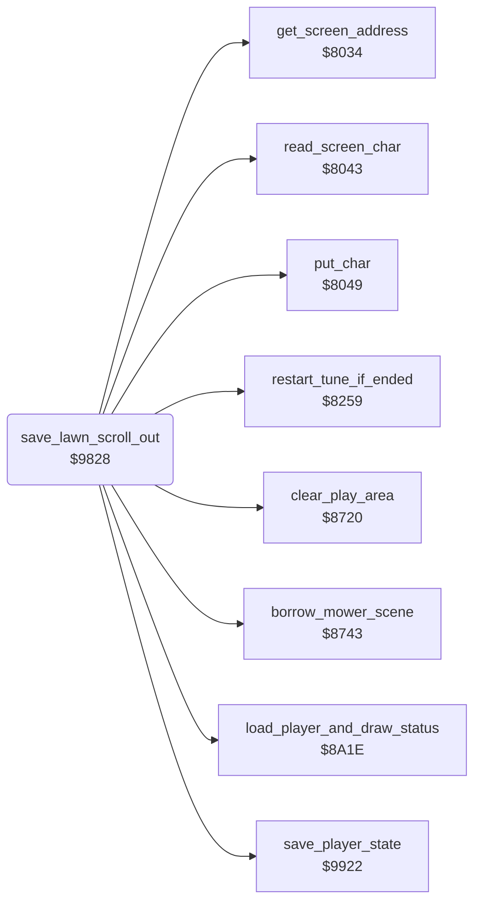

<!-- Generated by c64-docs from knowledge revision 20261025T214622.637-xq1idr and .c64-re-tools/local/generated/src/source-map.json. Do not edit: change the knowledge, generate the source again, then run docs.ts generate. -->
# neighbour/neighbour_catch.asm: An actor catches Gordon

Range `$97AE-$9921`. Source: [neighbour/neighbour_catch.asm](../../../../src/neighbour/neighbour_catch.asm). Index: [the reference](../../index.md).

## Routines

| Routine | Address | Reached from | Summary |
|---|---|---|---|
| [`actor_catches_gordon`](neighbour_catch.md#actor_catches_gordon) | `$97AE` | [`actor_collisions`](../actors/actor_collision.md#actor_collisions) | An actor catches Gordon. |
| [`save_lawn_scroll_out`](neighbour_catch.md#save_lawn_scroll_out) | `$9828` | [`$99C8`](../../../../src/lawn/lawn_complete.asm#L8) | The colours go 8 pages higher, to $5800 or $5c00. |
| [`restore_lawn`](neighbour_catch.md#restore_lawn) | `$98D0` | [`setup_lawn`](../lawn/setup_lawn.md#setup_lawn) | Then it continues at $8f30. |

## Call graph

A solid arrow is a call, a thick arrow a table entry. Rounded nodes are in this file.

## Details

### [`actor_catches_gordon`](../../../../src/neighbour/neighbour_catch.asm#L6) `$97AE`

*label*

An actor catches Gordon. $9b00 shows a message only when $2f is 0, so it clears $2f and shows message 6 ('GIMME THAT MOWER!!'). Then the actor walks to the right with Gordon until its X is $c0.

- **Jumped to from:** [`actor_collisions`](../actors/actor_collision.md#actor_collisions)

### [`save_lawn_scroll_out`](../../../../src/neighbour/neighbour_catch.asm#L71) `$9828`

*routine*

The colours go 8 pages higher, to $5800 or $5c00. The routine turns off the sprites and voice 3. Input: the current player $1c.

- **Called from:** [`$9822`](../../../../src/neighbour/neighbour_catch.asm#L68), [`$99C8`](../../../../src/lawn/lawn_complete.asm#L8)
- **Calls:** [`read_screen_char`](../screen/screen_chars.md#read_screen_char), [`get_screen_address`](../screen/screen_chars.md#get_screen_address), [`restart_tune_if_ended`](../music/tune_start.md#restart_tune_if_ended), [`save_player_state`](../player/player_state.md#save_player_state), [`load_player_and_draw_status`](../status/draw_status.md#load_player_and_draw_status), [`borrow_mower_scene`](../game/borrow_mower_scene.md#borrow_mower_scene), [`clear_play_area`](../screen/clear_play_area.md#clear_play_area), [`put_char`](../screen/screen_chars.md#put_char)
- **Jumps to:** [`switch_player`](../player/player_state.md#switch_player), [`game_over`](../game/game_over.md#game_over), [`start_lawn_play`](../game/start_lawn_play.md#start_lawn_play)
- **Reads:** [`current_player`](../../memory-map.md#current_player), [`work_ptr`](../../memory-map.md#work_ptr), [`screen_ptr_hi`](../../memory-map.md#screen_ptr_hi), [`work_ptr_hi`](../../memory-map.md#work_ptr_hi), [`screen_ptr`](../../memory-map.md#screen_ptr), [`work_temp`](../../memory-map.md#work_temp), [`cursor_row`](../../memory-map.md#cursor_row), [`player_count`](../../memory-map.md#player_count), [`mower_lender`](../../memory-map.md#mower_lender), [`cursor_col`](../../memory-map.md#cursor_col)
- **Writes:** [`work_ptr_hi`](../../memory-map.md#work_ptr_hi), [`work_ptr`](../../memory-map.md#work_ptr), [`cursor_row`](../../memory-map.md#cursor_row), [`SPENA`](../../memory-map.md#SPENA), [`VCREG3`](../../memory-map.md#VCREG3), [`cursor_col`](../../memory-map.md#cursor_col), [`work_temp`](../../memory-map.md#work_temp), [`screen_ptr_hi`](../../memory-map.md#screen_ptr_hi), [`mower_lender`](../../memory-map.md#mower_lender), [`cursor_char`](../../memory-map.md#cursor_char), [`cursor_colour`](../../memory-map.md#cursor_colour)

| Label | Address | Comment |
|---|---|---|
| [`save_lawn_stop_sprites`](../../../../src/neighbour/neighbour_catch.asm#L82) | `$983C` |  |
| [`save_lawn_next_row`](../../../../src/neighbour/neighbour_catch.asm#L86) | `$9844` |  |
| [`save_lawn_next_char`](../../../../src/neighbour/neighbour_catch.asm#L90) | `$984A` | Reads the character at column 0 of the row. |
| [`save_lawn_shift_row`](../../../../src/neighbour/neighbour_catch.asm#L109) | `$986B` |  |
| [`save_lawn_shift_chars`](../../../../src/neighbour/neighbour_catch.asm#L111) | `$986E` | Moves the characters of the row one column to the left. |
| [`save_lawn_shift_colours`](../../../../src/neighbour/neighbour_catch.asm#L126) | `$9886` | Moves the colours of the row one column to the left. |
| [`save_lawn_delay`](../../../../src/neighbour/neighbour_catch.asm#L135) | `$9893` |  |
| [`save_lawn_row_done`](../../../../src/neighbour/neighbour_catch.asm#L144) | `$98A4` |  |
| [`save_lawn_done`](../../../../src/neighbour/neighbour_catch.asm#L150) | `$98AF` |  |
| [`next_mower_or_player`](../../../../src/neighbour/neighbour_catch.asm#L153) | `$98B0` | With 1 player, the player borrows the next mower. After the third mower, the game is over. |
| [`next_mower`](../../../../src/neighbour/neighbour_catch.asm#L158) | `$98B9` | $20 is the number of the mower: 1 JIM, 2 TOM, 3 ALF. |
| [`next_mower_show`](../../../../src/neighbour/neighbour_catch.asm#L175) | `$98C7` |  |
| [`restore_lawn_start`](../../../../src/neighbour/neighbour_catch.asm#L193) | `$98E9` |  |
| [`restore_lawn_next_char`](../../../../src/neighbour/neighbour_catch.asm#L196) | `$98ED` |  |
| [`restore_lawn_next_column`](../../../../src/neighbour/neighbour_catch.asm#L213) | `$990B` |  |

### [`restore_lawn`](../../../../src/neighbour/neighbour_catch.asm#L180) `$98D0`

*label*

Then it continues at $8f30. $8ac2 also jumps here when the grass counter $22/$23 is not 0.

- **Jumped to from:** [`setup_lawn`](../lawn/setup_lawn.md#setup_lawn)

## Labels

| Label | Address | Comment |
|---|---|---|
| [`catch_walk_loop`](../../../../src/neighbour/neighbour_catch.asm#L15) | `$97BB` |  |
| [`catch_frame_ok`](../../../../src/neighbour/neighbour_catch.asm#L29) | `$97DC` |  |
| [`catch_set_frame`](../../../../src/neighbour/neighbour_catch.asm#L34) | `$97E5` |  |
| [`catch_place_sprites`](../../../../src/neighbour/neighbour_catch.asm#L39) | `$97EB` | Places the sprite of the actor, then sprite 1 with pointer $d6 at 8 to the right of it. |
| [`neighbour_leave_delay`](../../../../src/neighbour/neighbour_catch.asm#L58) | `$980E` | Waits 3 x 256 calls of $8259. |
