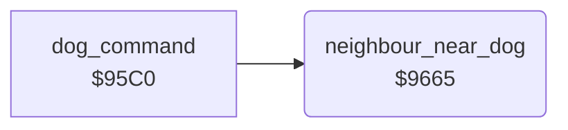

<!-- Generated by c64-docs from knowledge revision 20261024T102038.431-pgzet3 and .c64-re-tools/local/generated/src/source-map.json. Do not edit: change the knowledge, generate the source again, then run docs.ts generate. -->
# neighbour/neighbour_flee.asm: Neighbour near the dog

Range `$9665-$9697`. Source: [neighbour/neighbour_flee.asm](../../../../src/neighbour/neighbour_flee.asm). Index: [the reference](../../index.md).

## Call graph

A solid arrow is a call, a thick arrow a table entry, a dotted arrow a jump. Rounded nodes are in this file.

## Names

### [`neighbour_near_dog`](../../../../src/neighbour/neighbour_flee.asm#L6) `$9665`

*routine*

Tests the distance of the dog (actor 1) and the neighbour (actor 2). With an X difference from -16 to 15 and a Y difference from -24 to 23, the neighbour takes mode 1 (flee).

- **Called from:** [`dog_command`](../dog/dog_command.md#dog_command) [`$95E5`](../../../../src/dog/dog_command.asm#L27)
- **Reads:** [`dog_x`](../../memory-map.md#dog_x), [`neighbour_x`](../../memory-map.md#neighbour_x), [`work_ptr3_hi`](../../memory-map.md#work_ptr3_hi), [`dog_y`](../../memory-map.md#dog_y), [`neighbour_y`](../../memory-map.md#neighbour_y)
- **Writes:** [`work_ptr3_hi`](../../memory-map.md#work_ptr3_hi), [`neighbour_mode`](../../memory-map.md#neighbour_mode)

### [`neighbour_far`](../../../../src/neighbour/neighbour_flee.asm#L29) `$9691`

*label*

- **Jumped to from:** [`neighbour_near_dog`](neighbour_flee.md#neighbour_near_dog) [`$9673`](../../../../src/neighbour/neighbour_flee.asm#L14), [`neighbour_near_dog`](neighbour_flee.md#neighbour_near_dog) [`$9679`](../../../../src/neighbour/neighbour_flee.asm#L17), [`neighbour_near_dog`](neighbour_flee.md#neighbour_near_dog) [`$9689`](../../../../src/neighbour/neighbour_flee.asm#L25)

### [`neighbour_flee`](../../../../src/neighbour/neighbour_flee.asm#L31) `$9692`

*label*

- **Jumped to from:** [`neighbour_near_dog`](neighbour_flee.md#neighbour_near_dog) [`$968F`](../../../../src/neighbour/neighbour_flee.asm#L28)
