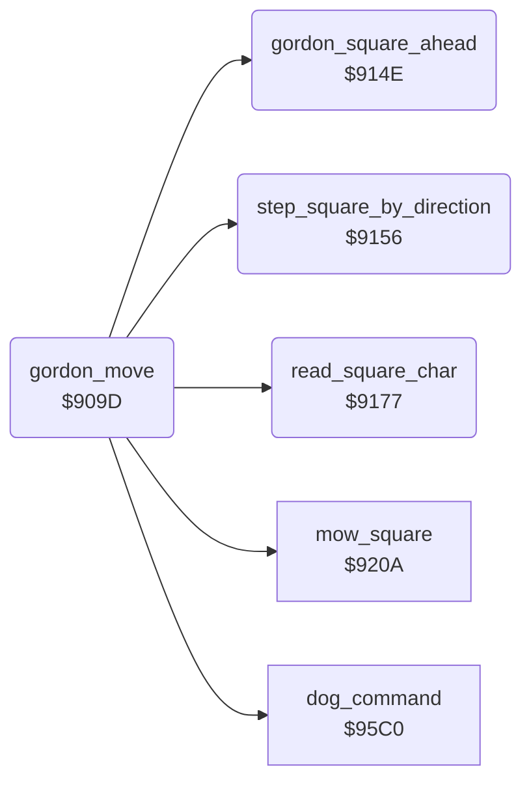

<!-- Generated by c64-docs from knowledge revision 20261025T214622.637-xq1idr and .c64-re-tools/local/generated/src/source-map.json. Do not edit: change the knowledge, generate the source again, then run docs.ts generate. -->
# player/gordon_move.asm: Movement of Gordon and mowing

Range `$909D-$9179`. Source: [player/gordon_move.asm](../../../../src/player/gordon_move.asm). Index: [the reference](../../index.md).

## Routines

| Routine | Address | Reached from | Summary |
|---|---|---|---|
| [`gordon_move`](gordon_move.md#gordon_move) | `$909D` | [`gordon_timer`](gordon_timer.md#gordon_timer) | Moves Gordon one step. |
| [`gordon_step`](gordon_move.md#gordon_step) | `$90AB` | [`$919D`](../../../../src/player/gordon_joystick.asm#L36) | Direction $30 bits: 0 up (Y-2), 1 down (Y+2), 2 left (X-1), 3 right (X+1). |
| [`gordon_mow_square`](gordon_move.md#gordon_mow_square) | `$90FF` | [`$91E5`](../../../../src/player/gordon_joystick.asm#L78) | Mows the square at column $02, row $03. |
| [`gordon_square_ahead`](gordon_move.md#gordon_square_ahead) | `$914E` | [`gordon_move`](gordon_move.md#gordon_move) | Copies the square $33/$34 of Gordon to $02/$03 (column, row). |
| [`step_square_by_direction`](gordon_move.md#step_square_by_direction) | `$9156` | [`gordon_move`](gordon_move.md#gordon_move) | Moves the square $02/$03 one square in direction $30: 1 up, 2 down, 4 left, 8 right. |
| [`read_square_char`](gordon_move.md#read_square_char) | `$9177` | [`gordon_move`](gordon_move.md#gordon_move) | Reads the character at column $02, row $03 with $8043. |

## Call graph

A solid arrow is a call, a thick arrow a table entry. Rounded nodes are in this file.

## Details

### [`gordon_move`](../../../../src/player/gordon_move.asm#L6) `$909D`

*routine*

Moves Gordon one step. First it runs the dog command at $95c0. Nothing moves while the mower is overheated ($3e = 1). With steps left in $37, it moves the position $35/$36 in direction $30. At 0 steps, Gordon is on a square.

- **Jumped to from:** [`gordon_timer`](gordon_timer.md#gordon_timer)
- **Calls:** [`dog_command`](../dog/dog_command.md#dog_command), [`gordon_square_ahead`](gordon_move.md#gordon_square_ahead), [`read_square_char`](gordon_move.md#read_square_char), [`mow_square`](../lawn/mow_square.md#mow_square), [`step_square_by_direction`](gordon_move.md#step_square_by_direction)
- **Jumps to:** [`place_mower_and_gordon`](place_mower.md#place_mower_and_gordon), [`lawn_complete`](../lawn/lawn_complete.md#lawn_complete), [`gordon_read_stick`](gordon_joystick.md#gordon_read_stick)
- **Reads:** [`mower_overheated`](../../memory-map.md#mower_overheated), [`gordon_steps`](../../memory-map.md#gordon_steps), [`gordon_dir`](../../memory-map.md#gordon_dir), [`gordon_y`](../../memory-map.md#gordon_y), [`gordon_x`](../../memory-map.md#gordon_x), [`gordon_walk_frame`](../../memory-map.md#gordon_walk_frame), [`grass_count`](../../memory-map.md#grass_count), [`grass_count_hi`](../../memory-map.md#grass_count_hi), [`cursor_col`](../../memory-map.md#cursor_col), [`cursor_row`](../../memory-map.md#cursor_row), [`screen_ptr`](../../memory-map.md#screen_ptr), [`work_ptr`](../../memory-map.md#work_ptr) and 1 more
- **Writes:** [`gordon_y`](../../memory-map.md#gordon_y), [`gordon_x`](../../memory-map.md#gordon_x), [`gordon_steps`](../../memory-map.md#gordon_steps), [`gordon_walk_frame`](../../memory-map.md#gordon_walk_frame), [`work_ptr`](../../memory-map.md#work_ptr), [`work_ptr_hi`](../../memory-map.md#work_ptr_hi), [`gordon_col`](../../memory-map.md#gordon_col), [`gordon_row`](../../memory-map.md#gordon_row), [`gordon_blocked_dir`](../../memory-map.md#gordon_blocked_dir), [`gordon_speed`](../../memory-map.md#gordon_speed), [`gordon_dir`](../../memory-map.md#gordon_dir)

| Label | Address | Comment |
|---|---|---|
| [`gordon_test_steps`](../../../../src/player/gordon_move.asm#L12) | `$90A7` |  |
| [`gordon_step_down`](../../../../src/player/gordon_move.asm#L23) | `$90B8` |  |
| [`gordon_step_left`](../../../../src/player/gordon_move.asm#L30) | `$90C5` |  |
| [`gordon_step_right`](../../../../src/player/gordon_move.asm#L36) | `$90D0` |  |
| [`gordon_step_done`](../../../../src/player/gordon_move.asm#L42) | `$90D8` | Counts the step in $37 and steps the walk frame $39 through 0, 1 and 2. |
| [`gordon_draw_sprites`](../../../../src/player/gordon_move.asm#L50) | `$90E6` | Places sprites 0 and 1 at $8f8e. |
| [`gordon_on_square`](../../../../src/player/gordon_move.asm#L53) | `$90E9` | Gordon is on a square. When the grass counter $22/$23 is 0, the lawn is complete: JMP $99c5. |
| [`gordon_next_square`](../../../../src/player/gordon_move.asm#L60) | `$90F4` | Puts the next square in direction $30 into $02/$03 and $07/$08. |
| [`gordon_blocked`](../../../../src/player/gordon_move.asm#L98) | `$913F` | The way is blocked. $31 keeps the blocked direction, the speed $32 goes to 0 and Gordon stops ($30 = 0). |

### [`gordon_step`](../../../../src/player/gordon_move.asm#L16) `$90AB`

*label*

Direction $30 bits: 0 up (Y-2), 1 down (Y+2), 2 left (X-1), 3 right (X+1).

- **Jumped to from:** [`$919D`](../../../../src/player/gordon_joystick.asm#L36)

### [`gordon_mow_square`](../../../../src/player/gordon_move.asm#L67) `$90FF`

*label*

Mows the square at column $02, row $03. The square $07/$08 becomes the square $33/$34 of Gordon. Then it tests the square after it.

- **Jumped to from:** [`$91E5`](../../../../src/player/gordon_joystick.asm#L78)

### [`gordon_square_ahead`](../../../../src/player/gordon_move.asm#L107) `$914E`

*routine*

Copies the square $33/$34 of Gordon to $02/$03 (column, row). Then it moves that square in direction $30 at $9156.

- **Called from:** [`gordon_move`](gordon_move.md#gordon_move)
- **Reads:** [`gordon_col`](../../memory-map.md#gordon_col), [`gordon_row`](../../memory-map.md#gordon_row)
- **Writes:** [`cursor_col`](../../memory-map.md#cursor_col), [`cursor_row`](../../memory-map.md#cursor_row)

### [`step_square_by_direction`](../../../../src/player/gordon_move.asm#L113) `$9156`

*routine*

Moves the square $02/$03 one square in direction $30: 1 up, 2 down, 4 left, 8 right. Direction 0 changes nothing.

- **Called from:** [`gordon_move`](gordon_move.md#gordon_move)
- **Reads:** [`gordon_dir`](../../memory-map.md#gordon_dir), [`cursor_row`](../../memory-map.md#cursor_row), [`cursor_col`](../../memory-map.md#cursor_col)
- **Writes:** [`cursor_row`](../../memory-map.md#cursor_row), [`cursor_col`](../../memory-map.md#cursor_col)

| Label | Address | Comment |
|---|---|---|
| [`square_step_test_up`](../../../../src/player/gordon_move.asm#L117) | `$915B` |  |
| [`square_step_test_down`](../../../../src/player/gordon_move.asm#L122) | `$9162` |  |
| [`square_step_test_left`](../../../../src/player/gordon_move.asm#L127) | `$9169` |  |
| [`square_step_return`](../../../../src/player/gordon_move.asm#L131) | `$916F` |  |
| [`square_step_test_right`](../../../../src/player/gordon_move.asm#L133) | `$9170` |  |

### [`read_square_char`](../../../../src/player/gordon_move.asm#L139) `$9177`

*routine*

Reads the character at column $02, row $03 with $8043. A holds the character, and $48/$49 with Y point to it.

- **Called from:** [`gordon_move`](gordon_move.md#gordon_move)
- **Jumps to:** [`read_screen_char`](../screen/screen_chars.md#read_screen_char)
