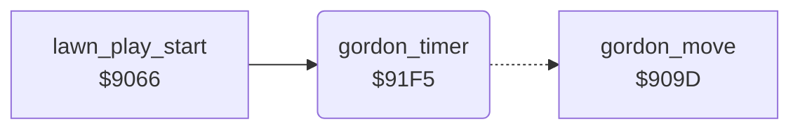

<!-- Generated by c64-docs from knowledge revision 20261024T102038.431-pgzet3 and .c64-re-tools/local/generated/src/source-map.json. Do not edit: change the knowledge, generate the source again, then run docs.ts generate. -->
# player/gordon_timer.asm: Move timer of Gordon

Range `$91F5-$9209`. Source: [player/gordon_timer.asm](../../../../src/player/gordon_timer.asm). Index: [the reference](../../index.md).

## Call graph

A solid arrow is a call, a thick arrow a table entry, a dotted arrow a jump. Rounded nodes are in this file.

## Names

### [`gordon_timer`](../../../../src/player/gordon_timer.asm#L6) `$91F5`

*routine*

Counts down $3a. At 0 it loads $3a with $45 - 8 x the speed $32 and moves Gordon at $909d.

- **Called from:** [`lawn_play_start`](../game/main_loop.md#lawn_play_start) [`$9085`](../../../../src/game/main_loop.asm#L33)
- **Jumps to:** [`gordon_move`](gordon_move.md#gordon_move)
- **Reads:** [`gordon_step_timer`](../../memory-map.md#gordon_step_timer), [`gordon_speed`](../../memory-map.md#gordon_speed), [`work_ptr`](../../memory-map.md#work_ptr)
- **Writes:** [`gordon_step_timer`](../../memory-map.md#gordon_step_timer), [`work_ptr`](../../memory-map.md#work_ptr)

### [`gordon_timer_expired`](../../../../src/player/gordon_timer.asm#L10) `$91FA`

*label*

- **Jumped to from:** [`gordon_timer`](gordon_timer.md#gordon_timer) [`$91F7`](../../../../src/player/gordon_timer.asm#L8)
