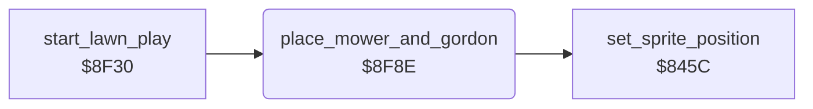

<!-- Generated by c64-docs from knowledge revision 20261025T214622.637-xq1idr and .c64-re-tools/local/generated/src/source-map.json. Do not edit: change the knowledge, generate the source again, then run docs.ts generate. -->
# player/place_mower.asm: Mower and Gordon sprites

Range `$8F8E-$8FE3`. Source: [player/place_mower.asm](../../../../src/player/place_mower.asm). Index: [the reference](../../index.md).

## Routines

| Routine | Address | Reached from | Summary |
|---|---|---|---|
| [`place_mower_and_gordon`](place_mower.md#place_mower_and_gordon) | `$8F8E` | [`start_lawn_play`](../game/start_lawn_play.md#start_lawn_play), [`gordon_move`](gordon_move.md#gordon_move) | Gordon is behind the mower: the tables at $8fd3 and $8fdc give his offset from the mower. |

## Data

| Range | Type | Name | Read by | Written by |
|---|---|---|---|---|
| [`$8FC1`](../../../../src/player/place_mower.asm#L32)-`$8FC9` | bytes | [`mower_frame_by_dir`](../../../../src/player/place_mower.asm#L31) | [`place_mower_and_gordon`](place_mower.md#place_mower_and_gordon) |  |
| [`$8FCA`](../../../../src/player/place_mower.asm#L36)-`$8FD2` | bytes | [`gordon_frame_by_dir`](../../../../src/player/place_mower.asm#L35) | [`place_mower_and_gordon`](place_mower.md#place_mower_and_gordon) |  |
| [`$8FD3`](../../../../src/player/place_mower.asm#L40)-`$8FDB` | bytes | [`gordon_dx_by_dir`](../../../../src/player/place_mower.asm#L39) | [`place_mower_and_gordon`](place_mower.md#place_mower_and_gordon) |  |
| [`$8FDC`](../../../../src/player/place_mower.asm#L44)-`$8FE3` | bytes | [`gordon_dy_by_dir`](../../../../src/player/place_mower.asm#L43) | [`place_mower_and_gordon`](place_mower.md#place_mower_and_gordon) |  |

## Call graph

A solid arrow is a call, a thick arrow a table entry. Rounded nodes are in this file.

## Details

### [`place_mower_and_gordon`](../../../../src/player/place_mower.asm#L6) `$8F8E`

*routine*

Gordon is behind the mower: the tables at $8fd3 and $8fdc give his offset from the mower. Changes $07 and $08.

- **Called from:** [`start_lawn_play`](../game/start_lawn_play.md#start_lawn_play)
- **Jumped to from:** [`gordon_move`](gordon_move.md#gordon_move)
- **Calls:** [`set_sprite_position`](../screen/sprite_position.md#set_sprite_position)
- **Jumps to:** [`set_sprite_position`](../screen/sprite_position.md#set_sprite_position)
- **Reads:** [`gordon_dir`](../../memory-map.md#gordon_dir), [`gordon_walk_frame`](../../memory-map.md#gordon_walk_frame), [`gordon_x`](../../memory-map.md#gordon_x), [`gordon_y`](../../memory-map.md#gordon_y), [`work_ptr`](../../memory-map.md#work_ptr), [`work_ptr_hi`](../../memory-map.md#work_ptr_hi)
- **Writes:** [`SPRPTR`](../../memory-map.md#SPRPTR), [`work_ptr`](../../memory-map.md#work_ptr), [`work_ptr_hi`](../../memory-map.md#work_ptr_hi)

### [`mower_frame_by_dir`](../../../../src/player/place_mower.asm#L31) `$8FC1-$8FC9`

*data*

Mower sprite frame for each direction 0-8 (only 1, 2, 4 and 8 are used).

- **Read by:** [`place_mower_and_gordon`](place_mower.md#place_mower_and_gordon)

### [`gordon_frame_by_dir`](../../../../src/player/place_mower.asm#L35) `$8FCA-$8FD2`

*data*

Gordon's first sprite frame for each direction. The code adds the step $39.

- **Read by:** [`place_mower_and_gordon`](place_mower.md#place_mower_and_gordon)

### [`gordon_dx_by_dir`](../../../../src/player/place_mower.asm#L39) `$8FD3-$8FDB`

*data*

X offset of Gordon from the mower for each direction (signed).

- **Read by:** [`place_mower_and_gordon`](place_mower.md#place_mower_and_gordon)

### [`gordon_dy_by_dir`](../../../../src/player/place_mower.asm#L43) `$8FDC-$8FE3`

*data*

Y offset of Gordon from the mower for each direction (signed). Entry 8 is the byte at $8fe4.

- **Read by:** [`place_mower_and_gordon`](place_mower.md#place_mower_and_gordon)
