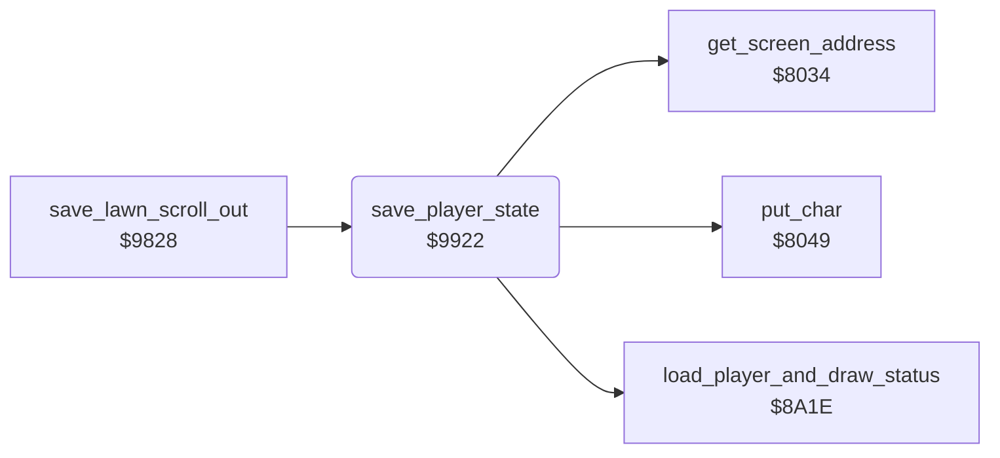

<!-- Generated by c64-docs from knowledge revision 20261025T214622.637-xq1idr and .c64-re-tools/local/generated/src/source-map.json. Do not edit: change the knowledge, generate the source again, then run docs.ts generate. -->
# player/player_state.asm: Saving the player state and switching the player

Range `$9922-$99C4`. Source: [player/player_state.asm](../../../../src/player/player_state.asm). Index: [the reference](../../index.md).

## Routines

| Routine | Address | Reached from | Summary |
|---|---|---|---|
| [`save_player_state`](player_state.md#save_player_state) | `$9922` | [`save_lawn_scroll_out`](../neighbour/neighbour_catch.md#save_lawn_scroll_out), [`$9A28`](../../../../src/lawn/lawn_complete.asm#L62) | Then it resets the three scales and copies the status rows 22 to 24 of the screen to $4000 (player 1) or $4080 (player 2). |
| [`switch_player`](player_state.md#switch_player) | `$998A` | [`save_lawn_scroll_out`](../neighbour/neighbour_catch.md#save_lawn_scroll_out) | When player 2 loses the third mower, the game is over. |

## Call graph

A solid arrow is a call, a thick arrow a table entry. Rounded nodes are in this file.

## Details

### [`save_player_state`](../../../../src/player/player_state.asm#L6) `$9922`

*routine*

Then it resets the three scales and copies the status rows 22 to 24 of the screen to $4000 (player 1) or $4080 (player 2).

- **Called from:** [`save_lawn_scroll_out`](../neighbour/neighbour_catch.md#save_lawn_scroll_out), [`$9A28`](../../../../src/lawn/lawn_complete.asm#L62)
- **Calls:** [`put_char`](../screen/screen_chars.md#put_char), [`get_screen_address`](../screen/screen_chars.md#get_screen_address), [`load_player_and_draw_status`](../status/draw_status.md#load_player_and_draw_status)
- **Jumps to:** [`game_over`](../game/game_over.md#game_over), [`player_turn_intro`](../game/player_turn.md#player_turn_intro)
- **Reads:** [`current_player`](../../memory-map.md#current_player), [`player_vars`](../../memory-map.md#player_vars), [`cursor_row`](../../memory-map.md#cursor_row), [`cursor_col`](../../memory-map.md#cursor_col), [`screen_ptr`](../../memory-map.md#screen_ptr), [`stick_count`](../../memory-map.md#stick_count), [`joy_port`](../../memory-map.md#joy_port), [`mower_lender`](../../memory-map.md#mower_lender)
- **Writes:** [`player1_state`](../../memory-map.md#player1_state), [`player2_state`](../../memory-map.md#player2_state), [`cursor_col`](../../memory-map.md#cursor_col), [`cursor_colour`](../../memory-map.md#cursor_colour), [`cursor_char`](../../memory-map.md#cursor_char), [`cursor_row`](../../memory-map.md#cursor_row), [`status_p1`](../../memory-map.md#status_p1), [`status_p2`](../../memory-map.md#status_p2), [`joy_port`](../../memory-map.md#joy_port), [`mower_lender`](../../memory-map.md#mower_lender), [`current_player`](../../memory-map.md#current_player)

| Label | Address | Comment |
|---|---|---|
| [`save_state_p1_loop`](../../../../src/player/player_state.asm#L11) | `$992A` |  |
| [`save_state_p2`](../../../../src/player/player_state.asm#L17) | `$9935` |  |
| [`save_state_p2_loop`](../../../../src/player/player_state.asm#L19) | `$9937` |  |
| [`clear_scales`](../../../../src/player/player_state.asm#L25) | `$993F` | Row 24 (MOWER OVERLOAD) gets spaces, empty cells. |
| [`clear_scales_column`](../../../../src/player/player_state.asm#L30) | `$9947` |  |
| [`save_status_rows_loop`](../../../../src/player/player_state.asm#L51) | `$9973` | Reads row 22 to row 24: 120 characters from $0770. |
| [`save_status_rows_p2`](../../../../src/player/player_state.asm#L58) | `$9981` |  |
| [`save_status_rows_next`](../../../../src/player/player_state.asm#L60) | `$9984` |  |
| [`switch_player_save`](../../../../src/player/player_state.asm#L78) | `$999F` | The next mower of this player. |
| [`switch_player_next`](../../../../src/player/player_state.asm#L88) | `$99B3` | Player 1 to 2, player 2 to 1. |
| [`switch_player_start`](../../../../src/player/player_state.asm#L95) | `$99BF` | Loads the state of the new player and draws the status rows. |

### [`switch_player`](../../../../src/player/player_state.asm#L66) `$998A`

*label*

When player 2 loses the third mower, the game is over. Else the other player gets the turn: $8a1e loads the state and $8672 starts the lawn.
Resets the stack.

- **Jumped to from:** [`save_lawn_scroll_out`](../neighbour/neighbour_catch.md#save_lawn_scroll_out)
