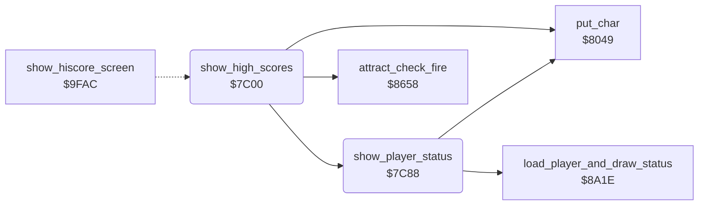

<!-- Generated by c64-docs from knowledge revision 20261024T102038.431-pgzet3 and .c64-re-tools/local/generated/src/source-map.json. Do not edit: change the knowledge, generate the source again, then run docs.ts generate. -->
# scores/high_score_screen.asm: High-score screen

Range `$7C00-$7CDD`. Source: [scores/high_score_screen.asm](../../../../src/scores/high_score_screen.asm). Index: [the reference](../../index.md).

## Call graph

A solid arrow is a call, a thick arrow a table entry, a dotted arrow a jump. Rounded nodes are in this file.

## Data

| Range | Type | Name | Read by | Written by |
|---|---|---|---|---|
| [`$7CCA`](../../../../src/scores/high_score_screen.asm#L129)-`$7CDD` | bytes | [`text_mega_mower_maniacs`](../../../../src/scores/high_score_screen.asm#L118) | [`show_hiscore_screen`](../title/attract_loop.md#show_hiscore_screen) |  |

## Names

### [`show_high_scores`](../../../../src/scores/high_score_screen.asm#L6) `$7C00`

*routine*

Then it shows the status lines of the players 8 times with a delay. Fire goes to the setup screen. It returns to the attract loop.

- **Jumped to from:** [`show_hiscore_screen`](../title/attract_loop.md#show_hiscore_screen) [`$9FD2`](../../../../src/title/attract_loop.asm#L33)
- **Calls:** [`put_char`](../screen/screen_chars.md#put_char), [`show_player_status`](high_score_screen.md#show_player_status), [`attract_check_fire`](../input/joystick.md#attract_check_fire)
- **Reads:** [`work_temp`](../../memory-map.md#work_temp), [`cycle_colours`](../game/game_over.md#cycle_colours), [`work_ptr3`](../../memory-map.md#work_ptr3), [`high_score_table+1`](../../memory-map.md#high_score_table), [`work_ptr2`](../../memory-map.md#work_ptr2), [`cursor_col`](../../memory-map.md#cursor_col), [`work_count2`](../../memory-map.md#work_count2), [`cursor_row`](../../memory-map.md#cursor_row), [`work_ptr3_hi`](../../memory-map.md#work_ptr3_hi)
- **Writes:** [`work_ptr3`](../../memory-map.md#work_ptr3), [`work_temp`](../../memory-map.md#work_temp), [`work_ptr3_hi`](../../memory-map.md#work_ptr3_hi), [`cursor_row`](../../memory-map.md#cursor_row), [`cursor_col`](../../memory-map.md#cursor_col), [`cursor_colour`](../../memory-map.md#cursor_colour), [`work_count2`](../../memory-map.md#work_count2), [`cursor_char`](../../memory-map.md#cursor_char), [`work_ptr2`](../../memory-map.md#work_ptr2), [`current_player`](../../memory-map.md#current_player)

### [`high_scores_next_entry`](../../../../src/scores/high_score_screen.asm#L14) `$7C0E`

*label*

- **Jumped to from:** [`show_high_scores`](high_score_screen.md#show_high_scores) [`$7C63`](../../../../src/scores/high_score_screen.asm#L59)

### [`high_scores_put_digit`](../../../../src/scores/high_score_screen.asm#L23) `$7C1F`

*label*

- **Jumped to from:** [`show_high_scores`](high_score_screen.md#show_high_scores) [`$7C30`](../../../../src/scores/high_score_screen.asm#L32)

### [`high_scores_put_initial`](../../../../src/scores/high_score_screen.asm#L41) `$7C41`

*label*

- **Jumped to from:** [`show_high_scores`](high_score_screen.md#show_high_scores) [`$7C52`](../../../../src/scores/high_score_screen.asm#L50)

### [`high_scores_status`](../../../../src/scores/high_score_screen.asm#L60) `$7C66`

*label*

$1c: current player 1.

- **Jumped to from:** [`show_high_scores`](high_score_screen.md#show_high_scores) [`$7C61`](../../../../src/scores/high_score_screen.asm#L58)

### [`high_scores_status_round`](../../../../src/scores/high_score_screen.asm#L65) `$7C6E`

*label*

- **Jumped to from:** [`show_high_scores`](high_score_screen.md#show_high_scores) [`$7C85`](../../../../src/scores/high_score_screen.asm#L78)

### [`high_scores_wait`](../../../../src/scores/high_score_screen.asm#L69) `$7C75`

*label*

Fire jumps to the setup screen. Else $8259 keeps the tune playing.

- **Jumped to from:** [`show_high_scores`](high_score_screen.md#show_high_scores) [`$7C79`](../../../../src/scores/high_score_screen.asm#L72), [`show_high_scores`](high_score_screen.md#show_high_scores) [`$7C7D`](../../../../src/scores/high_score_screen.asm#L74), [`show_high_scores`](high_score_screen.md#show_high_scores) [`$7C81`](../../../../src/scores/high_score_screen.asm#L76)

### [`show_player_status`](../../../../src/scores/high_score_screen.asm#L81) `$7C88`

*routine*

It calls $8a1e, which loads the state of player $1c and draws the status lines. Then it writes "PLAYER ONE" or "PLAYER TWO" at row 19, column 13, in white.

- **Called from:** [`show_high_scores`](high_score_screen.md#show_high_scores) [`$7C6E`](../../../../src/scores/high_score_screen.asm#L66)
- **Calls:** [`load_player_and_draw_status`](../status/draw_status.md#load_player_and_draw_status), [`put_char`](../screen/screen_chars.md#put_char)
- **Reads:** [`player_count`](../../memory-map.md#player_count), [`current_player`](../../memory-map.md#current_player), [`player_one_text`](hiscores.md#player_one_text), [`player_two_text`](hiscores.md#player_two_text), [`work_ptr2`](../../memory-map.md#work_ptr2), [`cursor_col`](../../memory-map.md#cursor_col)
- **Writes:** [`current_player`](../../memory-map.md#current_player), [`cursor_row`](../../memory-map.md#cursor_row), [`cursor_col`](../../memory-map.md#cursor_col), [`cursor_colour`](../../memory-map.md#cursor_colour), [`cursor_char`](../../memory-map.md#cursor_char), [`work_ptr2`](../../memory-map.md#work_ptr2)

### [`player_status_draw`](../../../../src/scores/high_score_screen.asm#L91) `$7C9A`

*label*

- **Jumped to from:** [`show_player_status`](high_score_screen.md#show_player_status) [`$7C8C`](../../../../src/scores/high_score_screen.asm#L84), [`show_player_status`](high_score_screen.md#show_player_status) [`$7C94`](../../../../src/scores/high_score_screen.asm#L88)

### [`player_status_name_char`](../../../../src/scores/high_score_screen.asm#L100) `$7CAB`

*label*

Text "PLAYER ONE" at $9ed5.

- **Jumped to from:** [`show_player_status`](high_score_screen.md#show_player_status) [`$7CC7`](../../../../src/scores/high_score_screen.asm#L115)

### [`player_status_put_char`](../../../../src/scores/high_score_screen.asm#L106) `$7CB7`

*label*

ASCII to screen code.

- **Jumped to from:** [`show_player_status`](high_score_screen.md#show_player_status) [`$7CB2`](../../../../src/scores/high_score_screen.asm#L104)

### [`text_mega_mower_maniacs`](../../../../src/scores/high_score_screen.asm#L118) `$7CCA-$7CDD`

*data*

Text "MEGA  MOWER  MANIACS" (20 characters), the title of the high-score screen. $9fbd writes it at row 2.

- **Read by:** [`show_hiscore_screen`](../title/attract_loop.md#show_hiscore_screen) [`$9FBD`](../../../../src/title/attract_loop.asm#L23)
