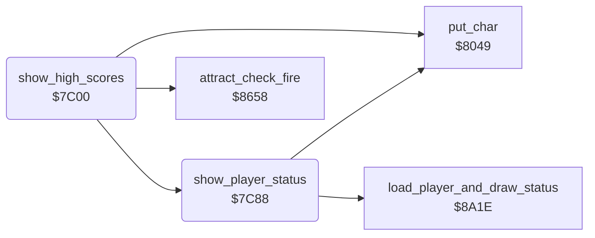

<!-- Generated by c64-docs from knowledge revision 20261025T214622.637-xq1idr and .c64-re-tools/local/generated/src/source-map.json. Do not edit: change the knowledge, generate the source again, then run docs.ts generate. -->
# scores/high_score_screen.asm: High-score screen

Range `$7C00-$7CDD`. Source: [scores/high_score_screen.asm](../../../../src/scores/high_score_screen.asm). Index: [the reference](../../index.md).

## Routines

| Routine | Address | Reached from | Summary |
|---|---|---|---|
| [`show_high_scores`](high_score_screen.md#show_high_scores) | `$7C00` | [`show_hiscore_screen`](../title/attract_loop.md#show_hiscore_screen) | Then it shows the status lines of the players 8 times with a delay. |
| [`show_player_status`](high_score_screen.md#show_player_status) | `$7C88` | [`show_high_scores`](high_score_screen.md#show_high_scores) | It calls $8a1e, which loads the state of player $1c and draws the status lines. |

## Data

| Range | Type | Name | Read by | Written by |
|---|---|---|---|---|
| [`$7CCA`](../../../../src/scores/high_score_screen.asm#L129)-`$7CDD` | bytes | [`text_mega_mower_maniacs`](../../../../src/scores/high_score_screen.asm#L118) | [`show_hiscore_screen`](../title/attract_loop.md#show_hiscore_screen) |  |

## Call graph

A solid arrow is a call, a thick arrow a table entry. Rounded nodes are in this file.

## Details

### [`show_high_scores`](../../../../src/scores/high_score_screen.asm#L6) `$7C00`

*routine*

Then it shows the status lines of the players 8 times with a delay. Fire goes to the setup screen. It returns to the attract loop.

- **Jumped to from:** [`show_hiscore_screen`](../title/attract_loop.md#show_hiscore_screen)
- **Calls:** [`put_char`](../screen/screen_chars.md#put_char), [`show_player_status`](high_score_screen.md#show_player_status), [`attract_check_fire`](../input/joystick.md#attract_check_fire)
- **Reads:** [`work_temp`](../../memory-map.md#work_temp), [`cycle_colours`](../game/game_over.md#cycle_colours), [`work_ptr3`](../../memory-map.md#work_ptr3), [`high_score_table`](../../memory-map.md#high_score_table), [`work_ptr2`](../../memory-map.md#work_ptr2), [`cursor_col`](../../memory-map.md#cursor_col), [`work_count2`](../../memory-map.md#work_count2), [`cursor_row`](../../memory-map.md#cursor_row), [`work_ptr3_hi`](../../memory-map.md#work_ptr3_hi)
- **Writes:** [`work_ptr3`](../../memory-map.md#work_ptr3), [`work_temp`](../../memory-map.md#work_temp), [`work_ptr3_hi`](../../memory-map.md#work_ptr3_hi), [`cursor_row`](../../memory-map.md#cursor_row), [`cursor_col`](../../memory-map.md#cursor_col), [`cursor_colour`](../../memory-map.md#cursor_colour), [`work_count2`](../../memory-map.md#work_count2), [`cursor_char`](../../memory-map.md#cursor_char), [`work_ptr2`](../../memory-map.md#work_ptr2), [`current_player`](../../memory-map.md#current_player)

| Label | Address | Comment |
|---|---|---|
| [`high_scores_next_entry`](../../../../src/scores/high_score_screen.asm#L14) | `$7C0E` |  |
| [`high_scores_put_digit`](../../../../src/scores/high_score_screen.asm#L23) | `$7C1F` |  |
| [`high_scores_put_initial`](../../../../src/scores/high_score_screen.asm#L41) | `$7C41` |  |
| [`high_scores_status`](../../../../src/scores/high_score_screen.asm#L60) | `$7C66` | $1c: current player 1. |
| [`high_scores_status_round`](../../../../src/scores/high_score_screen.asm#L65) | `$7C6E` |  |
| [`high_scores_wait`](../../../../src/scores/high_score_screen.asm#L69) | `$7C75` | Fire jumps to the setup screen. Else $8259 keeps the tune playing. |

### [`show_player_status`](../../../../src/scores/high_score_screen.asm#L81) `$7C88`

*routine*

It calls $8a1e, which loads the state of player $1c and draws the status lines. Then it writes "PLAYER ONE" or "PLAYER TWO" at row 19, column 13, in white.

- **Called from:** [`show_high_scores`](high_score_screen.md#show_high_scores)
- **Calls:** [`load_player_and_draw_status`](../status/draw_status.md#load_player_and_draw_status), [`put_char`](../screen/screen_chars.md#put_char)
- **Reads:** [`player_count`](../../memory-map.md#player_count), [`current_player`](../../memory-map.md#current_player), [`player_one_text`](hiscores.md#player_one_text), [`player_two_text`](hiscores.md#player_two_text), [`work_ptr2`](../../memory-map.md#work_ptr2), [`cursor_col`](../../memory-map.md#cursor_col)
- **Writes:** [`current_player`](../../memory-map.md#current_player), [`cursor_row`](../../memory-map.md#cursor_row), [`cursor_col`](../../memory-map.md#cursor_col), [`cursor_colour`](../../memory-map.md#cursor_colour), [`cursor_char`](../../memory-map.md#cursor_char), [`work_ptr2`](../../memory-map.md#work_ptr2)

| Label | Address | Comment |
|---|---|---|
| [`player_status_draw`](../../../../src/scores/high_score_screen.asm#L91) | `$7C9A` |  |
| [`player_status_name_char`](../../../../src/scores/high_score_screen.asm#L100) | `$7CAB` | Text "PLAYER ONE" at $9ed5. |
| [`player_status_put_char`](../../../../src/scores/high_score_screen.asm#L106) | `$7CB7` | ASCII to screen code. |

### [`text_mega_mower_maniacs`](../../../../src/scores/high_score_screen.asm#L118) `$7CCA-$7CDD`

*data*

Text "MEGA  MOWER  MANIACS" (20 characters), the title of the high-score screen. $9fbd writes it at row 2.

- **Read by:** [`show_hiscore_screen`](../title/attract_loop.md#show_hiscore_screen)
