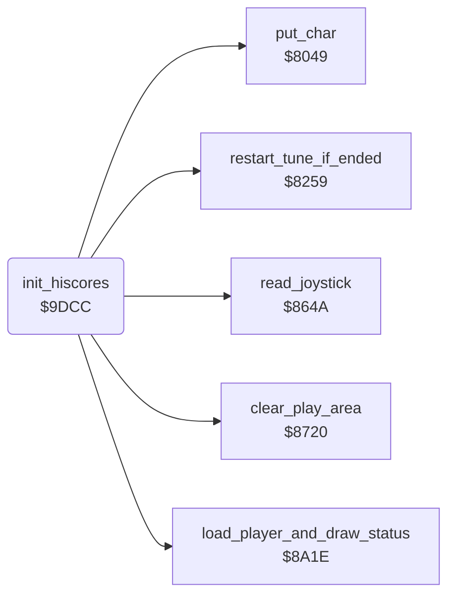

<!-- Generated by c64-docs from knowledge revision 20261025T214622.637-xq1idr and .c64-re-tools/local/generated/src/source-map.json. Do not edit: change the knowledge, generate the source again, then run docs.ts generate. -->
# scores/hiscores.asm: High-score table: initial values, check and entry of the initials

Range `$9DCC-$9F9F`. Source: [scores/hiscores.asm](../../../../src/scores/hiscores.asm). Index: [the reference](../../index.md).

## Routines

| Routine | Address | Reached from | Summary |
|---|---|---|---|
| [`init_hiscores`](hiscores.md#init_hiscores) | `$9DCC` | [`$8202`](../../../../src/init/game_init.asm#L8) | Copies the initial high-score table (50 bytes) to $4c01-$4c32 as screen codes. |
| [`hiscore_check`](hiscores.md#hiscore_check) | `$9DDA` | [`$9D90`](../../../../src/game/game_over.asm#L53) | A score that is higher than an entry goes into the table. |

## Data

| Range | Type | Name | Read by | Written by |
|---|---|---|---|---|
| [`$9E43`](../../../../src/scores/hiscores.asm#L83)-`$9E4C` | bytes | [`initial_hiscore_table`](../../../../src/scores/hiscores.asm#L82) |  |  |
| [`$9E4D`](../../../../src/scores/hiscores.asm#L98)-`$9E56` | bytes |  |  |  |
| [`$9E57`](../../../../src/scores/hiscores.asm#L100)-`$9E60` | bytes |  |  |  |
| [`$9E61`](../../../../src/scores/hiscores.asm#L102)-`$9E6A` | bytes |  |  |  |
| [`$9E6B`](../../../../src/scores/hiscores.asm#L104)-`$9E74` | bytes |  |  |  |
| [`$9ED5`](../../../../src/scores/hiscores.asm#L162)-`$9EDE` | bytes | [`player_one_text`](../../../../src/scores/hiscores.asm#L161) | [`show_player_status`](high_score_screen.md#show_player_status), [`init_hiscores`](hiscores.md#init_hiscores) |  |
| [`$9EDF`](../../../../src/scores/hiscores.asm#L166)-`$9EE8` | bytes | [`player_two_text`](../../../../src/scores/hiscores.asm#L165) | [`show_player_status`](high_score_screen.md#show_player_status), [`init_hiscores`](hiscores.md#init_hiscores) |  |
| [`$9EE9`](../../../../src/scores/hiscores.asm#L170)-`$9F01` | bytes | [`enter_initials_text`](../../../../src/scores/hiscores.asm#L169) | [`init_hiscores`](hiscores.md#init_hiscores) |  |

## Call graph

A solid arrow is a call, a thick arrow a table entry. Rounded nodes are in this file.

## Details

### [`init_hiscores`](../../../../src/scores/hiscores.asm#L6) `$9DCC`

*routine*

Copies the initial high-score table (50 bytes) to $4c01-$4c32 as screen codes. The cold start at $81ff calls it.

- **Called from:** [`$8202`](../../../../src/init/game_init.asm#L8)
- **Calls:** [`load_player_and_draw_status`](../status/draw_status.md#load_player_and_draw_status), [`clear_play_area`](../screen/clear_play_area.md#clear_play_area), [`put_char`](../screen/screen_chars.md#put_char), [`read_joystick`](../input/joystick.md#read_joystick), [`restart_tune_if_ended`](../music/tune_start.md#restart_tune_if_ended)
- **Jumps to:** [`attract_hiscores`](../title/attract_loop.md#attract_hiscores)
- **Reads:** [`score_digits`](../../memory-map.md#score_digits), [`high_score_table`](../../memory-map.md#high_score_table), [`work_ptr3`](../../memory-map.md#work_ptr3), [`player_count`](../../memory-map.md#player_count), [`current_player`](../../memory-map.md#current_player), [`high_score_prev`](../../memory-map.md#high_score_prev), [`work_ptr3_hi`](../../memory-map.md#work_ptr3_hi), [`cursor_col`](../../memory-map.md#cursor_col), [`stick_count`](../../memory-map.md#stick_count), [`joy_bits`](../../memory-map.md#joy_bits), [`hiscore_initials`](../../memory-map.md#hiscore_initials), [`work_temp`](../../memory-map.md#work_temp) and 1 more
- **Writes:** [`high_score_table`](../../memory-map.md#high_score_table), [`current_player`](../../memory-map.md#current_player), [`work_ptr3`](../../memory-map.md#work_ptr3), [`joy_port`](../../memory-map.md#joy_port), [`work_ptr3_hi`](../../memory-map.md#work_ptr3_hi), [`work_temp`](../../memory-map.md#work_temp), [`cursor_row`](../../memory-map.md#cursor_row), [`cursor_col`](../../memory-map.md#cursor_col), [`cursor_colour`](../../memory-map.md#cursor_colour), [`cursor_char`](../../memory-map.md#cursor_char), `$DA23`, [`hiscore_initials`](../../memory-map.md#hiscore_initials) and 3 more

| Label | Address | Comment |
|---|---|---|
| [`init_hiscores_loop`](../../../../src/scores/hiscores.asm#L8) | `$9DCE` |  |
| [`hiscore_check_player`](../../../../src/scores/hiscores.asm#L19) | `$9DDE` | Loads the state of player $1c and draws the score in row 22. |
| [`hiscore_check_entry`](../../../../src/scores/hiscores.asm#L22) | `$9DE3` |  |
| [`hiscore_check_digit`](../../../../src/scores/hiscores.asm#L25) | `$9DE7` | The score digits are at $0790-$0796. |
| [`hiscore_next_digit`](../../../../src/scores/hiscores.asm#L31) | `$9DF3` |  |
| [`hiscore_next_entry`](../../../../src/scores/hiscores.asm#L36) | `$9DF9` |  |
| [`hiscore_next_player`](../../../../src/scores/hiscores.asm#L44) | `$9E04` |  |
| [`hiscore_done`](../../../../src/scores/hiscores.asm#L54) | `$9E18` | Joystick port 1 again. |
| [`hiscore_insert`](../../../../src/scores/hiscores.asm#L59) | `$9E1F` | Moves the entries below the new place one entry down. The last entry is lost. |
| [`hiscore_shift_entry`](../../../../src/scores/hiscores.asm#L64) | `$9E27` |  |
| [`hiscore_shift_byte`](../../../../src/scores/hiscores.asm#L66) | `$9E29` |  |
| [`hiscore_store_score`](../../../../src/scores/hiscores.asm#L109) | `$9E75` | Writes the score into the entry and shows "PLAYER ONE" or "PLAYER TWO" in row 10 and "ENTER YOUR INITIALS:  AAA" in row 13. |
| [`hiscore_copy_digits`](../../../../src/scores/hiscores.asm#L112) | `$9E79` |  |
| [`hiscore_player_text`](../../../../src/scores/hiscores.asm#L127) | `$9E95` |  |
| [`hiscore_player_char`](../../../../src/scores/hiscores.asm#L133) | `$9EA1` |  |
| [`hiscore_prompt_loop`](../../../../src/scores/hiscores.asm#L148) | `$9EBD` |  |
| [`enter_initials`](../../../../src/scores/hiscores.asm#L175) | `$9F02` | The current letter is cyan. Player 2 with 2 sticks uses port 2. After the third letter, it continues at hiscore_next_player. |
| [`enter_initial`](../../../../src/scores/hiscores.asm#L185) | `$9F14` |  |
| [`enter_initial_right`](../../../../src/scores/hiscores.asm#L198) | `$9F31` |  |
| [`enter_initial_fire`](../../../../src/scores/hiscores.asm#L208) | `$9F46` |  |
| [`enter_initial_delay`](../../../../src/scores/hiscores.asm#L214) | `$9F50` |  |
| [`enter_initial_store`](../../../../src/scores/hiscores.asm#L221) | `$9F5D` |  |
| [`enter_initial_tone`](../../../../src/scores/hiscores.asm#L233) | `$9F76` |  |
| [`enter_initial_tone_step`](../../../../src/scores/hiscores.asm#L236) | `$9F7A` |  |
| [`enter_initial_tone_wait`](../../../../src/scores/hiscores.asm#L243) | `$9F87` |  |
| [`enter_initial_tone_next`](../../../../src/scores/hiscores.asm#L247) | `$9F8C` |  |
| [`enter_initials_done`](../../../../src/scores/hiscores.asm#L256) | `$9F9D` |  |

### [`hiscore_check`](../../../../src/scores/hiscores.asm#L16) `$9DDA`

*label*

A score that is higher than an entry goes into the table. A score that is equal does not.

- **Jumped to from:** [`$9D90`](../../../../src/game/game_over.asm#L53)

### [`initial_hiscores_m1`](../../../../src/scores/hiscores.asm#L79) `$9E42`

*data*

- **Read by:** [`init_hiscores`](hiscores.md#init_hiscores)

### [`initial_hiscore_table`](../../../../src/scores/hiscores.asm#L82) `$9E43-$9E4C`

*data*

The initial high-score table: "0000000JCM", "0000000NOT", "0000000TEG", "0000000ZAP", "0000000POW". init_hiscores reads it from initial_hiscores_m1 + 1.

### [`player_one_text`](../../../../src/scores/hiscores.asm#L161) `$9ED5-$9EDE`

*data*

"PLAYER ONE": 10 characters. $7cab also reads it.

- **Read by:** [`show_player_status`](high_score_screen.md#show_player_status), [`init_hiscores`](hiscores.md#init_hiscores)

### [`player_two_text`](../../../../src/scores/hiscores.asm#L165) `$9EDF-$9EE8`

*data*

"PLAYER TWO": 10 characters. $7cab also reads it.

- **Read by:** [`show_player_status`](high_score_screen.md#show_player_status), [`init_hiscores`](hiscores.md#init_hiscores)

### [`enter_initials_text`](../../../../src/scores/hiscores.asm#L169) `$9EE9-$9F01`

*data*

"ENTER YOUR INITIALS:  AAA": 25 characters. The three A characters are the start values of the initials at $0623-$0625.

- **Read by:** [`init_hiscores`](hiscores.md#init_hiscores)
