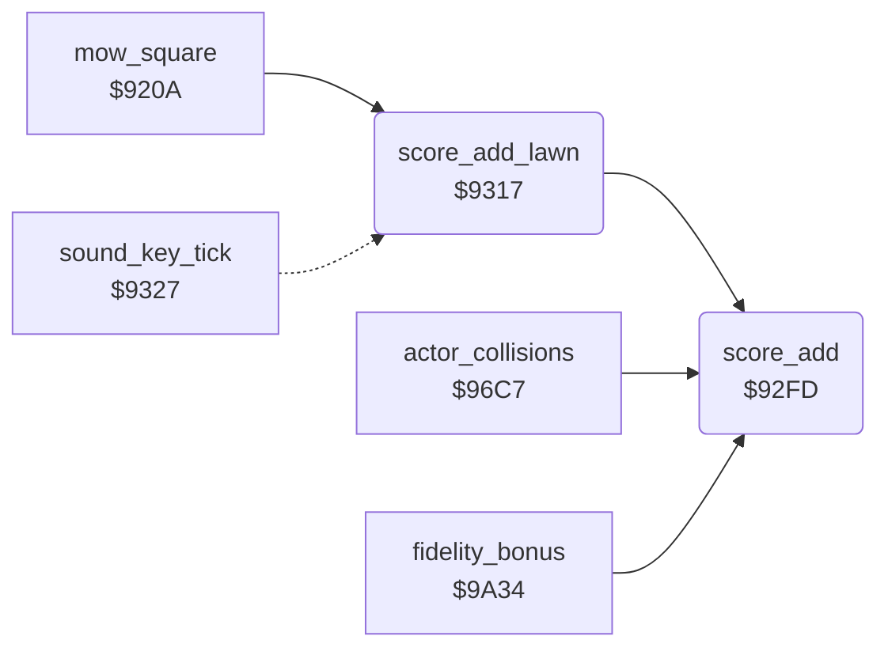

<!-- Generated by c64-docs from knowledge revision 20261024T102038.431-pgzet3 and .c64-re-tools/local/generated/src/source-map.json. Do not edit: change the knowledge, generate the source again, then run docs.ts generate. -->
# scores/score_add.asm: Score addition

Range `$92FD-$9326`. Source: [scores/score_add.asm](../../../../src/scores/score_add.asm). Index: [the reference](../../index.md).

## Call graph

A solid arrow is a call, a thick arrow a table entry, a dotted arrow a jump. Rounded nodes are in this file.

## Names

### [`score_add`](../../../../src/scores/score_add.asm#L6) `$92FD`

*routine*

Adds 1 to the score digit X, Y times. The digits are on the screen at $078f+X, and X = 7 is the last digit. A digit after '9' becomes '0' and adds 1 to the digit on its left. It keeps X.

- **Called from:** [`score_add_lawn`](score_add.md#score_add_lawn) [`$931F`](../../../../src/scores/score_add.asm#L32), [`actor_collisions`](../actors/actor_collision.md#actor_collisions) [`$970B`](../../../../src/actors/actor_collision.asm#L46), [`fidelity_bonus`](../lawn/lawn_complete.md#fidelity_bonus) [`$9A5B`](../../../../src/lawn/lawn_complete.asm#L92)
- **Reads:** [`score_digits`](../../memory-map.md#score_digits)
- **Writes:** [`score_digits`](../../memory-map.md#score_digits)

### [`score_digit_carry`](../../../../src/scores/score_add.asm#L9) `$92FF`

*label*

- **Jumped to from:** [`score_add`](score_add.md#score_add) [`$930F`](../../../../src/scores/score_add.asm#L17)

### [`score_add_next`](../../../../src/scores/score_add.asm#L18) `$9311`

*label*

- **Jumped to from:** [`score_add`](score_add.md#score_add) [`$9307`](../../../../src/scores/score_add.asm#L13)

### [`score_add_lawn`](../../../../src/scores/score_add.asm#L25) `$9317`

*routine*

Adds the lawn number $21 to the score. It keeps X and Y.

- **Called from:** [`mow_square`](../lawn/mow_square.md#mow_square) [`$9225`](../../../../src/lawn/mow_square.asm#L20)
- **Calls:** [`score_add`](score_add.md#score_add)
- **Reads:** [`lawn_number`](../../memory-map.md#lawn_number)

### [`score_add_lawn_return`](../../../../src/scores/score_add.asm#L37) `$9326`

*label*

- **Jumped to from:** [`sound_key_tick`](../sound/sound_tick.md#sound_key_tick) [`$9329`](../../../../src/sound/sound_tick.asm#L8), [`sound_key_tick`](../sound/sound_tick.md#sound_key_tick) [`$9342`](../../../../src/sound/sound_tick.asm#L20)
