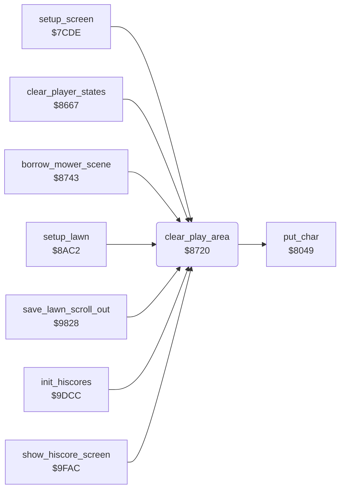

<!-- Generated by c64-docs from knowledge revision 20261025T214622.637-xq1idr and .c64-re-tools/local/generated/src/source-map.json. Do not edit: change the knowledge, generate the source again, then run docs.ts generate. -->
# screen/clear_play_area.asm: Clear the play area

Range `$8720-$8742`. Source: [screen/clear_play_area.asm](../../../../src/screen/clear_play_area.asm). Index: [the reference](../../index.md).

## Routines

| Routine | Address | Reached from | Summary |
|---|---|---|---|
| [`clear_play_area`](clear_play_area.md#clear_play_area) | `$8720` | [`setup_screen`](../setup/setup_screen.md#setup_screen), [`clear_player_states`](../game/player_turn.md#clear_player_states), [`borrow_mower_scene`](../game/borrow_mower_scene.md#borrow_mower_scene), [`setup_lawn`](../lawn/setup_lawn.md#setup_lawn), [`save_lawn_scroll_out`](../neighbour/neighbour_catch.md#save_lawn_scroll_out), [`init_hiscores`](../scores/hiscores.md#init_hiscores), [`show_hiscore_screen`](../title/attract_loop.md#show_hiscore_screen), [`$9FA0`](../../../../src/title/attract_loop.asm#L7) | Turns off all sprites and fills the rows 0-21 with spaces in the colour $05. |

## Call graph

A solid arrow is a call, a thick arrow a table entry. Rounded nodes are in this file.

## Details

### [`clear_play_area`](../../../../src/screen/clear_play_area.asm#L6) `$8720`

*routine*

Turns off all sprites and fills the rows 0-21 with spaces in the colour $05. On exit, $03 is 22.

- **Called from:** [`setup_screen`](../setup/setup_screen.md#setup_screen), [`clear_player_states`](../game/player_turn.md#clear_player_states), [`borrow_mower_scene`](../game/borrow_mower_scene.md#borrow_mower_scene), [`setup_lawn`](../lawn/setup_lawn.md#setup_lawn), [`save_lawn_scroll_out`](../neighbour/neighbour_catch.md#save_lawn_scroll_out), [`init_hiscores`](../scores/hiscores.md#init_hiscores), [`$9FA0`](../../../../src/title/attract_loop.asm#L7), [`show_hiscore_screen`](../title/attract_loop.md#show_hiscore_screen)
- **Calls:** [`put_char`](screen_chars.md#put_char)
- **Reads:** [`cursor_col`](../../memory-map.md#cursor_col), [`cursor_row`](../../memory-map.md#cursor_row)
- **Writes:** [`cursor_row`](../../memory-map.md#cursor_row), [`SPENA`](../../memory-map.md#SPENA), [`cursor_char`](../../memory-map.md#cursor_char), [`cursor_col`](../../memory-map.md#cursor_col)

| Label | Address | Comment |
|---|---|---|
| [`clear_play_area_row`](../../../../src/screen/clear_play_area.asm#L12) | `$872B` |  |
| [`clear_play_area_column`](../../../../src/screen/clear_play_area.asm#L15) | `$872F` |  |
