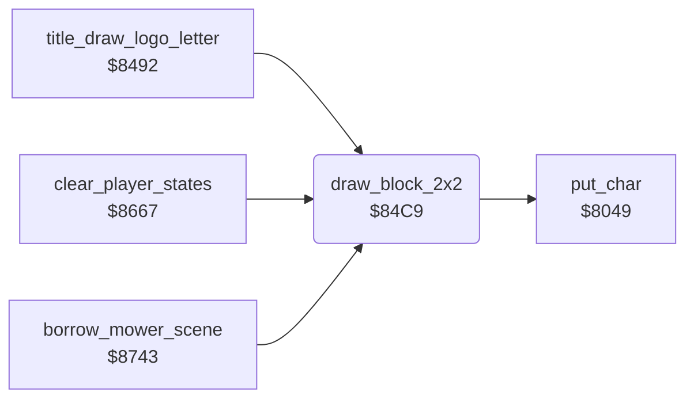

<!-- Generated by c64-docs from knowledge revision 20261024T102038.431-pgzet3 and .c64-re-tools/local/generated/src/source-map.json. Do not edit: change the knowledge, generate the source again, then run docs.ts generate. -->
# screen/draw_block.asm: Character block of 2x2

Range `$84C9-$84E2`. Source: [screen/draw_block.asm](../../../../src/screen/draw_block.asm). Index: [the reference](../../index.md).

## Call graph

A solid arrow is a call, a thick arrow a table entry, a dotted arrow a jump. Rounded nodes are in this file.

## Names

### [`draw_block_2x2`](../../../../src/screen/draw_block.asm#L6) `$84C9`

*routine*

Draws a block of 2x2 characters with the colour $05. The screen codes $04, $04+1, $04+2, $04+3 go to the top left, bottom left, top right and bottom right of column $02, row $03. On exit, $02 and $03 are 1 more, and $04 is 3 more.

- **Called from:** [`title_draw_logo_letter`](../title/title_logo.md#title_draw_logo_letter) [`$84B5`](../../../../src/title/title_logo.asm#L26), [`clear_player_states`](../game/player_turn.md#clear_player_states) [`$86AA`](../../../../src/game/player_turn.asm#L44), [`clear_player_states`](../game/player_turn.md#clear_player_states) [`$86C5`](../../../../src/game/player_turn.asm#L58), [`borrow_mower_scene`](../game/borrow_mower_scene.md#borrow_mower_scene) [`$885B`](../../../../src/game/borrow_mower_scene.asm#L149), [`borrow_mower_scene`](../game/borrow_mower_scene.md#borrow_mower_scene) [`$886B`](../../../../src/game/borrow_mower_scene.asm#L157), [`borrow_mower_scene`](../game/borrow_mower_scene.md#borrow_mower_scene) [`$887E`](../../../../src/game/borrow_mower_scene.asm#L165), [`borrow_mower_scene`](../game/borrow_mower_scene.md#borrow_mower_scene) [`$888E`](../../../../src/game/borrow_mower_scene.asm#L173), [`borrow_mower_scene`](../game/borrow_mower_scene.md#borrow_mower_scene) [`$8905`](../../../../src/game/borrow_mower_scene.asm#L236)
- **Calls:** [`put_char`](screen_chars.md#put_char)
- **Jumps to:** [`put_char`](screen_chars.md#put_char)
- **Reads:** [`cursor_row`](../../memory-map.md#cursor_row), [`cursor_char`](../../memory-map.md#cursor_char), [`cursor_col`](../../memory-map.md#cursor_col)
- **Writes:** [`cursor_row`](../../memory-map.md#cursor_row), [`cursor_char`](../../memory-map.md#cursor_char), [`cursor_col`](../../memory-map.md#cursor_col)
