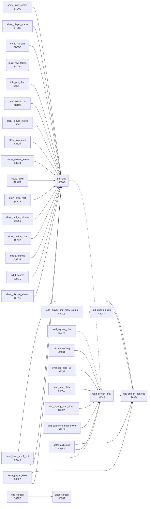

<!-- Generated by c64-docs from knowledge revision 20261024T102038.431-pgzet3 and .c64-re-tools/local/generated/src/source-map.json. Do not edit: change the knowledge, generate the source again, then run docs.ts generate. -->
# screen/screen_chars.asm: Screen row tables and character access

Range `$800D-$8075`. Source: [screen/screen_chars.asm](../../../../src/screen/screen_chars.asm). Index: [the reference](../../index.md).

## Call graph

A solid arrow is a call, a thick arrow a table entry, a dotted arrow a jump. Rounded nodes are in this file.

## Names

### [`build_row_tables`](../../../../src/screen/screen_chars.asm#L6) `$800D`

*routine*

Builds the tables of the row start addresses of the screen: low bytes at $0340, high bytes at $0360. There are 27 rows of 40 bytes from $0400.

- **Called from:** [`$81FF`](../../../../src/init/game_init.asm#L7)
- **Reads:** [`screen_ptr`](../../memory-map.md#screen_ptr), [`screen_ptr_hi`](../../memory-map.md#screen_ptr_hi)
- **Writes:** [`screen_ptr_hi`](../../memory-map.md#screen_ptr_hi), [`screen_ptr`](../../memory-map.md#screen_ptr), [`row_addr_lo`](../../memory-map.md#row_addr_lo), [`row_addr_hi`](../../memory-map.md#row_addr_hi)

### [`build_row_tables_loop`](../../../../src/screen/screen_chars.asm#L12) `$8017`

*label*

- **Jumped to from:** [`build_row_tables`](screen_chars.md#build_row_tables) [`$8031`](../../../../src/screen/screen_chars.asm#L26)

### [`get_screen_address`](../../../../src/screen/screen_chars.asm#L29) `$8034`

*routine*

Gets the screen address of row $03 into $48/$49 and the column $02 into Y. Changes X.

- **Called from:** [`read_screen_char`](screen_chars.md#read_screen_char) [`$8043`](../../../../src/screen/screen_chars.asm#L39), [`put_char_no_clip`](screen_chars.md#put_char_no_clip) [`$804F`](../../../../src/screen/screen_chars.asm#L50), [`actor_collisions`](../actors/actor_collision.md#actor_collisions) [`$978B`](../../../../src/actors/actor_collision.asm#L137), [`save_lawn_scroll_out`](../neighbour/neighbour_catch.md#save_lawn_scroll_out) [`$986B`](../../../../src/neighbour/neighbour_catch.asm#L110), [`save_player_state`](../player/player_state.md#save_player_state) [`$9970`](../../../../src/player/player_state.asm#L50)
- **Reads:** [`cursor_row`](../../memory-map.md#cursor_row), [`cursor_col`](../../memory-map.md#cursor_col), [`row_addr_lo`](../../memory-map.md#row_addr_lo), [`row_addr_hi`](../../memory-map.md#row_addr_hi)
- **Writes:** [`screen_ptr`](../../memory-map.md#screen_ptr), [`screen_ptr_hi`](../../memory-map.md#screen_ptr_hi)

### [`read_screen_char`](../../../../src/screen/screen_chars.asm#L38) `$8043`

*routine*

Reads the screen code at column $02, row $03 into A.

- **Called from:** [`mower_cooling`](../status/mower_cooling.md#mower_cooling) [`$9244`](../../../../src/status/mower_cooling.asm#L25), [`overload_step_up`](../status/mower_overload.md#overload_step_up) [`$92B2`](../../../../src/status/mower_overload.asm#L34), [`actor_test_place`](../actors/actor_place_test.md#actor_test_place) [`$94EC`](../../../../src/actors/actor_place_test.asm#L30), [`dog_loyalty_step_down`](../dog/dog_loyalty.md#dog_loyalty_step_down) [`$95A6`](../../../../src/dog/dog_loyalty.asm#L13), [`dog_tolerance_step_down`](../dog/dog_tolerance.md#dog_tolerance_step_down) [`$9630`](../../../../src/dog/dog_tolerance.asm#L23), [`actor_collisions`](../actors/actor_collision.md#actor_collisions) [`$9767`](../../../../src/actors/actor_collision.asm#L114), [`save_lawn_scroll_out`](../neighbour/neighbour_catch.md#save_lawn_scroll_out) [`$984A`](../../../../src/neighbour/neighbour_catch.asm#L91)
- **Jumped to from:** [`read_square_char`](../player/gordon_move.md#read_square_char) [`$9177`](../../../../src/player/gordon_move.asm#L140)
- **Calls:** [`get_screen_address`](screen_chars.md#get_screen_address)
- **Reads:** [`screen_ptr`](../../memory-map.md#screen_ptr)

### [`put_char_done`](../../../../src/screen/screen_chars.asm#L41) `$8048`

*label*

- **Jumped to from:** [`put_char`](screen_chars.md#put_char) [`$804D`](../../../../src/screen/screen_chars.asm#L47)

### [`put_char`](../../../../src/screen/screen_chars.asm#L44) `$8049`

*routine*

Writes the screen code $04 and the colour $05 at column $02, row $03. It writes nothing for the columns 40-167 ($28-$a7).

- **Called from:** [`show_high_scores`](../scores/high_score_screen.md#show_high_scores) [`$7C26`](../../../../src/scores/high_score_screen.asm#L27), [`show_high_scores`](../scores/high_score_screen.md#show_high_scores) [`$7C48`](../../../../src/scores/high_score_screen.asm#L45), [`show_player_status`](../scores/high_score_screen.md#show_player_status) [`$7CBD`](../../../../src/scores/high_score_screen.asm#L110), [`setup_screen`](../setup/setup_screen.md#setup_screen) [`$7CFB`](../../../../src/setup/setup_screen.asm#L22), [`setup_screen`](../setup/setup_screen.md#setup_screen) [`$7D0B`](../../../../src/setup/setup_screen.asm#L29), [`title_put_char`](../title/title_screen.md#title_put_char) [`$8303`](../../../../src/title/title_screen.asm#L54), [`$8410`](../../../../src/title/title_mower.asm#L34), [`draw_block_2x2`](draw_block.md#draw_block_2x2) [`$84C9`](../../../../src/screen/draw_block.asm#L7), [`draw_block_2x2`](draw_block.md#draw_block_2x2) [`$84D0`](../../../../src/screen/draw_block.asm#L10), [`draw_block_2x2`](draw_block.md#draw_block_2x2) [`$84D9`](../../../../src/screen/draw_block.asm#L14), [`clear_player_states`](../game/player_turn.md#clear_player_states) [`$8688`](../../../../src/game/player_turn.asm#L27), [`clear_player_states`](../game/player_turn.md#clear_player_states) [`$868F`](../../../../src/game/player_turn.asm#L30), [`clear_player_states`](../game/player_turn.md#clear_player_states) [`$86F4`](../../../../src/game/player_turn.asm#L82), [`clear_play_area`](clear_play_area.md#clear_play_area) [`$872F`](../../../../src/screen/clear_play_area.asm#L16), [`borrow_mower_scene`](../game/borrow_mower_scene.md#borrow_mower_scene) [`$87DB`](../../../../src/game/borrow_mower_scene.asm#L81), [`borrow_mower_scene`](../game/borrow_mower_scene.md#borrow_mower_scene) [`$8808`](../../../../src/game/borrow_mower_scene.asm#L107), [`borrow_mower_scene`](../game/borrow_mower_scene.md#borrow_mower_scene) [`$881F`](../../../../src/game/borrow_mower_scene.asm#L120), [`borrow_mower_scene`](../game/borrow_mower_scene.md#borrow_mower_scene) [`$88BA`](../../../../src/game/borrow_mower_scene.asm#L196), [`borrow_mower_scene`](../game/borrow_mower_scene.md#borrow_mower_scene) [`$88CB`](../../../../src/game/borrow_mower_scene.asm#L205), [`borrow_mower_scene`](../game/borrow_mower_scene.md#borrow_mower_scene) [`$88D0`](../../../../src/game/borrow_mower_scene.asm#L207), [`borrow_mower_scene`](../game/borrow_mower_scene.md#borrow_mower_scene) [`$88E0`](../../../../src/game/borrow_mower_scene.asm#L216), [`setup_lawn`](../lawn/setup_lawn.md#setup_lawn) [`$8AF7`](../../../../src/lawn/setup_lawn.asm#L35), [`draw_lawn_rect`](../lawn/lawn_shapes.md#draw_lawn_rect) [`$8B37`](../../../../src/lawn/lawn_shapes.asm#L34), [`draw_hedge_column`](../lawn/lawn_shapes.md#draw_hedge_column) [`$8B62`](../../../../src/lawn/lawn_shapes.asm#L62), [`draw_hedge_column`](../lawn/lawn_shapes.md#draw_hedge_column) [`$8B69`](../../../../src/lawn/lawn_shapes.asm#L65), [`draw_hedge_row`](../lawn/lawn_shapes.md#draw_hedge_row) [`$8B8D`](../../../../src/lawn/lawn_shapes.asm#L87), [`draw_hedge_row`](../lawn/lawn_shapes.md#draw_hedge_row) [`$8B94`](../../../../src/lawn/lawn_shapes.asm#L90), [`save_lawn_scroll_out`](../neighbour/neighbour_catch.md#save_lawn_scroll_out) [`$9902`](../../../../src/neighbour/neighbour_catch.asm#L209), [`save_player_state`](../player/player_state.md#save_player_state) [`$994F`](../../../../src/player/player_state.asm#L35), [`save_player_state`](../player/player_state.md#save_player_state) [`$9954`](../../../../src/player/player_state.asm#L37), [`save_player_state`](../player/player_state.md#save_player_state) [`$995D`](../../../../src/player/player_state.asm#L41), [`$99E2`](../../../../src/lawn/lawn_complete.asm#L22), [`fidelity_bonus`](../lawn/lawn_complete.md#fidelity_bonus) [`$9A4B`](../../../../src/lawn/lawn_complete.asm#L82), [`$9D54`](../../../../src/game/game_over.asm#L23), [`$9D77`](../../../../src/game/game_over.asm#L42), [`init_hiscores`](../scores/hiscores.md#init_hiscores) [`$9EA7`](../../../../src/scores/hiscores.asm#L137), [`init_hiscores`](../scores/hiscores.md#init_hiscores) [`$9EC6`](../../../../src/scores/hiscores.asm#L153), [`show_hiscore_screen`](../title/attract_loop.md#show_hiscore_screen) [`$9FC6`](../../../../src/title/attract_loop.asm#L27)
- **Jumped to from:** [`draw_block_2x2`](draw_block.md#draw_block_2x2) [`$84E0`](../../../../src/screen/draw_block.asm#L17)
- **Jumps to:** [`put_char_done`](screen_chars.md#put_char_done)
- **Reads:** [`cursor_col`](../../memory-map.md#cursor_col)

### [`put_char_no_clip`](../../../../src/screen/screen_chars.asm#L49) `$804F`

*routine*

Writes the screen code $04 and the colour $05 at column $02, row $03, without the column test. Changes X and Y.

- **Called from:** [`load_player_and_draw_status`](../status/draw_status.md#load_player_and_draw_status) [`$8A59`](../../../../src/status/draw_status.asm#L40)
- **Calls:** [`get_screen_address`](screen_chars.md#get_screen_address)
- **Reads:** [`cursor_char`](../../memory-map.md#cursor_char), [`screen_ptr`](../../memory-map.md#screen_ptr), [`screen_ptr_hi`](../../memory-map.md#screen_ptr_hi), [`cursor_colour`](../../memory-map.md#cursor_colour)
- **Writes:** [`screen_ptr_hi`](../../memory-map.md#screen_ptr_hi)

### [`clear_screen`](../../../../src/screen/screen_chars.asm#L61) `$8062`

*routine*

Fills the screen $0400-$07ff with spaces ($20). This also writes the sprite pointers $07f8-$07ff.

- **Called from:** [`title_screen`](../title/title_screen.md#title_screen) [`$829F`](../../../../src/title/title_screen.asm#L7)
- **Writes:** [`VICSCN`](../../memory-map.md#VICSCN), [`VICSCN+256`](../../memory-map.md#VICSCN), [`VICSCN+512`](../../memory-map.md#VICSCN), [`VICSCN+768`](../../memory-map.md#VICSCN)

### [`clear_screen_loop`](../../../../src/screen/screen_chars.asm#L63) `$8064`

*label*

- **Jumped to from:** [`clear_screen`](screen_chars.md#clear_screen) [`$8073`](../../../../src/screen/screen_chars.asm#L70)
