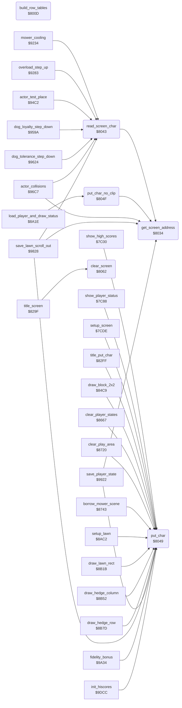

<!-- Generated by c64-docs from knowledge revision 20261025T214622.637-xq1idr and .c64-re-tools/local/generated/src/source-map.json. Do not edit: change the knowledge, generate the source again, then run docs.ts generate. -->
# screen/screen_chars.asm: Screen row tables and character access

Range `$800D-$8075`. Source: [screen/screen_chars.asm](../../../../src/screen/screen_chars.asm). Index: [the reference](../../index.md).

## Routines

| Routine | Address | Reached from | Summary |
|---|---|---|---|
| [`build_row_tables`](screen_chars.md#build_row_tables) | `$800D` | [`$81FF`](../../../../src/init/game_init.asm#L7) | Builds the tables of the row start addresses of the screen: low bytes at $0340, high bytes at $0360. |
| [`get_screen_address`](screen_chars.md#get_screen_address) | `$8034` | [`read_screen_char`](screen_chars.md#read_screen_char), [`put_char_no_clip`](screen_chars.md#put_char_no_clip), [`actor_collisions`](../actors/actor_collision.md#actor_collisions), [`save_lawn_scroll_out`](../neighbour/neighbour_catch.md#save_lawn_scroll_out), [`save_player_state`](../player/player_state.md#save_player_state) | Gets the screen address of row $03 into $48/$49 and the column $02 into Y. |
| [`read_screen_char`](screen_chars.md#read_screen_char) | `$8043` | [`mower_cooling`](../status/mower_cooling.md#mower_cooling), [`overload_step_up`](../status/mower_overload.md#overload_step_up), [`actor_test_place`](../actors/actor_place_test.md#actor_test_place), [`dog_loyalty_step_down`](../dog/dog_loyalty.md#dog_loyalty_step_down), [`dog_tolerance_step_down`](../dog/dog_tolerance.md#dog_tolerance_step_down), [`actor_collisions`](../actors/actor_collision.md#actor_collisions), [`save_lawn_scroll_out`](../neighbour/neighbour_catch.md#save_lawn_scroll_out), [`read_square_char`](../player/gordon_move.md#read_square_char) | Reads the screen code at column $02, row $03 into A. |
| [`put_char`](screen_chars.md#put_char) | `$8049` | [`show_high_scores`](../scores/high_score_screen.md#show_high_scores), [`show_player_status`](../scores/high_score_screen.md#show_player_status), [`setup_screen`](../setup/setup_screen.md#setup_screen), [`title_put_char`](../title/title_screen.md#title_put_char), [`draw_block_2x2`](draw_block.md#draw_block_2x2), [`clear_player_states`](../game/player_turn.md#clear_player_states), [`clear_play_area`](clear_play_area.md#clear_play_area), [`borrow_mower_scene`](../game/borrow_mower_scene.md#borrow_mower_scene), [`setup_lawn`](../lawn/setup_lawn.md#setup_lawn), [`draw_lawn_rect`](../lawn/lawn_shapes.md#draw_lawn_rect), [`draw_hedge_column`](../lawn/lawn_shapes.md#draw_hedge_column), [`draw_hedge_row`](../lawn/lawn_shapes.md#draw_hedge_row) and 9 more | Writes the screen code $04 and the colour $05 at column $02, row $03. |
| [`put_char_no_clip`](screen_chars.md#put_char_no_clip) | `$804F` | [`load_player_and_draw_status`](../status/draw_status.md#load_player_and_draw_status) | Writes the screen code $04 and the colour $05 at column $02, row $03, without the column test. |
| [`clear_screen`](screen_chars.md#clear_screen) | `$8062` | [`title_screen`](../title/title_screen.md#title_screen) | Fills the screen $0400-$07ff with spaces ($20). |

## Call graph

A solid arrow is a call, a thick arrow a table entry. Rounded nodes are in this file.

The graph shows 30 of the 31 edges.

## Details

### [`build_row_tables`](../../../../src/screen/screen_chars.asm#L6) `$800D`

*routine*

Builds the tables of the row start addresses of the screen: low bytes at $0340, high bytes at $0360. There are 27 rows of 40 bytes from $0400.

- **Called from:** [`$81FF`](../../../../src/init/game_init.asm#L7)
- **Reads:** [`screen_ptr`](../../memory-map.md#screen_ptr), [`screen_ptr_hi`](../../memory-map.md#screen_ptr_hi)
- **Writes:** [`screen_ptr_hi`](../../memory-map.md#screen_ptr_hi), [`screen_ptr`](../../memory-map.md#screen_ptr), [`row_addr_lo`](../../memory-map.md#row_addr_lo), [`row_addr_hi`](../../memory-map.md#row_addr_hi)

| Label | Address | Comment |
|---|---|---|
| [`build_row_tables_loop`](../../../../src/screen/screen_chars.asm#L12) | `$8017` |  |

### [`get_screen_address`](../../../../src/screen/screen_chars.asm#L29) `$8034`

*routine*

Gets the screen address of row $03 into $48/$49 and the column $02 into Y. Changes X.

- **Called from:** [`read_screen_char`](screen_chars.md#read_screen_char), [`put_char_no_clip`](screen_chars.md#put_char_no_clip), [`actor_collisions`](../actors/actor_collision.md#actor_collisions), [`save_lawn_scroll_out`](../neighbour/neighbour_catch.md#save_lawn_scroll_out), [`save_player_state`](../player/player_state.md#save_player_state)
- **Reads:** [`cursor_row`](../../memory-map.md#cursor_row), [`cursor_col`](../../memory-map.md#cursor_col), [`row_addr_lo`](../../memory-map.md#row_addr_lo), [`row_addr_hi`](../../memory-map.md#row_addr_hi)
- **Writes:** [`screen_ptr`](../../memory-map.md#screen_ptr), [`screen_ptr_hi`](../../memory-map.md#screen_ptr_hi)

### [`read_screen_char`](../../../../src/screen/screen_chars.asm#L38) `$8043`

*routine*

Reads the screen code at column $02, row $03 into A.

- **Called from:** [`mower_cooling`](../status/mower_cooling.md#mower_cooling), [`overload_step_up`](../status/mower_overload.md#overload_step_up), [`actor_test_place`](../actors/actor_place_test.md#actor_test_place), [`dog_loyalty_step_down`](../dog/dog_loyalty.md#dog_loyalty_step_down), [`dog_tolerance_step_down`](../dog/dog_tolerance.md#dog_tolerance_step_down), [`actor_collisions`](../actors/actor_collision.md#actor_collisions), [`save_lawn_scroll_out`](../neighbour/neighbour_catch.md#save_lawn_scroll_out)
- **Jumped to from:** [`read_square_char`](../player/gordon_move.md#read_square_char)
- **Calls:** [`get_screen_address`](screen_chars.md#get_screen_address)
- **Reads:** [`screen_ptr`](../../memory-map.md#screen_ptr)

| Label | Address | Comment |
|---|---|---|
| [`put_char_done`](../../../../src/screen/screen_chars.asm#L41) | `$8048` |  |

### [`put_char`](../../../../src/screen/screen_chars.asm#L44) `$8049`

*routine*

Writes the screen code $04 and the colour $05 at column $02, row $03. It writes nothing for the columns 40-167 ($28-$a7).

- **Called from:** [`show_high_scores`](../scores/high_score_screen.md#show_high_scores), [`show_player_status`](../scores/high_score_screen.md#show_player_status), [`setup_screen`](../setup/setup_screen.md#setup_screen), [`title_put_char`](../title/title_screen.md#title_put_char), [`$8410`](../../../../src/title/title_mower.asm#L34), [`draw_block_2x2`](draw_block.md#draw_block_2x2), [`clear_player_states`](../game/player_turn.md#clear_player_states), [`clear_play_area`](clear_play_area.md#clear_play_area), [`borrow_mower_scene`](../game/borrow_mower_scene.md#borrow_mower_scene), [`setup_lawn`](../lawn/setup_lawn.md#setup_lawn), [`draw_lawn_rect`](../lawn/lawn_shapes.md#draw_lawn_rect), [`draw_hedge_column`](../lawn/lawn_shapes.md#draw_hedge_column) and 9 more
- **Jumped to from:** [`draw_block_2x2`](draw_block.md#draw_block_2x2)
- **Jumps to:** [`put_char_done`](screen_chars.md#put_char_done)
- **Reads:** [`cursor_col`](../../memory-map.md#cursor_col)

### [`put_char_no_clip`](../../../../src/screen/screen_chars.asm#L49) `$804F`

*routine*

Writes the screen code $04 and the colour $05 at column $02, row $03, without the column test. Changes X and Y.

- **Called from:** [`load_player_and_draw_status`](../status/draw_status.md#load_player_and_draw_status)
- **Calls:** [`get_screen_address`](screen_chars.md#get_screen_address)
- **Reads:** [`cursor_char`](../../memory-map.md#cursor_char), [`screen_ptr`](../../memory-map.md#screen_ptr), [`screen_ptr_hi`](../../memory-map.md#screen_ptr_hi), [`cursor_colour`](../../memory-map.md#cursor_colour)
- **Writes:** [`screen_ptr_hi`](../../memory-map.md#screen_ptr_hi)

### [`clear_screen`](../../../../src/screen/screen_chars.asm#L61) `$8062`

*routine*

Fills the screen $0400-$07ff with spaces ($20). This also writes the sprite pointers $07f8-$07ff.

- **Called from:** [`title_screen`](../title/title_screen.md#title_screen)
- **Writes:** [`VICSCN`](../../memory-map.md#VICSCN)

| Label | Address | Comment |
|---|---|---|
| [`clear_screen_loop`](../../../../src/screen/screen_chars.asm#L63) | `$8064` |  |
