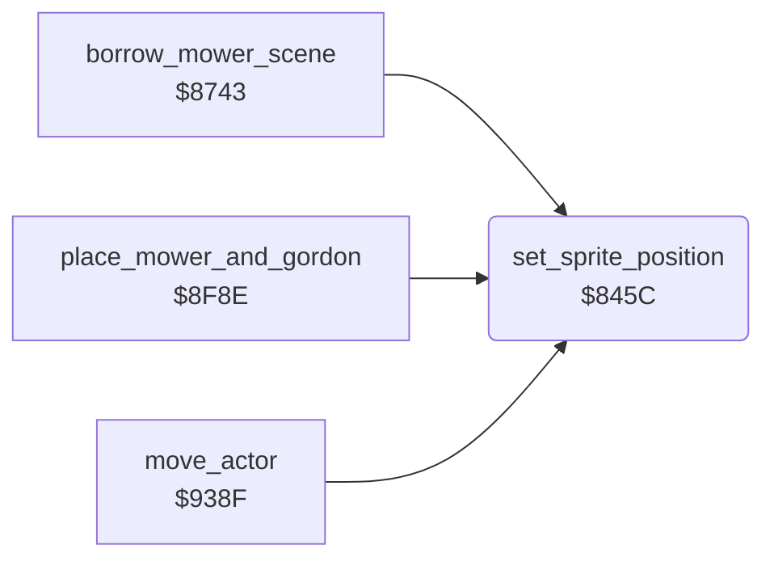

<!-- Generated by c64-docs from knowledge revision 20261024T102038.431-pgzet3 and .c64-re-tools/local/generated/src/source-map.json. Do not edit: change the knowledge, generate the source again, then run docs.ts generate. -->
# screen/sprite_position.asm: Sprite position

Range `$845C-$8491`. Source: [screen/sprite_position.asm](../../../../src/screen/sprite_position.asm). Index: [the reference](../../index.md).

## Call graph

A solid arrow is a call, a thick arrow a table entry, a dotted arrow a jump. Rounded nodes are in this file.

## Names

### [`set_sprite_position`](../../../../src/screen/sprite_position.asm#L6) `$845C`

*routine*

Sets the position of sprite Y: x = $07 * 2, y = $08. Bit 8 of x goes into $d010. Keeps X. Changes A and Y.

- **Called from:** [`$842B`](../../../../src/title/title_mower.asm#L47), [`$8438`](../../../../src/title/title_mower.asm#L54), [`$8556`](../../../../src/title/title_walk.asm#L40), [`$857B`](../../../../src/title/title_walk.asm#L58), [`$85B3`](../../../../src/title/title_walk.asm#L87), [`$85DE`](../../../../src/title/title_walk.asm#L109), [`$861E`](../../../../src/title/title_walk.asm#L141), [`$862B`](../../../../src/title/title_walk.asm#L148), [`borrow_mower_scene`](../game/borrow_mower_scene.md#borrow_mower_scene) [`$874D`](../../../../src/game/borrow_mower_scene.asm#L14), [`borrow_mower_scene`](../game/borrow_mower_scene.md#borrow_mower_scene) [`$883C`](../../../../src/game/borrow_mower_scene.asm#L135), [`borrow_mower_scene`](../game/borrow_mower_scene.md#borrow_mower_scene) [`$8841`](../../../../src/game/borrow_mower_scene.asm#L137), [`borrow_mower_scene`](../game/borrow_mower_scene.md#borrow_mower_scene) [`$889E`](../../../../src/game/borrow_mower_scene.asm#L181), [`borrow_mower_scene`](../game/borrow_mower_scene.md#borrow_mower_scene) [`$892D`](../../../../src/game/borrow_mower_scene.asm#L265), [`borrow_mower_scene`](../game/borrow_mower_scene.md#borrow_mower_scene) [`$895E`](../../../../src/game/borrow_mower_scene.asm#L291), [`borrow_mower_scene`](../game/borrow_mower_scene.md#borrow_mower_scene) [`$896B`](../../../../src/game/borrow_mower_scene.asm#L298), [`place_mower_and_gordon`](../player/place_mower.md#place_mower_and_gordon) [`$8FA9`](../../../../src/player/place_mower.asm#L19), [`move_actor`](../actors/actor_move.md#move_actor) [`$9430`](../../../../src/actors/actor_move.asm#L112), [`$97EE`](../../../../src/neighbour/neighbour_catch.asm#L43), [`$9805`](../../../../src/neighbour/neighbour_catch.asm#L54)
- **Jumped to from:** [`place_mower_and_gordon`](../player/place_mower.md#place_mower_and_gordon) [`$8FBE`](../../../../src/player/place_mower.asm#L29)
- **Reads:** [`work_ptr_hi`](../../memory-map.md#work_ptr_hi), [`work_ptr`](../../memory-map.md#work_ptr), [`MSIGX`](../../memory-map.md#MSIGX)
- **Writes:** [`SP0Y`](../../memory-map.md#SP0Y), [`SP0X`](../../memory-map.md#SP0X), [`MSIGX`](../../memory-map.md#MSIGX)

### [`sprite_pos_clear_mask`](../../../../src/screen/sprite_position.asm#L22) `$8473`

*label*

- **Jumped to from:** [`set_sprite_position`](sprite_position.md#set_sprite_position) [`$8475`](../../../../src/screen/sprite_position.asm#L25)

### [`sprite_pos_set_msb`](../../../../src/screen/sprite_position.asm#L30) `$8482`

*label*

- **Jumped to from:** [`set_sprite_position`](sprite_position.md#set_sprite_position) [`$846E`](../../../../src/screen/sprite_position.asm#L19)

### [`sprite_pos_set_mask`](../../../../src/screen/sprite_position.asm#L33) `$8485`

*label*

- **Jumped to from:** [`set_sprite_position`](sprite_position.md#set_sprite_position) [`$8487`](../../../../src/screen/sprite_position.asm#L36)

### [`sprite_pos_done`](../../../../src/screen/sprite_position.asm#L39) `$848F`

*label*

- **Jumped to from:** [`set_sprite_position`](sprite_position.md#set_sprite_position) [`$847F`](../../../../src/screen/sprite_position.asm#L29)
