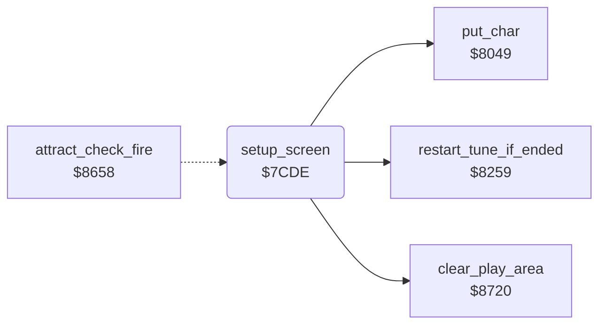

<!-- Generated by c64-docs from knowledge revision 20261024T102038.431-pgzet3 and .c64-re-tools/local/generated/src/source-map.json. Do not edit: change the knowledge, generate the source again, then run docs.ts generate. -->
# setup/setup_screen.asm: Setup screen

Range `$7CDE-$7DDA`. Source: [setup/setup_screen.asm](../../../../src/setup/setup_screen.asm). Index: [the reference](../../index.md).

## Call graph

A solid arrow is a call, a thick arrow a table entry, a dotted arrow a jump. Rounded nodes are in this file.

## Data

| Range | Type | Name | Read by | Written by |
|---|---|---|---|---|
| [`$7D1A`](../../../../src/setup/setup_screen.asm#L38)-`$7D3F` | bytes | [`text_setup_keys`](../../../../src/setup/setup_screen.asm#L37) | [`setup_screen`](setup_screen.md#setup_screen) |  |
| [`$7D40`](../../../../src/setup/setup_screen.asm#L45)-`$7D65` | bytes | [`text_setup_values`](../../../../src/setup/setup_screen.asm#L44) | [`setup_screen`](setup_screen.md#setup_screen) |  |

## Names

### [`setup_screen`](../../../../src/setup/setup_screen.asm#L6) `$7CDE`

*routine*

F7 stores them to the lawn $21, the players $2d and the sticks $1e, and starts the game at $827c.

- **Jumped to from:** [`attract_check_fire`](../input/joystick.md#attract_check_fire) [`$8664`](../../../../src/input/joystick.asm#L24)
- **Calls:** [`clear_play_area`](../screen/clear_play_area.md#clear_play_area), [`put_char`](../screen/screen_chars.md#put_char), [`restart_tune_if_ended`](../music/tune_start.md#restart_tune_if_ended)
- **Jumps to:** [`start_game`](../game/start_game.md#start_game)
- **Reads:** [`work_ptr2`](../../memory-map.md#work_ptr2), [`cursor_col`](../../memory-map.md#cursor_col), [`LSTX`](../../memory-map.md#LSTX), [`setup_lawn_digit`](../../memory-map.md#setup_lawn_digit), [`setup_players_digit`](../../memory-map.md#setup_players_digit), [`setup_sticks_digit`](../../memory-map.md#setup_sticks_digit)
- **Writes:** [`cursor_colour`](../../memory-map.md#cursor_colour), [`cursor_col`](../../memory-map.md#cursor_col), [`cursor_row`](../../memory-map.md#cursor_row), [`cursor_char`](../../memory-map.md#cursor_char), [`work_ptr2`](../../memory-map.md#work_ptr2), [`setup_lawn_digit`](../../memory-map.md#setup_lawn_digit), [`setup_players_digit`](../../memory-map.md#setup_players_digit), [`setup_sticks_digit`](../../memory-map.md#setup_sticks_digit), [`lawn_number`](../../memory-map.md#lawn_number), [`player_count`](../../memory-map.md#player_count), [`stick_count`](../../memory-map.md#stick_count)

### [`setup_put_char`](../../../../src/setup/setup_screen.asm#L15) `$7CEE`

*label*

- **Jumped to from:** [`setup_screen`](setup_screen.md#setup_screen) [`$7D15`](../../../../src/setup/setup_screen.asm#L34)

### [`text_setup_keys`](../../../../src/setup/setup_screen.asm#L37) `$7D1A-$7D3F`

*data*

Text "USE F1,3,5 TO SET VALUES.. F7 TO START" (38 characters) at row 10.

- **Read by:** [`setup_screen`](setup_screen.md#setup_screen) [`$7CF2`](../../../../src/setup/setup_screen.asm#L18)

### [`text_setup_values`](../../../../src/setup/setup_screen.asm#L44) `$7D40-$7D65`

*data*

Text "ENTRY LAWN: 1   PLAYERS: 1   STICKS: 1" (38 characters) at row 13. The digits go to $0615, $0622 and $062e.

- **Read by:** [`setup_screen`](setup_screen.md#setup_screen) [`$7D04`](../../../../src/setup/setup_screen.asm#L26)

### [`setup_read_key`](../../../../src/setup/setup_screen.asm#L50) `$7D66`

*label*

KERNAL key code of the key that is down.

- **Jumped to from:** [`setup_screen`](setup_screen.md#setup_screen) [`$7D17`](../../../../src/setup/setup_screen.asm#L35), [`setup_screen`](setup_screen.md#setup_screen) [`$7D77`](../../../../src/setup/setup_screen.asm#L63)

### [`setup_key_delay`](../../../../src/setup/setup_screen.asm#L55) `$7D6C`

*label*

Delay of up to $20 x 256 calls of $8259, which keeps the tune playing. Then the next key.

- **Jumped to from:** [`setup_screen`](setup_screen.md#setup_screen) [`$7D8D`](../../../../src/setup/setup_screen.asm#L74), [`setup_screen`](setup_screen.md#setup_screen) [`$7DA3`](../../../../src/setup/setup_screen.asm#L85), [`setup_screen`](setup_screen.md#setup_screen) [`$7DB9`](../../../../src/setup/setup_screen.asm#L96)

### [`setup_key_delay_loop`](../../../../src/setup/setup_screen.asm#L57) `$7D6E`

*label*

- **Jumped to from:** [`setup_screen`](setup_screen.md#setup_screen) [`$7D72`](../../../../src/setup/setup_screen.asm#L60), [`setup_screen`](setup_screen.md#setup_screen) [`$7D75`](../../../../src/setup/setup_screen.asm#L62)

### [`setup_test_f1`](../../../../src/setup/setup_screen.asm#L64) `$7D7A`

*label*

F1: next entry lawn.

- **Jumped to from:** [`setup_screen`](setup_screen.md#setup_screen) [`$7D6A`](../../../../src/setup/setup_screen.asm#L53)

### [`setup_f1_done`](../../../../src/setup/setup_screen.asm#L73) `$7D8D`

*label*

- **Jumped to from:** [`setup_screen`](setup_screen.md#setup_screen) [`$7D86`](../../../../src/setup/setup_screen.asm#L70)

### [`setup_test_f3`](../../../../src/setup/setup_screen.asm#L75) `$7D90`

*label*

F3: next number of players.

- **Jumped to from:** [`setup_screen`](setup_screen.md#setup_screen) [`$7D7C`](../../../../src/setup/setup_screen.asm#L66)

### [`setup_f3_done`](../../../../src/setup/setup_screen.asm#L84) `$7DA3`

*label*

- **Jumped to from:** [`setup_screen`](setup_screen.md#setup_screen) [`$7D9C`](../../../../src/setup/setup_screen.asm#L81)

### [`setup_test_f5`](../../../../src/setup/setup_screen.asm#L86) `$7DA6`

*label*

F5: next number of sticks.

- **Jumped to from:** [`setup_screen`](setup_screen.md#setup_screen) [`$7D92`](../../../../src/setup/setup_screen.asm#L77)

### [`setup_key_done`](../../../../src/setup/setup_screen.asm#L95) `$7DB9`

*label*

- **Jumped to from:** [`setup_screen`](setup_screen.md#setup_screen) [`$7DB2`](../../../../src/setup/setup_screen.asm#L92), [`setup_screen`](setup_screen.md#setup_screen) [`$7DBE`](../../../../src/setup/setup_screen.asm#L99)

### [`setup_test_f7`](../../../../src/setup/setup_screen.asm#L97) `$7DBC`

*label*

F7: start the game.

- **Jumped to from:** [`setup_screen`](setup_screen.md#setup_screen) [`$7DA8`](../../../../src/setup/setup_screen.asm#L88)
