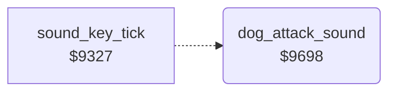

<!-- Generated by c64-docs from knowledge revision 20261024T102038.431-pgzet3 and .c64-re-tools/local/generated/src/source-map.json. Do not edit: change the knowledge, generate the source again, then run docs.ts generate. -->
# sound/dog_sound.asm: Sound of the dog attack

Range `$9698-$96C6`. Source: [sound/dog_sound.asm](../../../../src/sound/dog_sound.asm). Index: [the reference](../../index.md).

## Call graph

A solid arrow is a call, a thick arrow a table entry, a dotted arrow a jump. Rounded nodes are in this file.

## Names

### [`dog_attack_sound`](../../../../src/sound/dog_sound.asm#L6) `$9698`

*routine*

Sound of the dog attack on voice 3. While $3c is not 0, a sawtooth rises in 8 steps. Then it waits a random time $5d and starts again.

- **Jumped to from:** [`sound_key_tick`](sound_tick.md#sound_key_tick) [`$9339`](../../../../src/sound/sound_tick.asm#L15)
- **Reads:** [`sfx_pitch`](../../memory-map.md#sfx_pitch), [`RASTER`](../../memory-map.md#RASTER), [`bark_pause`](../../memory-map.md#bark_pause)
- **Writes:** [`VCREG3`](../../memory-map.md#VCREG3), [`sfx_pitch`](../../memory-map.md#sfx_pitch), [`FREHI3`](../../memory-map.md#FREHI3), [`bark_pause`](../../memory-map.md#bark_pause)

### [`dog_sound_random_pause`](../../../../src/sound/dog_sound.asm#L23) `$96B6`

*label*

Reads the raster line $d012. The pause $5d is the value AND $1f.

- **Jumped to from:** [`dog_attack_sound`](dog_sound.md#dog_attack_sound) [`$96B3`](../../../../src/sound/dog_sound.asm#L20)

### [`dog_sound_return`](../../../../src/sound/dog_sound.asm#L27) `$96BD`

*label*

- **Jumped to from:** [`dog_attack_sound`](dog_sound.md#dog_attack_sound) [`$96C0`](../../../../src/sound/dog_sound.asm#L31)

### [`dog_sound_pause`](../../../../src/sound/dog_sound.asm#L29) `$96BE`

*label*

- **Jumped to from:** [`dog_attack_sound`](dog_sound.md#dog_attack_sound) [`$969A`](../../../../src/sound/dog_sound.asm#L8)
