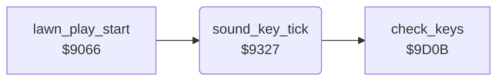

<!-- Generated by c64-docs from knowledge revision 20261025T214622.637-xq1idr and .c64-re-tools/local/generated/src/source-map.json. Do not edit: change the knowledge, generate the source again, then run docs.ts generate. -->
# sound/sound_tick.asm: Sound and key tick

Range `$9327-$9373`. Source: [sound/sound_tick.asm](../../../../src/sound/sound_tick.asm). Index: [the reference](../../index.md).

## Routines

| Routine | Address | Reached from | Summary |
|---|---|---|---|
| [`sound_key_tick`](sound_tick.md#sound_key_tick) | `$9327` | [`lawn_play_start`](../game/main_loop.md#lawn_play_start) | Every 16 calls ($40), it checks the keys and updates voice 3. |

## Call graph

A solid arrow is a call, a thick arrow a table entry. Rounded nodes are in this file.

## Details

### [`sound_key_tick`](../../../../src/sound/sound_tick.asm#L6) `$9327`

*routine*

Every 16 calls ($40), it checks the keys and updates voice 3. When the dog attacks ($1f31 = 2), $9698 makes the sound. Else an overheated mower flashes sprite 0. The mower noise falls in pitch until $3c is 0.

- **Called from:** [`lawn_play_start`](../game/main_loop.md#lawn_play_start)
- **Calls:** [`check_keys`](../input/keys.md#check_keys)
- **Jumps to:** [`score_add_lawn_return`](../scores/score_add.md#score_add_lawn_return), [`dog_attack_sound`](dog_sound.md#dog_attack_sound)
- **Reads:** [`sound_task_timer`](../../memory-map.md#sound_task_timer), [`dog_mode`](../../memory-map.md#dog_mode), [`mower_overheated`](../../memory-map.md#mower_overheated), [`mow_sound_on`](../../memory-map.md#mow_sound_on), [`sfx_pitch`](../../memory-map.md#sfx_pitch), [`SP0COL`](../../memory-map.md#SP0COL)
- **Writes:** [`sound_task_timer`](../../memory-map.md#sound_task_timer), [`sfx_pitch`](../../memory-map.md#sfx_pitch), [`FREHI3`](../../memory-map.md#FREHI3), [`mow_sound_on`](../../memory-map.md#mow_sound_on), [`VCREG3`](../../memory-map.md#VCREG3), [`SP0COL`](../../memory-map.md#SP0COL), [`gordon_speed`](../../memory-map.md#gordon_speed)

| Label | Address | Comment |
|---|---|---|
| [`sound_mower`](../../../../src/sound/sound_tick.asm#L16) | `$933C` |  |
| [`sound_noise_off`](../../../../src/sound/sound_tick.asm#L26) | `$934E` |  |
| [`sound_tick_return`](../../../../src/sound/sound_tick.asm#L31) | `$9357` |  |
| [`sound_overheated`](../../../../src/sound/sound_tick.asm#L34) | `$9358` | The mower is overheated ($3e = 1). Sprite 0 changes colour, the colour sets the pitch of voice 3, and the speed $32 stays 0. |
