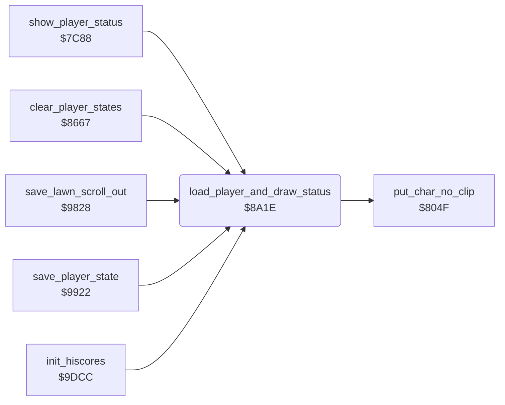

<!-- Generated by c64-docs from knowledge revision 20261024T102038.431-pgzet3 and .c64-re-tools/local/generated/src/source-map.json. Do not edit: change the knowledge, generate the source again, then run docs.ts generate. -->
# status/draw_status.asm: Player state and status rows

Range `$8A1E-$8AC1`. Source: [status/draw_status.asm](../../../../src/status/draw_status.asm). Index: [the reference](../../index.md).

## Call graph

A solid arrow is a call, a thick arrow a table entry, a dotted arrow a jump. Rounded nodes are in this file.

## Data

| Range | Type | Name | Read by | Written by |
|---|---|---|---|---|
| [`$8A98`](../../../../src/status/draw_status.asm#L80)-`$8AA6` | bytes |  | [`load_player_and_draw_status`](draw_status.md#load_player_and_draw_status) |  |
| [`$8AA7`](../../../../src/status/draw_status.asm#L85)-`$8AB5` | bytes |  |  |  |
| [`$8AB6`](../../../../src/status/draw_status.asm#L98)-`$8AC1` | bytes | [`lender_names`](../../../../src/status/draw_status.asm#L88) | [`load_player_and_draw_status`](draw_status.md#load_player_and_draw_status) |  |

## Names

### [`load_player_and_draw_status`](../../../../src/status/draw_status.asm#L6) `$8A1E`

*routine*

Copies the 8 state bytes of the current player ($1c) from $4f01 or $4f11 to $20-$27. Then it draws the status rows of that player, the lender name and the scale colours.

- **Called from:** [`show_player_status`](../scores/high_score_screen.md#show_player_status) [`$7C9A`](../../../../src/scores/high_score_screen.asm#L92), [`clear_player_states`](../game/player_turn.md#clear_player_states) [`$8675`](../../../../src/game/player_turn.asm#L17), [`save_lawn_scroll_out`](../neighbour/neighbour_catch.md#save_lawn_scroll_out) [`$98CA`](../../../../src/neighbour/neighbour_catch.asm#L177), [`save_player_state`](../player/player_state.md#save_player_state) [`$99BF`](../../../../src/player/player_state.asm#L96), [`$9A2B`](../../../../src/lawn/lawn_complete.asm#L63), [`init_hiscores`](../scores/hiscores.md#init_hiscores) [`$9DDE`](../../../../src/scores/hiscores.asm#L20)
- **Calls:** [`put_char_no_clip`](../screen/screen_chars.md#put_char_no_clip)
- **Reads:** [`player1_state`](../../memory-map.md#player1_state), [`current_player`](../../memory-map.md#current_player), [`player2_state`](../../memory-map.md#player2_state), [`work_ptr2`](../../memory-map.md#work_ptr2), [`cursor_col`](../../memory-map.md#cursor_col), [`work_ptr`](../../memory-map.md#work_ptr), [`mower_lender`](../../memory-map.md#mower_lender)
- **Writes:** [`player_vars`](../../memory-map.md#player_vars), [`work_ptr2_hi`](../../memory-map.md#work_ptr2_hi), [`work_ptr2`](../../memory-map.md#work_ptr2), [`cursor_row`](../../memory-map.md#cursor_row), [`cursor_col`](../../memory-map.md#cursor_col), [`cursor_colour`](../../memory-map.md#cursor_colour), [`cursor_char`](../../memory-map.md#cursor_char), [`work_ptr`](../../memory-map.md#work_ptr), [`lender_name`](../../memory-map.md#lender_name), `$DBA7`, `$DB7F`, `$DBCF`

### [`status_load_state`](../../../../src/status/draw_status.asm#L8) `$8A20`

*label*

- **Jumped to from:** [`load_player_and_draw_status`](draw_status.md#load_player_and_draw_status) [`$8A2F`](../../../../src/status/draw_status.asm#L17)

### [`status_store_state`](../../../../src/status/draw_status.asm#L14) `$8A2C`

*label*

- **Jumped to from:** [`load_player_and_draw_status`](draw_status.md#load_player_and_draw_status) [`$8A27`](../../../../src/status/draw_status.asm#L12)

### [`status_set_text_pos`](../../../../src/status/draw_status.asm#L27) `$8A43`

*label*

- **Jumped to from:** [`load_player_and_draw_status`](draw_status.md#load_player_and_draw_status) [`$8A3D`](../../../../src/status/draw_status.asm#L24)

### [`status_draw_char`](../../../../src/status/draw_status.asm#L35) `$8A51`

*label*

- **Jumped to from:** [`load_player_and_draw_status`](draw_status.md#load_player_and_draw_status) [`$8A63`](../../../../src/status/draw_status.asm#L45)

### [`status_lender_mul3`](../../../../src/status/draw_status.asm#L51) `$8A6C`

*label*

- **Jumped to from:** [`load_player_and_draw_status`](draw_status.md#load_player_and_draw_status) [`$8A70`](../../../../src/status/draw_status.asm#L55)

### [`status_lender_index`](../../../../src/status/draw_status.asm#L56) `$8A72`

*label*

- **Jumped to from:** [`load_player_and_draw_status`](draw_status.md#load_player_and_draw_status) [`$8A6A`](../../../../src/status/draw_status.asm#L50)

### [`status_draw_lender`](../../../../src/status/draw_status.asm#L59) `$8A75`

*label*

- **Jumped to from:** [`load_player_and_draw_status`](draw_status.md#load_player_and_draw_status) [`$8A81`](../../../../src/status/draw_status.asm#L66)

### [`status_colour_scales`](../../../../src/status/draw_status.asm#L69) `$8A85`

*label*

- **Jumped to from:** [`load_player_and_draw_status`](draw_status.md#load_player_and_draw_status) [`$8A95`](../../../../src/status/draw_status.asm#L76)

### [`status_scale_colour_base`](../../../../src/status/draw_status.asm#L77) `$8A97`

*label*

RTS. The code also reads $8a97+X (X 1-15), the colours at $8a98-$8aa6.

- **Read by:** [`load_player_and_draw_status`](draw_status.md#load_player_and_draw_status) [`$8A85`](../../../../src/status/draw_status.asm#L70)

### [`overload_colour_base`](../../../../src/status/draw_status.asm#L82) `$8AA6`

*data*

Last byte of the table at $8a98. The code reads $8aa6+X (X 1-15), the MOWER OVERLOAD colours at $8aa7-$8ab5.

- **Read by:** [`load_player_and_draw_status`](draw_status.md#load_player_and_draw_status) [`$8A8E`](../../../../src/status/draw_status.asm#L73)

### [`lender_names`](../../../../src/status/draw_status.asm#L88) `$8AB6-$8AC1`

*data*

Lender names, 3 characters each: "JIM", "TOM", "ALF", "JCM". "JCM" is for mower number 4.

- **Read by:** [`load_player_and_draw_status`](draw_status.md#load_player_and_draw_status) [`$8A75`](../../../../src/status/draw_status.asm#L60)
