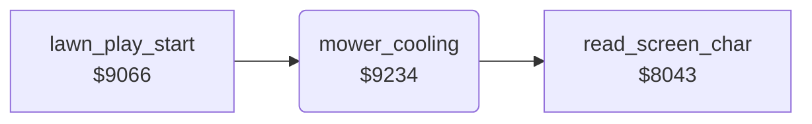

<!-- Generated by c64-docs from knowledge revision 20261025T214622.637-xq1idr and .c64-re-tools/local/generated/src/source-map.json. Do not edit: change the knowledge, generate the source again, then run docs.ts generate. -->
# status/mower_cooling.asm: Cooling of the mower

Range `$9234-$9282`. Source: [status/mower_cooling.asm](../../../../src/status/mower_cooling.asm). Index: [the reference](../../index.md).

## Routines

| Routine | Address | Reached from | Summary |
|---|---|---|---|
| [`mower_cooling`](mower_cooling.md#mower_cooling) | `$9234` | [`lawn_play_start`](../game/main_loop.md#lawn_play_start) | Every 192 calls ($3f), removes one step from the MOWER OVERLOAD scale on row 24 at column $2c. |

## Call graph

A solid arrow is a call, a thick arrow a table entry. Rounded nodes are in this file.

## Details

### [`mower_cooling`](../../../../src/status/mower_cooling.asm#L6) `$9234`

*routine*

Every 192 calls ($3f), removes one step from the MOWER OVERLOAD scale on row 24 at column $2c. When the column $2c goes down to $19, an overheated mower runs again.

- **Called from:** [`lawn_play_start`](../game/main_loop.md#lawn_play_start)
- **Calls:** [`read_screen_char`](../screen/screen_chars.md#read_screen_char)
- **Jumps to:** [`mow_square_done`](../lawn/mow_square.md#mow_square_done)
- **Reads:** [`cooldown_timer`](../../memory-map.md#cooldown_timer), [`overload_bar`](../../memory-map.md#overload_bar), [`mow_square_done`](../lawn/mow_square.md#mow_square_done), [`mown_grass_operand`](../lawn/mow_square.md#mown_grass_operand), [`screen_ptr`](../../memory-map.md#screen_ptr)
- **Writes:** [`cooldown_timer`](../../memory-map.md#cooldown_timer), [`cursor_row`](../../memory-map.md#cursor_row), [`cursor_col`](../../memory-map.md#cursor_col), [`overload_bar`](../../memory-map.md#overload_bar), [`VCREG3`](../../memory-map.md#VCREG3), [`mower_overheated`](../../memory-map.md#mower_overheated), [`SP0COL`](../../memory-map.md#SP0COL), [`dog_bit_gordon`](../../memory-map.md#dog_bit_gordon)
- **Refers to:** [`scale_chars`](scale_chars.md#scale_chars)

| Label | Address | Comment |
|---|---|---|
| [`cool_find_char`](../../../../src/status/mower_cooling.asm#L29) | `$924D` |  |
| [`cool_step_down`](../../../../src/status/mower_cooling.asm#L34) | `$9255` |  |
| [`cool_cell_empty`](../../../../src/status/mower_cooling.asm#L40) | `$925E` | The cell is empty. The column $2c moves one to the left, but not to $0f. |
| [`cool_test_restart`](../../../../src/status/mower_cooling.asm#L47) | `$9269` |  |
