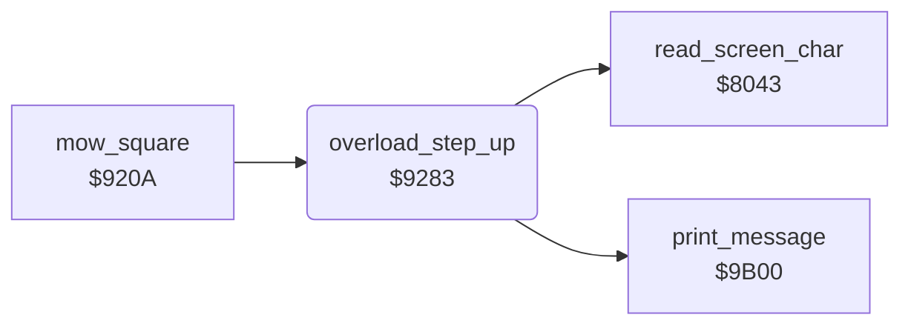

<!-- Generated by c64-docs from knowledge revision 20261024T102038.431-pgzet3 and .c64-re-tools/local/generated/src/source-map.json. Do not edit: change the knowledge, generate the source again, then run docs.ts generate. -->
# status/mower_overload.asm: Mower overload scale

Range `$9283-$92FC`. Source: [status/mower_overload.asm](../../../../src/status/mower_overload.asm). Index: [the reference](../../index.md).

## Call graph

A solid arrow is a call, a thick arrow a table entry, a dotted arrow a jump. Rounded nodes are in this file.

## Data

| Range | Type | Name | Read by | Written by |
|---|---|---|---|---|
| [`$92D9`](../../../../src/status/mower_overload.asm#L57)-`$92DA` | dual-use |  |  |  |

## Names

### [`overload_step_up`](../../../../src/status/mower_overload.asm#L6) `$9283`

*routine*

Adds one step to the MOWER OVERLOAD scale on row 24 at column $2c. It keeps A, X, Y, $02, $03 and $48/$49. When the dog does not attack ($1f31 is not 2), it starts the mower noise on voice 3 ($3d, $3c = $ff).

- **Called from:** [`mow_square`](../lawn/mow_square.md#mow_square) [`$9216`](../../../../src/lawn/mow_square.asm#L13), [`mow_square`](../lawn/mow_square.md#mow_square) [`$9219`](../../../../src/lawn/mow_square.asm#L14), [`mow_square`](../lawn/mow_square.md#mow_square) [`$9222`](../../../../src/lawn/mow_square.asm#L19)
- **Calls:** [`read_screen_char`](../screen/screen_chars.md#read_screen_char), [`print_message`](../text/messages.md#print_message)
- **Reads:** [`screen_ptr`](../../memory-map.md#screen_ptr), [`screen_ptr_hi`](../../memory-map.md#screen_ptr_hi), [`cursor_row`](../../memory-map.md#cursor_row), [`cursor_col`](../../memory-map.md#cursor_col), [`dog_mode`](../../memory-map.md#dog_mode), [`overload_bar`](../../memory-map.md#overload_bar), [`mow_square_done`](../lawn/mow_square.md#mow_square_done), [`scale_chars`](scale_chars.md#scale_chars), [`msg_mower_overheated`](../text/messages.md#msg_mower_overheated)
- **Writes:** [`VCREG3`](../../memory-map.md#VCREG3), [`mow_sound_on`](../../memory-map.md#mow_sound_on), [`sfx_pitch`](../../memory-map.md#sfx_pitch), [`cursor_row`](../../memory-map.md#cursor_row), [`cursor_col`](../../memory-map.md#cursor_col), [`overload_bar`](../../memory-map.md#overload_bar), [`mower_overheated`](../../memory-map.md#mower_overheated), [`screen_ptr_hi`](../../memory-map.md#screen_ptr_hi), [`screen_ptr`](../../memory-map.md#screen_ptr)
- **Refers to:** [`scale_chars`](scale_chars.md#scale_chars)

### [`overload_draw`](../../../../src/status/mower_overload.asm#L29) `$92AA`

*label*

- **Jumped to from:** [`overload_step_up`](mower_overload.md#overload_step_up) [`$9298`](../../../../src/status/mower_overload.asm#L21)

### [`overload_find_char`](../../../../src/status/mower_overload.asm#L38) `$92BB`

*label*

- **Jumped to from:** [`overload_step_up`](mower_overload.md#overload_step_up) [`$92C1`](../../../../src/status/mower_overload.asm#L42)

### [`overload_step`](../../../../src/status/mower_overload.asm#L43) `$92C3`

*label*

- **Jumped to from:** [`overload_step_up`](mower_overload.md#overload_step_up) [`$92BE`](../../../../src/status/mower_overload.asm#L40)

### [`overload_next_cell`](../../../../src/status/mower_overload.asm#L50) `$92CF`

*label*

The cell is full. The column $2c moves one to the right.

- **Jumped to from:** [`overload_step_up`](mower_overload.md#overload_step_up) [`$92B7`](../../../../src/status/mower_overload.asm#L36), [`overload_step_up`](mower_overload.md#overload_step_up) [`$92CA`](../../../../src/status/mower_overload.asm#L47)

### [`overload_restore`](../../../../src/status/mower_overload.asm#L65) `$92EC`

*label*

- **Jumped to from:** [`overload_step_up`](mower_overload.md#overload_step_up) [`$92CC`](../../../../src/status/mower_overload.asm#L48), [`overload_step_up`](mower_overload.md#overload_step_up) [`$92D5`](../../../../src/status/mower_overload.asm#L54)
