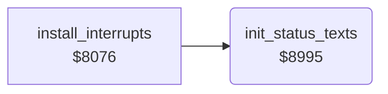

<!-- Generated by c64-docs from knowledge revision 20261025T214622.637-xq1idr and .c64-re-tools/local/generated/src/source-map.json. Do not edit: change the knowledge, generate the source again, then run docs.ts generate. -->
# status/status_texts.asm: Status texts of the two players

Range `$8995-$8A1D`. Source: [status/status_texts.asm](../../../../src/status/status_texts.asm). Index: [the reference](../../index.md).

## Routines

| Routine | Address | Reached from | Summary |
|---|---|---|---|
| [`init_status_texts`](status_texts.md#init_status_texts) | `$8995` | [`install_interrupts`](../irq/interrupts.md#install_interrupts), [`$827C`](../../../../src/game/start_game.asm#L7) | Copies the status text template ($89a6, 120 bytes = 3 screen rows) to the status buffers of player 1 at $4000 and player 2 at $4080. |

## Data

| Range | Type | Name | Read by | Written by |
|---|---|---|---|---|
| [`$89A6`](../../../../src/status/status_texts.asm#L18)-`$8A1D` | bytes | [`status_text_template`](../../../../src/status/status_texts.asm#L17) | [`init_status_texts`](status_texts.md#init_status_texts) |  |

## Call graph

A solid arrow is a call, a thick arrow a table entry. Rounded nodes are in this file.

## Details

### [`init_status_texts`](../../../../src/status/status_texts.asm#L6) `$8995`

*routine*

Copies the status text template ($89a6, 120 bytes = 3 screen rows) to the status buffers of player 1 at $4000 and player 2 at $4080.

- **Called from:** [`install_interrupts`](../irq/interrupts.md#install_interrupts), [`$827C`](../../../../src/game/start_game.asm#L7)
- **Writes:** [`status_p1`](../../memory-map.md#status_p1), [`status_p2`](../../memory-map.md#status_p2)

| Label | Address | Comment |
|---|---|---|
| [`init_status_copy`](../../../../src/status/status_texts.asm#L8) | `$8997` |  |

### [`status_text_template`](../../../../src/status/status_texts.asm#L17) `$89A6-$8A1D`

*data*

Status rows 22-24 (ASCII, the code ANDs with $3f): "DOG LOYALTY:", the scale, "0000000" (score), "DOG TOLERANCE:", the scale, "TOM'S", "MOWER OVERLOAD:", "MOWER".

- **Read by:** [`init_status_texts`](status_texts.md#init_status_texts)
