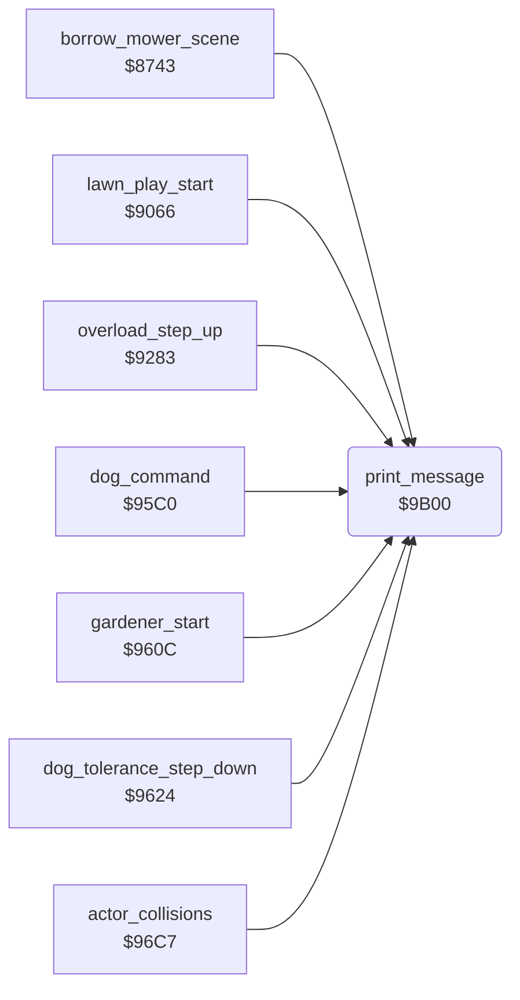

<!-- Generated by c64-docs from knowledge revision 20261025T214622.637-xq1idr and .c64-re-tools/local/generated/src/source-map.json. Do not edit: change the knowledge, generate the source again, then run docs.ts generate. -->
# text/messages.asm: Message printer and the messages of the game

Range `$9B00-$9D0A`. Source: [text/messages.asm](../../../../src/text/messages.asm). Index: [the reference](../../index.md).

## Routines

| Routine | Address | Reached from | Summary |
|---|---|---|---|
| [`print_message`](messages.md#print_message) | `$9B00` | [`borrow_mower_scene`](../game/borrow_mower_scene.md#borrow_mower_scene), [`lawn_play_start`](../game/main_loop.md#lawn_play_start), [`overload_step_up`](../status/mower_overload.md#overload_step_up), [`dog_command`](../dog/dog_command.md#dog_command), [`gardener_start`](../gardener/gardener_start.md#gardener_start), [`dog_tolerance_step_down`](../dog/dog_tolerance.md#dog_tolerance_step_down), [`actor_collisions`](../actors/actor_collision.md#actor_collisions), [`$97B6`](../../../../src/neighbour/neighbour_catch.asm#L12) | When the message timer $2f is not 0, it shows nothing. |

## Data

| Range | Type | Name | Read by | Written by |
|---|---|---|---|---|
| [`$9B47`](../../../../src/text/messages.asm#L55)-`$9B6F` | bytes | [`msg_borrow_jim`](../../../../src/text/messages.asm#L54) |  |  |
| [`$9B70`](../../../../src/text/messages.asm#L135)-`$9B98` | bytes | [`msg_borrow_tom`](../../../../src/text/messages.asm#L56) |  |  |
| [`$9B99`](../../../../src/text/messages.asm#L142)-`$9BC1` | bytes | [`msg_borrow_alf`](../../../../src/text/messages.asm#L57) |  |  |
| [`$9BC2`](../../../../src/text/messages.asm#L149)-`$9BEA` | bytes | [`msg_come_back`](../../../../src/text/messages.asm#L58) |  |  |
| [`$9BEB`](../../../../src/text/messages.asm#L156)-`$9C13` | bytes | [`msg_rover_kill`](../../../../src/text/messages.asm#L59) |  |  |
| [`$9C14`](../../../../src/text/messages.asm#L163)-`$9C3C` | bytes | [`msg_beastly_hound`](../../../../src/text/messages.asm#L60) |  |  |
| [`$9C3D`](../../../../src/text/messages.asm#L170)-`$9C65` | bytes | [`msg_gimme_mower`](../../../../src/text/messages.asm#L61) |  |  |
| [`$9C66`](../../../../src/text/messages.asm#L177)-`$9C8E` | bytes | [`msg_off_my_flowers`](../../../../src/text/messages.asm#L62) |  |  |
| [`$9C8F`](../../../../src/text/messages.asm#L184)-`$9CB7` | bytes | [`msg_dog_annoyed`](../../../../src/text/messages.asm#L63) |  |  |
| [`$9CB8`](../../../../src/text/messages.asm#L191)-`$9CE0` | bytes | [`msg_mower_overheated`](../../../../src/text/messages.asm#L64) | [`overload_step_up`](../status/mower_overload.md#overload_step_up) |  |
| [`$9CE1`](../../../../src/text/messages.asm#L198)-`$9D0A` | bytes | [`msg_hit_the_dog`](../../../../src/text/messages.asm#L65) |  |  |

## Call graph

A solid arrow is a call, a thick arrow a table entry. Rounded nodes are in this file.

## Details

### [`print_message`](../../../../src/text/messages.asm#L6) `$9B00`

*routine*

When the message timer $2f is not 0, it shows nothing. It sets $2f to $30. The interrupt clears row 21 when $2f gets to 0.
$0b/$0c points to the first message.

- **Called from:** [`borrow_mower_scene`](../game/borrow_mower_scene.md#borrow_mower_scene), [`lawn_play_start`](../game/main_loop.md#lawn_play_start), [`overload_step_up`](../status/mower_overload.md#overload_step_up), [`dog_command`](../dog/dog_command.md#dog_command), [`gardener_start`](../gardener/gardener_start.md#gardener_start), [`dog_tolerance_step_down`](../dog/dog_tolerance.md#dog_tolerance_step_down), [`actor_collisions`](../actors/actor_collision.md#actor_collisions), [`$97B6`](../../../../src/neighbour/neighbour_catch.asm#L12)
- **Reads:** [`message_timer`](../../memory-map.md#message_timer), [`work_count`](../../memory-map.md#work_count), [`work_temp`](../../memory-map.md#work_temp)
- **Writes:** [`work_count`](../../memory-map.md#work_count), [`work_temp`](../../memory-map.md#work_temp), [`message_row`](../../memory-map.md#message_row), `$DB48`, [`message_timer`](../../memory-map.md#message_timer)

| Label | Address | Comment |
|---|---|---|
| [`print_message_find`](../../../../src/text/messages.asm#L14) | `$9B0D` |  |
| [`print_message_skip`](../../../../src/text/messages.asm#L19) | `$9B13` | Skips one message: it finds the $ff at its end. |
| [`print_message_skip_next`](../../../../src/text/messages.asm#L27) | `$9B21` |  |
| [`print_message_skip_end`](../../../../src/text/messages.asm#L29) | `$9B24` |  |
| [`print_message_count`](../../../../src/text/messages.asm#L34) | `$9B2A` |  |
| [`print_message_copy`](../../../../src/text/messages.asm#L37) | `$9B2D` |  |
| [`print_message_char`](../../../../src/text/messages.asm#L39) | `$9B2F` |  |

### [`msg_borrow_jim`](../../../../src/text/messages.asm#L54) `$9B47-$9B6F`

*data*

Message 0: " JIM WON'T MIND IF I BORROW HIS MOWER...". $8743 shows messages 0 to 2 for the mower $20.

### [`msg_borrow_tom`](../../../../src/text/messages.asm#L56) `$9B70-$9B98`

*data*

Message 1: "     I'LL JUST NIP AND BORROW TOM'S!    ".

### [`msg_borrow_alf`](../../../../src/text/messages.asm#L57) `$9B99-$9BC1`

*data*

Message 2: "   GOOD OLD ALF! HE'S A DECENT CHAP!    ".

### [`msg_come_back`](../../../../src/text/messages.asm#L58) `$9BC2-$9BEA`

*data*

Message 3: "   COME BACK HERE WITH MY LAWNMOWER!!   ".

### [`msg_rover_kill`](../../../../src/text/messages.asm#L59) `$9BEB-$9C13`

*data*

Message 4: "ROVER.. KILL!! GO ON, BOY! SIEZE! KILL! ".

### [`msg_beastly_hound`](../../../../src/text/messages.asm#L60) `$9C14-$9C3C`

*data*

Message 5: "  AAARGH!  LAY OFF, YOU BEASTLY HOUND!  ".

### [`msg_gimme_mower`](../../../../src/text/messages.asm#L61) `$9C3D-$9C65`

*data*

Message 6: "           GIMME THAT MOWER!!           ". The code at $97ae shows it.

### [`msg_off_my_flowers`](../../../../src/text/messages.asm#L62) `$9C66-$9C8E`

*data*

Message 7: "    OI! OFF MY FLOWERS, YOU LUNATIC!    ".

### [`msg_dog_annoyed`](../../../../src/text/messages.asm#L63) `$9C8F-$9CB7`

*data*

Message 8: "  OH DEAR... THE DOG LOOKS ANNOYED...!  ".

### [`msg_mower_overheated`](../../../../src/text/messages.asm#L64) `$9CB8-$9CE0`

*data*

Message 9: "  OH RATS!.. THE MOWER HAS OVERHEATED!  ".

- **Read by:** [`overload_step_up`](../status/mower_overload.md#overload_step_up)

### [`msg_hit_the_dog`](../../../../src/text/messages.asm#L65) `$9CE1-$9D0A`

*data*

Message 10. Only the dead code at $977a prints it, so the game never shows it. It is 41 bytes, one more than the row.
