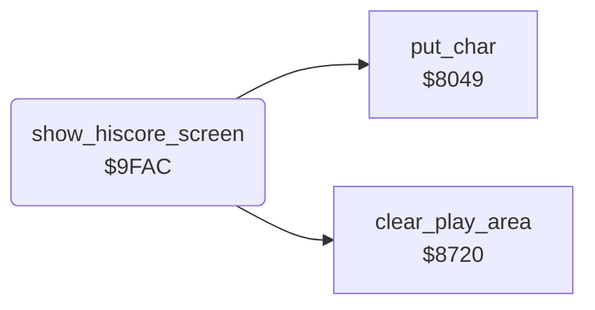

<!-- Generated by c64-docs from knowledge revision 20261025T214622.637-xq1idr and .c64-re-tools/local/generated/src/source-map.json. Do not edit: change the knowledge, generate the source again, then run docs.ts generate. -->
# title/attract_loop.asm: Attract loop and the high-score screen

Range `$9FA0-$9FFF`. Source: [title/attract_loop.asm](../../../../src/title/attract_loop.asm). Index: [the reference](../../index.md).

## Routines

| Routine | Address | Reached from | Summary |
|---|---|---|---|
| [`attract_loop`](attract_loop.md#attract_loop) | `$9FA0` | [`$8233`](../../../../src/init/game_init.asm#L27) | The cold start at $81ff jumps here. |
| [`attract_hiscores`](attract_loop.md#attract_hiscores) | `$9FA6` | [`init_hiscores`](../scores/hiscores.md#init_hiscores) | hiscore_done enters the loop here. |
| [`show_hiscore_screen`](attract_loop.md#show_hiscore_screen) | `$9FAC` |  | Clears the lawn area and writes "MEGA  MOWER  MANIACS" from $7cca in row 2 in yellow. |

## Data

| Range | Type | Name | Read by | Written by |
|---|---|---|---|---|
| [`$9FD5`](../../../../src/title/attract_loop.asm#L49)-`$9FDF` | unused |  |  |  |
| [`$9FE0`](../../../../src/title/attract_loop.asm#L79)-`$9FFA` | unused |  |  |  |
| [`$9FFB`](../../../../src/title/attract_loop.asm#L81)-`$9FFF` | bytes |  |  |  |

## Call graph

A solid arrow is a call, a thick arrow a table entry. Rounded nodes are in this file.

## Details

### [`attract_loop`](../../../../src/title/attract_loop.asm#L6) `$9FA0`

*label*

The cold start at $81ff jumps here. $8658 leaves the loop to the setup screen when the fire button is down.

- **Jumped to from:** [`$8233`](../../../../src/init/game_init.asm#L27), [`$9FA9`](../../../../src/title/attract_loop.asm#L11)

### [`attract_hiscores`](../../../../src/title/attract_loop.asm#L9) `$9FA6`

*label*

hiscore_done enters the loop here.

- **Jumped to from:** [`init_hiscores`](../scores/hiscores.md#init_hiscores)

### [`show_hiscore_screen`](../../../../src/title/attract_loop.asm#L13) `$9FAC`

*routine*

Clears the lawn area and writes "MEGA  MOWER  MANIACS" from $7cca in row 2 in yellow. Then it jumps to $7c00, which shows the table.

- **Called from:** [`$9FA6`](../../../../src/title/attract_loop.asm#L10)
- **Calls:** [`clear_play_area`](../screen/clear_play_area.md#clear_play_area), [`put_char`](../screen/screen_chars.md#put_char)
- **Jumps to:** [`show_high_scores`](../scores/high_score_screen.md#show_high_scores)
- **Reads:** [`text_mega_mower_maniacs`](../scores/high_score_screen.md#text_mega_mower_maniacs), [`work_ptr3_hi`](../../memory-map.md#work_ptr3_hi), [`cursor_col`](../../memory-map.md#cursor_col)
- **Writes:** [`cursor_row`](../../memory-map.md#cursor_row), [`cursor_col`](../../memory-map.md#cursor_col), [`cursor_colour`](../../memory-map.md#cursor_colour), [`cursor_char`](../../memory-map.md#cursor_char), [`work_ptr3_hi`](../../memory-map.md#work_ptr3_hi)

| Label | Address | Comment |
|---|---|---|
| [`hiscore_title_loop`](../../../../src/title/attract_loop.asm#L22) | `$9FBD` |  |
