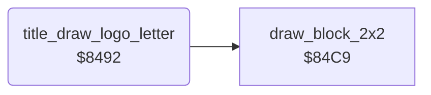

<!-- Generated by c64-docs from knowledge revision 20261024T102038.431-pgzet3 and .c64-re-tools/local/generated/src/source-map.json. Do not edit: change the knowledge, generate the source again, then run docs.ts generate. -->
# title/title_logo.asm: Title logo letters

Range `$8492-$84C8`. Source: [title/title_logo.asm](../../../../src/title/title_logo.asm). Index: [the reference](../../index.md).

## Call graph

A solid arrow is a call, a thick arrow a table entry, a dotted arrow a jump. Rounded nodes are in this file.

## Names

### [`title_draw_logo_letter`](../../../../src/title/title_logo.asm#L6) `$8492`

*routine*

Draws the logo letter of the column $02 - 4 at row 3 in yellow, when title_logo_letters has one there. Then sets $02 back, $03 to row 6, $04 to the mown grass $59 and $05 to green.

- **Called from:** [`$8413`](../../../../src/title/title_mower.asm#L35)
- **Calls:** [`draw_block_2x2`](../screen/draw_block.md#draw_block_2x2)
- **Reads:** [`cursor_col`](../../memory-map.md#cursor_col), [`work_temp`](../../memory-map.md#work_temp), [`title_logo_letters`](logo_letters.md#title_logo_letters)
- **Writes:** [`work_temp`](../../memory-map.md#work_temp), [`cursor_col`](../../memory-map.md#cursor_col), [`cursor_row`](../../memory-map.md#cursor_row), [`cursor_colour`](../../memory-map.md#cursor_colour), [`cursor_char`](../../memory-map.md#cursor_char)

### [`title_logo_draw`](../../../../src/title/title_logo.asm#L17) `$84A4`

*label*

- **Jumped to from:** [`title_draw_logo_letter`](title_logo.md#title_draw_logo_letter) [`$849D`](../../../../src/title/title_logo.asm#L13)

### [`title_logo_restore`](../../../../src/title/title_logo.asm#L27) `$84B8`

*label*

- **Jumped to from:** [`title_draw_logo_letter`](title_logo.md#title_draw_logo_letter) [`$84B3`](../../../../src/title/title_logo.asm#L25)
