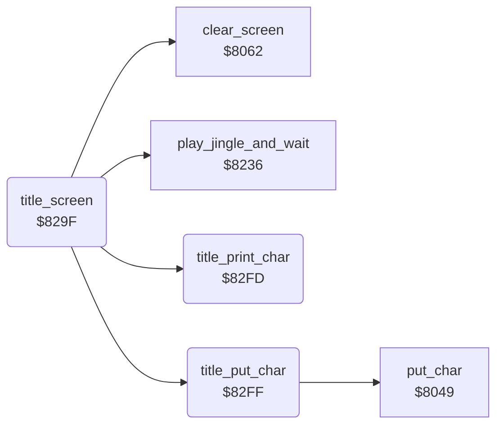

<!-- Generated by c64-docs from knowledge revision 20261024T102038.431-pgzet3 and .c64-re-tools/local/generated/src/source-map.json. Do not edit: change the knowledge, generate the source again, then run docs.ts generate. -->
# title/title_screen.asm: Title screen

Range `$829F-$830C`. Source: [title/title_screen.asm](../../../../src/title/title_screen.asm). Index: [the reference](../../index.md).

## Call graph

A solid arrow is a call, a thick arrow a table entry, a dotted arrow a jump. Rounded nodes are in this file.

## Names

### [`title_screen`](../../../../src/title/title_screen.asm#L6) `$829F`

*routine*

Title screen. Clears the screen, sets a black border and background and the charset at $2000. Writes the credit texts column by column: rows 1, 8, 10, 12 and 22. Fills row 6 with the grass character $58. Plays the jingle and waits, then the mower mows the logo.

- **Called from:** [`$9FA3`](../../../../src/title/attract_loop.asm#L8)
- **Calls:** [`clear_screen`](../screen/screen_chars.md#clear_screen), [`title_print_char`](title_screen.md#title_print_char), [`title_put_char`](title_screen.md#title_put_char), [`play_jingle_and_wait`](../music/tune_start.md#play_jingle_and_wait)
- **Jumps to:** [`title_mow_logo`](title_mower.md#title_mow_logo)
- **Reads:** [`text_title_presents`](../text/title_credits.md#text_title_presents), [`text_title_music`](../text/title_credits.md#text_title_music), [`text_title_programmer`](../text/title_credits.md#text_title_programmer), [`text_title_design`](../text/title_credits.md#text_title_design), [`text_title_copyright`](../text/title_credits.md#text_title_copyright), [`cursor_col`](../../memory-map.md#cursor_col)
- **Writes:** [`EXTCOL`](../../memory-map.md#EXTCOL), [`BGCOL0`](../../memory-map.md#BGCOL0), [`VMCSB`](../../memory-map.md#VMCSB), [`cursor_col`](../../memory-map.md#cursor_col), [`cursor_row`](../../memory-map.md#cursor_row), [`cursor_colour`](../../memory-map.md#cursor_colour)

### [`title_text_column`](../../../../src/title/title_screen.asm#L16) `$82B5`

*label*

- **Jumped to from:** [`title_screen`](title_screen.md#title_screen) [`$82F5`](../../../../src/title/title_screen.asm#L44)

### [`title_print_char`](../../../../src/title/title_screen.asm#L48) `$82FD`

*routine*

Changes the text character in A to a screen code (AND #$3f), then continues in title_put_char.

- **Called from:** [`title_screen`](title_screen.md#title_screen) [`$82C0`](../../../../src/title/title_screen.asm#L22), [`title_screen`](title_screen.md#title_screen) [`$82D7`](../../../../src/title/title_screen.asm#L32), [`title_screen`](title_screen.md#title_screen) [`$82DD`](../../../../src/title/title_screen.asm#L34), [`title_screen`](title_screen.md#title_screen) [`$82E3`](../../../../src/title/title_screen.asm#L36), [`title_screen`](title_screen.md#title_screen) [`$82ED`](../../../../src/title/title_screen.asm#L40)

### [`title_put_char`](../../../../src/title/title_screen.asm#L51) `$82FF`

*routine*

Writes the screen code in A with the colour $05 at column $02, row $03. Then moves 2 rows down ($03 + 2). Keeps X.

- **Called from:** [`title_screen`](title_screen.md#title_screen) [`$82CD`](../../../../src/title/title_screen.asm#L28)
- **Calls:** [`put_char`](../screen/screen_chars.md#put_char)
- **Reads:** [`work_ptr`](../../memory-map.md#work_ptr), [`cursor_row`](../../memory-map.md#cursor_row)
- **Writes:** [`cursor_char`](../../memory-map.md#cursor_char), [`work_ptr`](../../memory-map.md#work_ptr), [`cursor_row`](../../memory-map.md#cursor_row)
