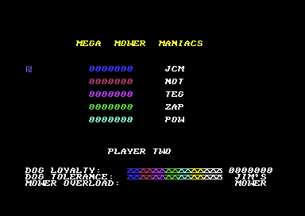
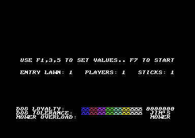
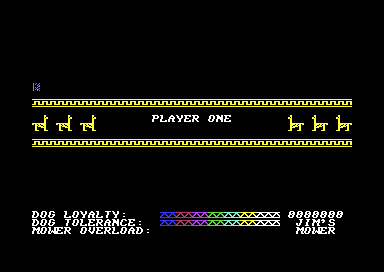
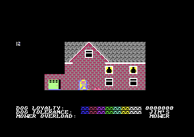
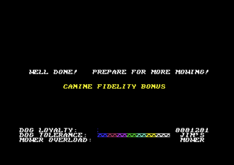

# The screens

Hover Bovver shows a set of screens around the play. The title shows the credits, and a mower mows the logo into a line of grass. Then a llama and Gordon walk across the screen, and the best scores follow. Fire opens the setup screen, and F7 starts the game. Before each turn, the game names the player, and Gordon borrows a mower from a neighbour. During the play, three status rows and one message row tell the player what happens. At the end, the game shows GAME OVER and asks for the initials of a new high score.

**Conventions.**
- Addresses are C64 addresses. Names are the names of the knowledge.
- The screen is at `$0400` with the charset at `$2000` (`$D018` = `$18`). A *row* is a text row 0-24, a *column* is a text column 0-39.
- The *play area* is the rows 0-21: the lawn in the rows 0-20 and the *message row* 21. The *status rows* are the rows 22-24.
- A *delay step* is one call of `attract_check_fire` or `restart_tune_if_ended` in a wait loop. Both keep the main tune going.
- The *lender* is the neighbour who lends the mower: 1 Jim, 2 Tom, 3 Alf. `mower_lender` holds the number.
- **Observed** marks a fact that a run showed. **Code** marks a fact from the code only. **Conclusion** marks an interpretation.

## How it works

The program starts at [`cold_start` `$8000`](../src/init/cold_start.asm#L6). It copies the graphics into place and prepares the game. Then the attract loop shows the title and the high scores until a player presses fire (**Code**).

~~~mermaid
flowchart TB
  A["Copy the charset and the sprites (copy_graphics)"] --> B["Row tables, high scores, interrupts, SID (game_init)"]
  B --> C["Clear the play area"]
  C --> D["Title: credits, jingle, the mower mows the logo"]
  D --> E["Walk: the llama and Gordon"]
  E --> F["High-score screen: MEGA MOWER MANIACS"]
  F --> C
  D -->|fire| G["Setup screen"]
  E -->|fire| G
  F -->|fire| G
  G -->|F7| H["Player intro, borrow scene, play"]
~~~

1. **The copy of the graphics.** `cold_start` calls [`copy_graphics` `$7E00`](../src/init/copy_graphics.asm#L6). The name says unpack, but the routine only copies. It moves `$6400-$6BFF` to `$2000-$27FF` and the 64 sprites `$6C00-$7BFF` to `$3000-$3FFF`. The upper half of that charset copy is the assembler leftover, characters 128-255, which the game does not use. Last, the routine writes `$80` to `$0291`, so SHIFT and C= do not change the case (**Code**).
2. **The preparation.** [`game_init` `$81FF`](../src/init/game_init.asm#L6) builds the tables of the row addresses and copies the initial high scores to `$4C01`. It installs the interrupt, sets the envelopes of the SID voices, and selects player 1, lender 1, joystick port 1 and music on (**Code**).
3. **The attract loop.** [`attract_loop` `$9FA0`](../src/title/attract_loop.asm#L6) clears the play area, runs the title and then the high-score screen. Then it starts again. Each delay step of these screens calls `attract_check_fire`. Fire jumps to the setup screen from any depth, and the setup screen resets the stack (**Code**).

A run started at `$8000` and ran the attract loop for 9000 frames with no input (**Observed**).

## The title

The title after the mower: the credits, the HOVER BOVVER logo and the mown grass line.

[`title_screen` `$829F`](../src/title/title_screen.asm#L6) clears the screen and sets a black border and background. It writes five texts of 40 characters, one column at a time (**Code**):

| Row | Text | Colour |
|---|---|---|
| 1 | LLAMASOFT PRESENTS... JEFF MINTER'S | white |
| 6 | a line of grass, character `$58` | green |
| 8 | MUSICAL ARRANGEMENTS BY JAMES LISNEY | white |
| 10 | GAME PROGRAMMED BY JEFF MINTER | white |
| 12 | GAME DESIGN BY P.K. AND J.C. MINTER | white |
| 22 | © 1983 LLAMASOFT SOFTWARE | white |

The text has `@` for the copyright sign. The code ANDs each character with `$3F`, and `@` becomes screen code 0, the copyright sign of the charset (**Code**).

Then the title plays the jingle and waits until it ends. Next, [`title_mow_logo` `$83D5`](../src/title/title_mower.asm#L6) moves Gordon and the mower from left to right along row 6. Gordon is sprite 0 with the frames `$C0-$C4`. The mower is sprite 1 with frame `$C5`, 24 pixels in front of him (**Code**).

At each column, the mower changes the grass `$58` into mown grass `$59`. `title_draw_logo_letter` then looks 4 columns back. When `title_logo_letters` has a letter for that column, it draws the letter as a 2 x 2 block at the rows 3-4 in yellow. The letters H, O, V, E and R are at the columns 2-15, and B, O, V, V, E and R at the columns 20-36. Thus the mower seems to leave the logo behind it (**Code**).

### The llama walk

[`title_walk_scene` `$8511`](../src/title/title_walk.asm#L6) is the second part of the title. A llama (sprite 1, frames `$CC-$CF`) enters from the left at the bottom of the screen. Gordon (sprite 0, frames `$C7-$CB`) enters from the right. Sprite 2 with frame `$D0` then shows for a time. In the sprite image of the reference, frame `$D0` is a heart (**Code**). Then the llama walks on to the right, and Gordon follows it off the screen (**Code**).

At the end, the routine waits until `music_playing` is 0. The main tune started after the jingle, so the title lasts until the main tune ends (**Code**). The main tune has 1057 tune steps, about 63 seconds on a PAL C64 (**Conclusion**).

## The high-score screen

The high-score screen with the five initial entries.

[`show_hiscore_screen` `$9FAC`](../src/title/attract_loop.asm#L13) clears the play area and writes "MEGA  MOWER  MANIACS" at row 2, column 8, in yellow. Then it jumps to [`show_high_scores` `$7C00`](../src/scores/high_score_screen.asm#L6) (**Code**).

The table at `$4C01` has 5 entries of 10 bytes: 7 score digits and 3 initials, all as screen codes. `show_high_scores` writes the entries at the rows 6, 8, 10, 12 and 14. The score is at column 10 in the colour of its place: blue, red, purple, green and cyan. The initials are at column 22 in white (**Code**).

Then the screen shows the status rows of the last game 8 times, with a long delay. Each time, it writes "PLAYER ONE" or "PLAYER TWO" at row 19, column 13. With two players, the rounds change between the players (**Code**).

`init_hiscores` fills the table at the cold start with the scores 0000000 and the initials JCM, NOT, TEG, ZAP and POW. No code saves the table, so a reset loses it (**Code**).

## The setup screen

The setup screen with the default values.

[`setup_screen` `$7CDE`](../src/setup/setup_screen.asm#L6) writes two lines in white at column 1. Row 10 has "USE F1,3,5 TO SET VALUES.. F7 TO START". Row 13 has "ENTRY LAWN: 1   PLAYERS: 1   STICKS: 1" (**Code**).

| Key | Value | Range | Screen address of the digit |
|---|---|---|---|
| F1 | Entry lawn | 1-8, then 1 again | `$0615` |
| F3 | Players | 1-2 | `$0622` |
| F5 | Sticks | 1-2 | `$062E` |
| F7 | Start the game | | |

The digits on the screen are the only copy of the values. Each key increments a screen code. F7 reads the three digits back and subtracts `$30`. It stores them in `lawn_number`, `player_count` and `stick_count`, then jumps to [`start_game` `$827C`](../src/game/start_game.asm#L6) (**Code**).

The screen reads the KERNAL key code `LSTX` once after each delay of `$20` x 256 delay steps. A key that stays down thus repeats after each delay (**Code**). The setup run presses F1 nine times, F3 and F5 two times each, and then F7 (**Observed**).

With two sticks, player 2 uses joystick port 2. `switch_player` changes the port at each change of player (**Code**).

## The player intro

The intro of player 1, before the jingle.

`start_game` copies the status template for both players and clears both player states. Then each player gets lender 1 and the entry lawn (**Code**).

[`player_turn_intro` `$8672`](../src/game/player_turn.asm#L15) clears the play area and draws the status rows of the player. It draws a line of character `$6A` in yellow across the rows 8 and 13. Between the lines, it draws three 2 x 2 blocks at the left and three at the right of row 10. "PLAYER ONE" or "PLAYER TWO" is at row 10, column 15, in white. Then it plays the jingle, waits until it ends, and starts the main tune (**Code**).

## The borrow scene

The borrow scene of Jim: the house, the doors, and Gordon with the mower.

Each mower starts with a short scene. [`borrow_mower_scene` `$8743`](../src/game/borrow_mower_scene.asm#L6) shows the message of the lender on row 21, for example " JIM WON'T MIND IF I BORROW HIS MOWER...". Then it draws the house of the lender in multicolour text mode, with grey and white as the background colours 1 and 2 (**Code**).

The house has walls of character `$5A` in the rows 12-17, a roof of 5 rows from row 6 and two pairs of windows. A table gives 8 bytes for each lender. They hold the roof column, the window places, two sprite colours and the X position of the door. Thus Jim, Tom and Alf each have a house of their own (**Code**).

Sprite 4 shows the front door (frame `$D2`) at the X position of the lender. Sprites 0 and 3 (frames `$D1` and `$D3`) stand at the left side. Gordon (sprite 1, frames `$C7-$CB`) walks from the right to the left side. Then he walks back to the right with the mower (sprite 2, frame `$C5`) 12 units in front of him. The routine returns, and `setup_lawn` draws the lawn (**Code**).

After a lost mower, `next_mower` shows the borrow scene of the next lender. Then `restore_lawn` puts back the saved lawn (**Code**).

## The status rows

The status rows show the three scales, the score and the mower of the player. `load_player_and_draw_status` draws them from the buffer of the player: `$4000` for player 1, `$4080` for player 2. The buffer is 120 characters, the rows 22-24 in white (**Code**).

| Row | Columns 0-15 | Columns 16-30 | Columns 32-38 |
|---|---|---|---|
| 22 | DOG LOYALTY: | scale, full at the start | the score, 7 digits |
| 23 | DOG TOLERANCE: | scale, full at the start | the lender name and 'S, for example JIM'S |
| 24 | MOWER OVERLOAD: | scale, empty at the start | MOWER |

Each scale has 15 cells, and each cell has 8 steps. `scale_chars` gives the characters of a cell: `$20` (empty), `$2A`, `$29`, `$28`, `$26`, `$25`, `$24`, `$23` and `$22` (full). The zero-page bytes `loyalty_bar`, `tolerance_bar` and `overload_bar` hold the column of the active cell. Column `$0F` is an empty scale and `$1E` a full scale (**Code**).

The colour RAM gives each cell its colour. DOG LOYALTY and DOG TOLERANCE go from blue through red, purple, green, cyan and yellow to white, two cells for each colour. MOWER OVERLOAD has 5 green, 5 yellow and 5 red cells (**Code**).

The score is 7 screen codes at `$0790-$0796`, not a number. `score_add` increments one digit and carries into the digit on its left. `save_player_state` copies the rows 22-24 into the buffer of the player. Thus the screen holds the score during the play, and the buffer holds it between the turns (**Code**).

## The message row

The game talks to the player on row 21. [`print_message` `$9B00`](../src/text/messages.asm#L6) gets the number of the message in X. It skips X texts from `$9B47`, each with an `$FF` at its end. Then it copies 40 characters to row 21 in yellow and sets `message_timer` to `$30` (**Code**).

The interrupt decrements `message_timer` at each tune step, every 3 frames. At 0 it clears row 21. Thus a message stays for 48 tune steps, about 2.9 seconds on a PAL C64 (**Conclusion**). While the timer runs, `print_message` shows no new message. `actor_catches_gordon` clears the timer first, so "GIMME THAT MOWER!!" always shows (**Code**).

| Number | Text | When |
|---|---|---|
| 0 | JIM WON'T MIND IF I BORROW HIS MOWER... | Borrow scene, lender 1 |
| 1 | I'LL JUST NIP AND BORROW TOM'S! | Borrow scene, lender 2 |
| 2 | GOOD OLD ALF! HE'S A DECENT CHAP! | Borrow scene, lender 3 |
| 3 | COME BACK HERE WITH MY LAWNMOWER!! | Start of the play on a lawn |
| 4 | ROVER.. KILL!! GO ON, BOY! SIEZE! KILL! | Fire, with DOG LOYALTY left |
| 5 | AAARGH!  LAY OFF, YOU BEASTLY HOUND! | Rover catches the neighbour |
| 6 | GIMME THAT MOWER!! | The neighbour catches Gordon |
| 7 | OI! OFF MY FLOWERS, YOU LUNATIC! | Gordon mows flowers, and the gardener comes |
| 8 | OH DEAR... THE DOG LOOKS ANNOYED...! | DOG TOLERANCE becomes empty |
| 9 | OH RATS!.. THE MOWER HAS OVERHEATED! | MOWER OVERLOAD gets to column `$1F` |
| 10 | DAMNATION!! I'VE HIT THE DOG! | Never: only dead code at `$977A` prints it |

Messages 0-9 have 40 characters each. Message 10 has 41 characters, one more than the row. The jump at `$976E` goes past the code that prints it (**Code**).

## The end of a lawn

The end of a lawn: WELL DONE! and the canine fidelity bonus.

When the grass counter is 0 and Gordon is on a square, `gordon_move` jumps to [`lawn_complete` `$99C5`](../src/lawn/lawn_complete.asm#L6). The routine does these steps (**Code**):

1. `lawn_complete_sound` plays 6 rising sweeps on voice 3. At each step, background colour 2 changes, so the lawn flashes.
2. `save_lawn_scroll_out` moves the lawn to the left, one row at a time, and keeps it in the memory of the player.
3. It writes "WELL DONE!   PREPARE FOR MORE MOWING!" at row 10, column 2. "WELL DONE!" then changes through all colours, and voice 3 follows the colour counter.
4. When DOG LOYALTY is not empty, [`fidelity_bonus` `$9A34`](../src/lawn/lawn_complete.asm#L68) writes "CANINE FIDELITY BONUS" at row 13 in yellow. Each step of DOG LOYALTY gives 10 x the lawn number in points, with a rising tone. The scale loses one step at a time until it is empty.
5. `next_lawn` increments `lawn_number`, saves and loads the player state, resets the stack and jumps to `setup_lawn`.

## Game over and the high-score entry

The game ends with the last mower. With one player, `next_mower` ends the game when `mower_lender` gets to 4. With two players, `switch_player` ends it only when player 2 loses the third mower. The players change after each lost mower, so player 1 loses the third mower first (**Code**).

[`game_over` `$9D37`](../src/game/game_over.asm#L6) writes "GAME OVER" at column 15 of each row from 0 to 20, one row at a time. Each row has the next colour of `cycle_colours`, and each row plays a falling tone on voice 3. Then it clears the columns 13-29 row by row, with the same tone. Then it jumps to `hiscore_check` (**Code**).

[`hiscore_check` `$9DDA`](../src/scores/hiscores.asm#L16) compares the score of player 1 with each entry, from the top. The first entry with a lower score gets the place. A score that is equal to an entry does not get in. The lower entries move one place down, and the last entry is lost. With two players, player 2 follows (**Code**).

For a new entry, the screen shows "PLAYER ONE" or "PLAYER TWO" at row 10 and "ENTER YOUR INITIALS:  AAA" at row 13. [`enter_initials` `$9F02`](../src/scores/hiscores.asm#L175) then reads the joystick (**Code**):

- Left and right change the current letter, which is cyan. The letters are `@` and A-Z, and they wrap at both ends.
- Fire stores the letter, plays 6 rising sweeps on voice 3 and makes the letter white.
- After three letters, the next player follows, or the high-score screen.

Player 2 with two sticks uses port 2 for the entry. The letter `@` is screen code 0, the copyright sign. Thus a player can enter the copyright sign as an initial (**Conclusion**).

The events run wrote a score of 9000 into the first entry during the play. At the game over, the score of the player went into the table below that entry, and the run entered the initials with fire (**Observed**).

## The state machine of the screens

The program has no state variable for the screens. Each routine jumps to the next screen. [`main_loop` `$9082`](../src/game/main_loop.asm#L21) runs the play (**Code**).

~~~mermaid
stateDiagram-v2
  state "Title and walk" as Title
  state "High-score screen" as Scores
  state "Setup screen" as Setup
  state "Player intro" as Intro
  state "Borrow scene" as Borrow
  state "Play" as Play
  state "End of a lawn" as Done
  state "Mower lost" as Lost
  state "Game over" as Over
  state "Initials" as Initials
  [*] --> Title
  Title --> Scores: tune ends
  Scores --> Title: 8 rounds end
  Title --> Setup: fire
  Scores --> Setup: fire
  Setup --> Intro: F7
  Intro --> Borrow: jingle ends
  Borrow --> Play
  Play --> Done: grass counter 0
  Done --> Play: next lawn
  Play --> Lost: the neighbour catches Gordon
  Lost --> Borrow: one player, mower left
  Lost --> Intro: two players
  Lost --> Over: last mower
  Over --> Initials: new high score
  Over --> Scores: no new high score
  Initials --> Scores
~~~

| State | Condition | Next state | Code |
|---|---|---|---|
| Title and walk | The main tune ends | High-score screen | `title_walk_scene` |
| High-score screen | 8 rounds of the status rows end | Title and walk | `attract_loop` |
| Title or high scores | Fire | Setup screen | `attract_check_fire` |
| Setup screen | F7 | Player intro | `start_game` |
| Player intro | The jingle ends | Borrow scene | `player_turn_intro` |
| Borrow scene | Gordon is back at the right with the mower | Play | `setup_lawn` |
| Play | Grass counter 0, Gordon on a square | End of a lawn | `gordon_move` |
| End of a lawn | The bonus ends | Play on the next lawn | `next_lawn` |
| Play | The neighbour catches Gordon | Mower lost | `actor_catches_gordon` |
| Mower lost | One player, `mower_lender` below 4 | Borrow scene | `next_mower` |
| Mower lost | Two players, not the end | Player intro of the other player | `switch_player` |
| Mower lost | Last mower | Game over | `next_mower`, `switch_player` |
| Game over | A score above an entry | Initials | `hiscore_check` |
| Game over | No new entry | High-score screen | `hiscore_done` |
| Initials | Three letters, last player | High-score screen | `hiscore_done` |

## Still open

- The runs did not show the heart frame `$D0` on the screen in a checkpoint. A screen capture during the walk can show it.
- The meaning of the sprites `$D1` and `$D3` at the left side of the borrow scene is not known. A screen capture of the borrow scene can show it.
- No run made a high score with two players. A recording with two players and two sticks can show the entry of player 2 on port 2.

The reference has each routine: [title](reference/modules/title/title_screen.md), [walk](reference/modules/title/title_walk.md), [setup](reference/modules/setup/setup_screen.md), [high scores](reference/modules/scores/hiscores.md), [borrow scene](reference/modules/game/borrow_mower_scene.md), [status rows](reference/modules/status/draw_status.md), [messages](reference/modules/text/messages.md).
