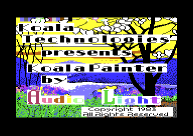

# How Koala Painter was made

This page tells what the program shows about its development. The facts come from the code of the two builds, from the leftovers in each build and from the title file. The page compares v1 (the Mayday! release) and v2 (the TBC and MAM builds) byte by byte where it helps.

**Conventions.**
- Addresses are C64 addresses. Names are the names of the knowledge of each version, with the label of the version, for example `v1:FLASHEM`.
- A *leftover* is a range of bytes that the program does not use. Only `LEFTOVERS = 1` builds it in the source.
- An *op* is an opcode of the script interpreter. The [script page](../v2/docs/scripts.md) of v2 explains the interpreter.
- **Observed** marks a fact that a run showed. **Code** marks a fact from the code only. **Conclusion** marks an interpretation.

## The authors and the two builds

The title picture of the file KTITLE gives the authors: "Koala Technologies presents KoalaPainter by Audio Light, Copyright 1983, All Rights Reserved". The program has no other credit text and no version text (**Code**).



The two builds come from one source. The names of the routines are the same in both knowledges, but the addresses are different. The code of v1 is 3 to 351 bytes lower than the same code in v2. An example is the flash code of the menu: `v1:SETFLASH` is at `$0CC5`, and `v2:SETFLASH` is at `$0CC8` (**Code**).

| Build | Origin of the bytes | Files | Copy protection |
|---|---|---|---|
| v1 | Mayday! 2023, from a G64 image of an original disk | one packed file, program at `$0900-$7F3F` | block reads of track 33, sectors 5 and 6 |
| v2 | the cracks of TBC and MAM, 1984 | KTITLE `$5718-$7F43`, KMAIN `$0900-$4838` (TBC) | `U1` reads of track 1, sectors 1 and 2 |

The two disks have different protection schemes (**Code**). **Conclusion**: the two builds come from two different productions of the original disk. Koala Technologies thus sold at least two builds, and the disk of 2023 holds the older build.

## The symbol-table fragments

Each build has a part of a symbol table after the end of its program. Nothing in the program reads these bytes (**Code**). The bytes give names from the source of the authors, and the knowledge of both builds uses some of them.

### The format of an entry

An entry has four fields. The first byte is the length of the entry, and the length counts all fields. Then the name follows in upper-case ASCII, then the 16-bit value (low byte first), then one zero byte (**Code**).

The first entry of v1 starts at `$4571` with its name. The byte before it, at `$4570`, is the last byte of the opcode table [`v1:script_ops` `$4525`](../v1/src/script/opcode_table.asm#L6). The next entries are complete:

```text
$4570  42                         last byte of script_ops (no length byte for COLORCHK)
$4571  43 4F 4C 4F 52 43 48 4B    "COLORCHK"
$4579  B6 0C                      value $0CB6
$457B  00                         zero byte
$457C  0C                         length 12 = 1 + 8 + 2 + 1
$457D  4E 4F 54 43 4F 4C 4F 52    "NOTCOLOR"
$4585  BE 0C                      value $0CBE
$4587  00                         zero byte
$4588  0A                         length 10 = 1 + 6 + 2 + 1
$4589  4E 45 57 54 4F 47          "NEWTOG", value $0CBF follows
```

The values of v1 grow from entry to entry. NOTCOLOR comes before NEWTOG, so the order is not alphabetic. **Conclusion**: the assembler adds each name to the table when the source defines it.

### The names of v1

The fragment of v1 at `$4571-$462A` has 13 entries. The values are the addresses of the flash code of the menu in v1. This code paints the cell of the current tool in the menu, and changes its colour between black and red (**Code**). The [menu page](../v2/docs/menu.md) of v2 explains the flash.

| Name | v1 value | v2 address | What the code at the address does |
|---|---|---|---|
| COLORCHK | `$0CB6` | `$0CB9` | selects a colour for an item code of `$40` or more (not reached) |
| NOTCOLOR | `$0CBE` | `$0CC1` | the RTS of COLORCHK |
| NEWTOG | `$0CBF` | `$0CC2` | a command item: SETFLASH, then the hit test again |
| SETFLASH | `$0CC5` | `$0CC8` | sets the chosen command and turns the flash on |
| FLASHEM | `$0CED` | `$0CF0` | changes the flash colour, the interrupt calls it |
| FLSHTOBL | `$0CFC` | `$0CFF` | sets the flash colour to 0 |
| DOFLASH | `$0D01` | `$0D04` | paints the three flash cells |
| ONLSTFX | `$0D0A` | `$0D0D` | paints the cell of the current command |
| ONLSTFX1 | `$0D0D` | `$0D10` | paints the cell of the index in A |
| MIRRED | `$0D1D` | `$0D20` | paints the Mirror cell |
| SETFLDNZ | `$0D27` | `$0D2A` | the Mirror cell with colour 0 |
| FLSHERA | `$0D2C` | `$0D2F` | paints the cell of the `Erase` tool |
| NEFLS... | | | damaged entry |

Each value is the address of an instruction in v1, and the code at that address fits the name. In v2 the same code is 3 bytes higher (**Code**). Thus the table comes from an assembly with the v1 layout in this part of the program (**Conclusion**). The knowledge of both builds uses the 12 complete names as labels.

The last entry has the length `$0A`, so its name has 6 characters. After "NEFLS" the bytes are `$7F` and `$FF`, then only zero bytes. `$7F` is not a letter, so the end of the entry has wrong bytes (**Code**).

### The names of v2

The fragment of v2 at `$46D0` starts directly after the opcode table [`v2:script_ops` `$4684`](../v2/src/script/opcode_table.asm#L6). It has the entries CR11 `$00BA`, CR12 `$00BB`, FC1 `$00BC`, FC2 `$00BD`, FC3 `$00BE` and FC4 `$00BF`. Each entry has the same format as in v1. For example, `07 46 43 31 BC 00 00` is FC1 with the value `$00BC` (**Code**).

The values are zero-page addresses. The program uses `$BA` as the device number, and `$BB` and `$BC` as counters of the directory read. The names do not tell how the authors used them, so the knowledge does not use them (**Code**).

The last entry, `07 46 43 43 40 7E 00`, is complete in the format: FCC with the value `$7E40`. The next byte is `$00`, which can be the end mark of the table. The comment of the knowledge calls FCC cut, but the bytes do not show a cut (**Code**). The other 253 bytes of the fragment are blocks of `$00` and `$FF` with a few other bits (**Code**). Such blocks are typical of RAM that no program wrote (**Conclusion**).

### Why the fragments are after the program

In both builds the opcode table of the script interpreter is the last part of the program. The fragment starts at the next byte, and its first entry has no length byte. The last byte of the opcode table is at the place of that length byte (**Code**).

The original KMAIN of v2 most likely ended at `$47FF`. The MAM file ends there, and TBC added its joystick code at `$4800` (**Code**). Thus the file holds the memory from the end of the program to the end of a page (**Conclusion**).

**Conclusion**: the memory after the program still held a symbol table of an earlier assembly. The program then covered the start of that table, and the save of the file took the rest with it. Nothing in the program reads these bytes.

## The CP/M bytes in the title file

KTITLE is the title file of the v2 disk. It holds the title code [`v2:title_show` `$5718`](../v2/src/leftovers/leftover_5718.asm#L6), the colour data at `$5800`, the screen at `$5C00` and the bitmap at `$6000`. The title code is 127 bytes long, at `$5718-$5796`. The 105 bytes [`v2:title_unused_8080_code` `$5797`](../v2/src/data/title_picture.asm#L6) fill the gap up to the colour data (**Code**).

No 6502 code reads these bytes. As 6502 code they make no sense. As code of the Intel 8080 they decode without an error. The 8080 code is also Z80 code (**Code**).

| Address | Bytes | 8080 instruction | What it does |
|---|---|---|---|
| `$579A` | `C3 69 01` | `JMP $0169` | the end of an earlier routine |
| `$57A1` | `0E 10` | `MVI C,$10` | C = BDOS function 16, close file |
| `$57A3` | `CD 05 00` | `CALL $0005` | calls the BDOS entry of CP/M |
| `$57A6` | `32 5F 1E` | `STA $1E5F` | stores the result |
| `$57A9` | `C9` | `RET` | |
| `$57AA` | `21 66 1E` | `LXI H,$1E66` | HL = the address of a variable |
| `$57AD` | `70 2B 71` | `MOV M,B / DCX H / MOV M,C` | stores the argument BC at `$1E65` |
| `$57B0` | `2A 65 1E` | `LHLD $1E65` | HL = the argument |
| `$57B3` | `EB` | `XCHG` | DE = the argument, the address of a file control block |
| `$57B4` | `0E 11` | `MVI C,$11` | C = BDOS function 17, search first |
| `$57BD` | `11 00 00` | `LXI D,$0000` | search next needs no file control block |
| `$57C0` | `0E 12` | `MVI C,$12` | C = BDOS function 18, search next |

The bytes hold seven small routines of the same form, with C = `$10` to `$16`. These are the CP/M 2.2 BDOS functions `close file`, `search first`, `search next`, `delete file`, `read sequential`, `write sequential` and `make file`. The last routine stops at `$57FF`, after the first byte of `LHLD` (**Code**).

Each routine stores its argument in its own fixed variable, and then loads it into DE. **Conclusion**: this is the code of a compiler with static variables, for example PL/M-80, and not hand-written assembly. The program kept variables at `$1E5F-$1E6E`, so it was most likely a program of about 8 KB from the CP/M start address `$0100`.

v1 has zero bytes at `$5718-$57FF`, because Mayday! replaced the title code with its own title code at `$0810`. Thus v1 has no CP/M bytes (**Code**).

**Conclusion**: the authors made KTITLE on a CP/M computer, or on a C64 with a CP/M cartridge. The gap between the code and the colour data kept the memory of a CP/M program. The bytes show that the development used a CP/M system, but not which assembler.

The title file has one more trace. KTITLE has the value `$01`, white, at `$5BFF`, the byte before the screen. v1 keeps its background colour [`v1:background_colour` `$5BFF`](../v1/src/data/title_picture_5bff.asm#L5) at the same address. v2 keeps it in zero page at `$E1` (**Code**). **Conclusion**: the authors possibly saved the title picture with a build that has the v1 layout.

## Op 25 and the JMP table

The program starts with a table of 9 JMP instructions, [`v2:entry_jump_table` `$0900`](../v2/src/init/entry.asm#L6). The table fills `$0900-$091A` in both builds. `$091B` is the first byte after the table, and in both builds it is [`v2:cold_start` `$091B`](../v2/src/init/entry.asm#L23) (**Code**).

| Entry | v1 target | v2 target |
|---|---|---|
| `$0900` | cold_start | cold_start |
| `$0903` | wait_for_hit | wait_for_hit |
| `$0906` | sample_pad | sample_pad |
| `$0909` | null_routine (an RTS) | null_routine |
| `$090C` | wait_jiffies | wait_jiffies |
| `$090F` | hit_test | hit_test |
| `$0912` | get_colour_slot | get_colour_slot |
| `$0915` | plot_pixel_bits | plot_pixel_bits |
| `$0918` | draw_line | draw_line |

The program itself uses only `$0900` and `$0906`. The script ops 20 and 26 call `$0915` and `$0918` (**Code**).

Op 25, [`v2:script_op_set_end_jump` `$4596`](../v2/src/script/opcodes.asm#L333), reads two operands into `v2:shape_x1` and `v2:shape_y1`. Then it executes `JMP $091B`. The bytes are `20 99 43 85 DB 20 99 43 85 DC 4C 1B 09`. [`v1:script_op_set_end_jump` `$4437`](../v1/src/script/opcodes.asm#L333) has the same bytes, except the address of the operand routine (**Code**). No script uses op 25. If a script used it, the program would start again from the cold start (**Code**).

**Conclusion**: an earlier layout had a tenth entry at `$091B`, for example a line to the point `v2:shape_x1`, `v2:shape_y1`. The scripts call the program only through the table, so the table was a fixed interface. The authors removed the tenth entry, and op 25 kept its jump because no script used it. Both builds have this state, so the change came before v1.

## The unused script opcodes

The interpreter has 38 opcodes in both builds. A scan of all scripts from the callers of [`v2:run_script` `$4361`](../v2/src/script/interpreter.asm#L6) finds no use of 18 opcodes: 7, 10, 17-26 and 29-34 (**Code**). The coverage of the v2 runs agrees (**Observed**). The [script page](../v2/docs/scripts.md) of v2 lists the scan.

v1 also does not use op 6, the SEI op. In v2 only the wipe script of the protection [`v2:wipe_program_script` `$1E71`](../v2/src/script/picture_buffers.asm#L59) uses it. [`v1:wipe_program_script` `$1E30`](../v1/src/script/picture_buffers.asm#L44) has no SEI, and it clears `$1000-$4E7F` in place of `$0900-$477F` (**Code**). **Conclusion**: the authors made the wipe of v2 more complete. It stops the interrupts first, and it also clears `$0900-$0FFF`.

The unused ops 20-26, 29, 30 and 32 form one group. They set a point, move it by a step, plot through the JMP table and push the point on the argument stack (**Code**). **Conclusion**: the authors made the interpreter for shapes too, but the program draws its shapes in 6502 code. The interpreter was possibly a general tool of the authors, older than this program.

## Old fill code in v2

The fill of v1 and the fill of v2 work in the same way. Both keep the waiting pixels on a stack at `$C100` with 3 bytes for each pixel: the direction, X and Y. The [tool page](../v2/docs/tools.md) of v2 explains the fill. The code is different in four places (**Code**).

| Part | v1 | v2 |
|---|---|---|
| Take an entry | `v1:fill_loop` calls `v1:fill_read_entry` and `v1:fill_stack_prev` | the same code is inline in `v2:fill_loop` |
| Select the next pushes | `v1:fill_push_neighbours`: AND `#$F0`, three compares | BEQ, BMI and one compare |
| Direction "right" | `$10` | `$80`, so that BMI can test it |
| Push a pixel | `JSR fill_push_indirect`, then `JMP ($003B)` | `JSR fill_push`, with no vector |

v2 still has the old code in five leftovers (**Code**):

1. v2 `$37D0-$37DD` holds `A5 4B 38 E9 03 85 4B A5 4C E9 00 85 4C 60`. These are the 14 bytes of [`v1:fill_stack_prev` `$3714`](../v1/src/tools/fill.asm#L109), byte for byte. In v2 nothing calls them, because [`v2:fill_loop` `$3794`](../v2/src/tools/fill.asm#L77) has the same code inline.
2. `$3819-$3822` holds `JSR $3865`, `JSR $387D`, `JMP $3794` and `RTS`. That is `JSR fill_push_left`, `JSR fill_push_up` and a jump back to `v2:fill_loop`. [`v2:fill_went_left` `$3813`](../v2/src/tools/fill_3813.asm#L6) replaces these lines with `JMP fill_push_left_up`, and the old lines stay after the new JMP.
3. `$3829-$3832` holds the same 10 bytes after [`v2:fill_went_up` `$3823`](../v2/src/tools/fill_3823.asm#L6).
4. `$3805` and `$3812` each hold an RTS after a `JMP fill_loop`. In v1 the direction routines end with an RTS. In v2 a `JMP fill_loop` comes before the old RTS.
5. [`v2:flood_fill` `$3709`](../v2/src/tools/fill.asm#L6) still writes `$38CA`, the address of `v2:fill_push`, to the vector `$3B/$3C`. No code of v2 reads the vector. v1 writes the vector in the same way and jumps through it.

The way also goes in the other direction once. [`v1:fill_push` `$37CA`](../v1/src/tools/fill.asm#L231) has a dead `STA temp_word` after `JMP fill_compact_stack` (the v1 leftover at `$37D5`). [`v2:fill_push` `$38CA`](../v2/src/tools/fill_3833.asm#L104) has no such bytes, and it does not load `v2:point_y1` a second time (**Code**).

**Conclusion**: the v2 fill is the v1 fill with changes for speed. The leftovers of v2 have the form of the v1 code, so v2 is the later build. The authors put new lines before the old lines and did not remove the old lines.

## Dead Xcolor routines in v1

Xcolor changes one colour in all of the picture. In v2, when the user selects a pixel of the background colour, Xcolor also clears the pixels of the old and the new colour. For this, [`v2:tool_xcolor` `$166E`](../v2/src/tools/xcolor_tool.asm#L6) calls [`v2:clear_colour_pixels` `$1737`](../v2/src/tools/xcolor_tool.asm#L122) and [`v2:clear_slot_pixels` `$1764`](../v2/src/tools/xcolor_tool.asm#L151) (**Code**). A run reached this case (**Observed**).

v1 has the same two routines as a leftover at `$1714-$1789`, directly after [`v1:first_cell_ptrs` `$1703`](../v1/src/tools/xcolor_tool.asm#L100), as in v2. No instruction of v1 calls them (**Code**). The 118 bytes are the same as `v2:$1737-$17AC`, except the addresses:

| Offset | v1 bytes | v2 bytes | Operand |
|---|---|---|---|
| +0 | `20 03 17` | `20 26 17` | JSR first_cell_ptrs |
| +3 | `20 F6 15` | `20 F9 15` | JSR read_cell_colours |
| +6, +17, +28 | `A5 E1`, `A5 E2`, `A5 E3` | `A5 E2`, `A5 E3`, `A5 E4` | the three cell colours |
| +14, +25, +36 | `20 41 17` | `20 64 17` | JSR clear_slot_pixels |
| +39 | `20 EC 16` | `20 0F 17` | JSR next_cell_ptrs |

Each JSR of v1 goes to the v1 address of the routine (**Code**). Thus the routines are a part of the v1 source, and the v1 assembler gave them their v1 addresses (**Conclusion**). The cell colours are one byte lower in v1, because v1 keeps the background colour at `$5BFF` and not at `$E1`.

v1 Xcolor sets only the background colour in this case. It also has no test for the case that the selected colour is the background colour (**Code**).

**Conclusion**: the authors wrote the two routines before the v1 build, but connected them only in v2. This agrees with the fill: v1 is the older build.

## The signs of a later revision

Each difference in this table is a new function or a correction in v2 (**Code**).

| Part | v1 | v2 |
|---|---|---|
| Idle beep | no SID code at all | a beep each 33 interrupts while the pen is off the pad |
| Copy frame | the frame shows only between two XOR calls | the frame stays, the tool waits for the button up |
| Copy target | no clear step | clears the target pixels first |
| Empty disk name | Init Disk formats the disk | the action stops |
| Empty picture name | Name & Save saves the picture | the action stops |
| Key entry | polls GETIN | `v2:wait_key` with a key flush |
| Disk access | sets the KERNAL vectors before, the program IRQ after | keeps its own IRQ |
| Long press | keeps `v1:off_pad_count` | clears `v2:off_pad_count` |
| Cell-colour cache | compares the pixel with `$0800/$0801`, which only the start-up writes | compares the cell address that the read stores |

The beep is [`v2:play_beep` `$431D`](../v2/src/sound/beep.asm#L6). The [input page](../v2/docs/input.md) of v2 explains it. v2 keeps the two new variables of the beep at `$4F6A` and `$4F6B`. v1 has its disk command buffer at `$4F6A`, and v2 has it at `$4F6E` (**Code**). **Conclusion**: the authors added the variables of the beep in front of the buffer.

The Copy changes are in [`v2:copy_xor_frame` `$35ED`](../v2/src/tools/copy.asm#L255) and [`v2:copy_clear_target` `$359B`](../v2/src/tools/copy.asm#L213). The cancel of an empty name is [`v2:storage_name_cancel` `$2C6E`](../v2/src/storage/storage_screen.asm#L336). The [storage page](../v2/docs/storage.md) of v2 explains the disk menu.

## Other small leftovers

Both builds have the same small leftovers (**Code**). They show code that the authors changed and did not remove (**Conclusion**).

| v1 | v2 | Content |
|---|---|---|
| `$0A68-$0A89` | `$0A5D-$0A75` | code that clears the VIC-II registers, not reached |
| `$147B` | `$147D` | a BEQ after a JMP |
| `$1C56` | `$1C81` | `LDA $F0`, `BEQ` that nothing executes |
| `$1DA0` | `$1DCB` | a copy of the 8 bytes of draw_menu |
| `$24D7` | `$2519` | the text "s0:" |
| `$2DAD` | `$2DEC` | a script for "Disk Not Initialized" |
| `$354F` | `$3600` | a cache of the source pixel of Copy, 25 bytes |

The cache of the source pixel uses `$0802-$0807`. The broken cell-colour cache of v1 uses `$0800-$0801`. **Conclusion**: the authors tried caches at `$0800` more than once. Only the cell-colour cache of v2 works.

## What the development tells

**Conclusion.**

1. Audio Light wrote one source for both builds. The assembler kept a symbol table in memory, and the save of the main file took a part of it.
2. A part of the development used a CP/M system. The title file holds the code of a compiled CP/M program between the title code and the colour data.
3. The script interpreter is most likely older than the drawing tools. It has ops for shapes and an op 25 that jumps to a removed tenth entry of the JMP table.
4. v1 is the older build. v2 holds the old fill code of v1, and it connects the Xcolor routines that v1 has as dead code.
5. v2 is a revision with corrections: the empty names, the Copy frame, the long press and the cell-colour cache. It adds the idle beep.
6. The authors changed the code with new lines before the old lines, and often did not remove the old lines.

## Still open

- Which assembler writes a symbol table with the entry format of length, name, value and a zero byte? A comparison with the assemblers of 1983 for CP/M and for the C64 can tell.
- What do CR11, CR12 and FC1-FC4 at `$BA-$BF` mean, and is FCC `$7E40` complete? A third build or a source text can tell.
- Did the authors assemble on the CP/M computer, or only make KTITLE there? A KTITLE of another original disk can show other bytes in the gap.
- Did the original v1 file have more of the symbol table after `$462A`? The packed Mayday! file has zero bytes there. A G64 image of the v1 disk can tell.
- Which build did Koala Technologies sell first? The dates of the original disks of both protection schemes can tell.
