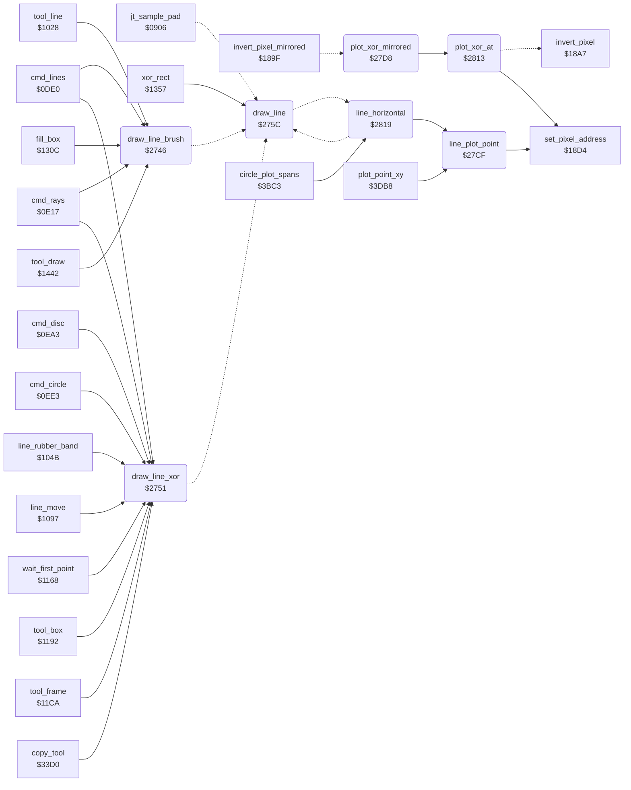

<!-- Generated by c64-docs from knowledge revision 20261024T063910.298-7zz1bw and .c64-re-tools/local/generated/src/source-map.json. Do not edit: change the knowledge, generate the source again, then run docs.ts generate. -->
# graphics/bresenham_line.asm: Line Drawing and Mirrored XOR Plot

Range `$2746-$29C6`. Source: [graphics/bresenham_line.asm](../../../../src/graphics/bresenham_line.asm). Index: [the reference](../../index.md).

## Call graph

A solid arrow is a call, a thick arrow a table entry, a dotted arrow a jump. Rounded nodes are in this file.

## Names

### [`draw_line_brush`](../../../../src/graphics/bresenham_line.asm#L6) `$2746`

*routine*

Draws a line from (line_x0,line_y0) to (line_x1,line_y1) with the brush: sets point_routine to $178a (plot_brush), then draw_line.

- **Called from:** [`cmd_lines`](../tools/lines.md#cmd_lines) [`$0DFD`](../../../../src/tools/lines.asm#L20), [`cmd_rays`](../tools/rays.md#cmd_rays) [`$0E62`](../../../../src/tools/rays.asm#L44), [`tool_line`](../tools/line_tool.md#tool_line) [`$1045`](../../../../src/tools/line_tool.asm#L20), [`fill_box`](../tools/box_frame_tool.md#fill_box) [`$1346`](../../../../src/tools/box_frame_tool.asm#L245), [`tool_draw`](../tools/draw_tool.md#tool_draw) [`$1485`](../../../../src/tools/draw_tool_147d.asm#L9)
- **Jumps to:** [`draw_line`](bresenham_line.md#draw_line)
- **Writes:** [`plot_vector`](../../memory-map.md#plot_vector), [`plot_vector+1`](../../memory-map.md#plot_vector)

### [`draw_line_xor`](../../../../src/graphics/bresenham_line.asm#L13) `$2751`

*routine*

Draws a line from (line_x0,line_y0) to (line_x1,line_y1) with inverted pixels: sets point_routine to $189f (XOR plot, with the mirror points when mirror_mode is set), then draw_line.

- **Called from:** [`cmd_lines`](../tools/lines.md#cmd_lines) [`$0DF6`](../../../../src/tools/lines.asm#L17), [`cmd_lines`](../tools/lines.md#cmd_lines) [`$0E11`](../../../../src/tools/lines.asm#L29), [`cmd_rays`](../tools/rays.md#cmd_rays) [`$0E31`](../../../../src/tools/rays.asm#L19), [`cmd_rays`](../tools/rays.md#cmd_rays) [`$0E68`](../../../../src/tools/rays.asm#L47), [`cmd_rays`](../tools/rays.md#cmd_rays) [`$0E8C`](../../../../src/tools/rays.asm#L67), [`cmd_rays`](../tools/rays.md#cmd_rays) [`$0E95`](../../../../src/tools/rays.asm#L72), [`cmd_rays`](../tools/rays.md#cmd_rays) [`$0E9D`](../../../../src/tools/rays.asm#L76), [`cmd_disc`](../tools/circle.md#cmd_disc) [`$0EB6`](../../../../src/tools/circle.asm#L16), [`cmd_circle`](../tools/circle.md#cmd_circle) [`$0EF6`](../../../../src/tools/circle.asm#L48), [`line_rubber_band`](../tools/line_tool.md#line_rubber_band) [`$1053`](../../../../src/tools/line_tool.asm#L27), [`line_rubber_band`](../tools/line_tool.md#line_rubber_band) [`$1083`](../../../../src/tools/line_tool.asm#L53), [`line_rubber_band`](../tools/line_tool.md#line_rubber_band) [`$1091`](../../../../src/tools/line_tool.asm#L59), [`line_move`](../tools/line_tool.md#line_move) [`$10E7`](../../../../src/tools/line_tool.asm#L106), [`line_move`](../tools/line_tool.md#line_move) [`$10F8`](../../../../src/tools/line_tool.asm#L115), [`line_move`](../tools/line_tool.md#line_move) [`$1115`](../../../../src/tools/line_tool.asm#L132), [`line_move`](../tools/line_tool.md#line_move) [`$1162`](../../../../src/tools/line_tool.asm#L179), [`wait_first_point`](../tools/line_tool.md#wait_first_point) [`$118E`](../../../../src/tools/line_tool.asm#L202), [`tool_box`](../tools/box_frame_tool.md#tool_box) [`$11A5`](../../../../src/tools/box_frame_tool.asm#L16), [`tool_frame`](../tools/box_frame_tool.md#tool_frame) [`$11DD`](../../../../src/tools/box_frame_tool.asm#L42), [`copy_tool`](../tools/copy.md#copy_tool) [`$33ED`](../../../../src/tools/copy.asm#L20)
- **Jumps to:** [`draw_line`](bresenham_line.md#draw_line)
- **Writes:** [`plot_vector`](../../memory-map.md#plot_vector), [`plot_vector+1`](../../memory-map.md#plot_vector)

### [`draw_line`](../../../../src/graphics/bresenham_line.asm#L20) `$275C`

*routine*

Draws a line from (line_x0,line_y0) to (line_x1,line_y1) with the routine at point_routine (Bresenham). A vertical or horizontal line plots both end points. Another line plots line_dx or line_dy points: not the end point. Keeps $3e-$41. Changes A, X, Y, cursor_x, cursor_y.

- **Called from:** [`xor_rect`](../tools/box_frame_tool.md#xor_rect) [`$1371`](../../../../src/tools/box_frame_tool.asm#L272), [`xor_rect`](../tools/box_frame_tool.md#xor_rect) [`$1387`](../../../../src/tools/box_frame_tool.asm#L284), [`xor_rect`](../tools/box_frame_tool.md#xor_rect) [`$1399`](../../../../src/tools/box_frame_tool.asm#L294), [`xor_rect`](../tools/box_frame_tool.md#xor_rect) [`$13B1`](../../../../src/tools/box_frame_tool.asm#L308), [`xor_rect`](../tools/box_frame_tool.md#xor_rect) [`$13C9`](../../../../src/tools/box_frame_tool.asm#L322), [`xor_rect`](../tools/box_frame_tool.md#xor_rect) [`$13E1`](../../../../src/tools/box_frame_tool.asm#L336)
- **Jumped to from:** [`jt_sample_pad`](../init/entry.md#jt_sample_pad) [`$0918`](../../../../src/init/entry.asm#L21), [`draw_line_brush`](bresenham_line.md#draw_line_brush) [`$274E`](../../../../src/graphics/bresenham_line.asm#L11), [`draw_line_xor`](bresenham_line.md#draw_line_xor) [`$2759`](../../../../src/graphics/bresenham_line.asm#L18)
- **Entry of:** [`entry_jump_table`](../../tables.md#entry_jump_table)
- **Jumps to:** [`line_vertical`](bresenham_line.md#line_vertical), [`line_horizontal`](bresenham_line.md#line_horizontal), [`line_x_major`](bresenham_line.md#line_x_major), [`line_y_major`](bresenham_line.md#line_y_major)
- **Reads:** [`shape_x0`](../../memory-map.md#shape_x0), [`shape_x1`](../../memory-map.md#shape_x1), [`shape_y0`](../../memory-map.md#shape_y0), [`shape_y1`](../../memory-map.md#shape_y1), [`delta_x`](../../memory-map.md#delta_x), [`circle_left_x`](../../memory-map.md#circle_left_x), [`delta_y`](../../memory-map.md#delta_y), [`circle_upper_y`](../../memory-map.md#circle_upper_y), [`line_dx`](../../memory-map.md#line_dx)
- **Writes:** [`line_x`](../../memory-map.md#line_x), [`line_y`](../../memory-map.md#line_y), [`line_x_negative`](../../memory-map.md#line_x_negative), [`line_y_negative`](../../memory-map.md#line_y_negative), [`line_dx`](../../memory-map.md#line_dx), [`line_dy`](../../memory-map.md#line_dy), [`circle_upper_y`](../../memory-map.md#circle_upper_y), [`delta_y`](../../memory-map.md#delta_y), [`circle_left_x`](../../memory-map.md#circle_left_x), [`delta_x`](../../memory-map.md#delta_x)

### [`draw_line_test_y`](../../../../src/graphics/bresenham_line.asm#L25) `$2765`

*label*

- **Jumped to from:** [`draw_line`](bresenham_line.md#draw_line) [`$2760`](../../../../src/graphics/bresenham_line.asm#L23)

### [`draw_line_slanted`](../../../../src/graphics/bresenham_line.asm#L31) `$276E`

*label*

A line that is not vertical and not horizontal: keeps $3e-$41 on the stack and gets the distances and directions.

- **Jumped to from:** [`draw_line`](bresenham_line.md#draw_line) [`$2769`](../../../../src/graphics/bresenham_line.asm#L28)

### [`draw_line_x_back`](../../../../src/graphics/bresenham_line.asm#L55) `$2797`

*label*

- **Jumped to from:** [`draw_line`](bresenham_line.md#draw_line) [`$278F`](../../../../src/graphics/bresenham_line.asm#L51)

### [`draw_line_set_dx`](../../../../src/graphics/bresenham_line.asm#L61) `$27A0`

*label*

- **Jumped to from:** [`draw_line`](bresenham_line.md#draw_line) [`$2794`](../../../../src/graphics/bresenham_line.asm#L54)

### [`draw_line_y_back`](../../../../src/graphics/bresenham_line.asm#L69) `$27AD`

*label*

- **Jumped to from:** [`draw_line`](bresenham_line.md#draw_line) [`$27A5`](../../../../src/graphics/bresenham_line.asm#L65)

### [`draw_line_set_dy`](../../../../src/graphics/bresenham_line.asm#L75) `$27B6`

*label*

- **Jumped to from:** [`draw_line`](bresenham_line.md#draw_line) [`$27AA`](../../../../src/graphics/bresenham_line.asm#L68)

### [`draw_line_to_y_major`](../../../../src/graphics/bresenham_line.asm#L80) `$27BF`

*label*

- **Jumped to from:** [`draw_line`](bresenham_line.md#draw_line) [`$27BA`](../../../../src/graphics/bresenham_line.asm#L78)

### [`draw_line_done`](../../../../src/graphics/bresenham_line.asm#L83) `$27C2`

*label*

Gets $3e-$41 back from the stack and returns.

- **Jumped to from:** [`line_horizontal`](bresenham_line.md#line_horizontal) [`$28D3`](../../../../src/graphics/bresenham_line.asm#L249), [`line_horizontal`](bresenham_line.md#line_horizontal) [`$297D`](../../../../src/graphics/bresenham_line.asm#L347)

### [`line_plot_point`](../../../../src/graphics/bresenham_line.asm#L94) `$27CF`

*routine*

Plots the point (X,Y) with the routine at point_routine. $18d4 gives the bitmap address of the point.
This load has no effect: $18d4 loads A from Y first.

- **Called from:** [`line_horizontal`](bresenham_line.md#line_horizontal) [`$2833`](../../../../src/graphics/bresenham_line.asm#L154), [`line_horizontal`](bresenham_line.md#line_horizontal) [`$2860`](../../../../src/graphics/bresenham_line.asm#L183), [`line_horizontal`](bresenham_line.md#line_horizontal) [`$28CC`](../../../../src/graphics/bresenham_line.asm#L246), [`line_horizontal`](bresenham_line.md#line_horizontal) [`$2900`](../../../../src/graphics/bresenham_line.asm#L276), [`line_horizontal`](bresenham_line.md#line_horizontal) [`$2976`](../../../../src/graphics/bresenham_line.asm#L344), [`line_horizontal`](bresenham_line.md#line_horizontal) [`$29AA`](../../../../src/graphics/bresenham_line.asm#L375), [`plot_point_xy`](circle_plot_3c21.md#plot_point_xy) [`$3DC2`](../../../../src/graphics/circle_plot_3c21.asm#L273)
- **Calls:** [`set_pixel_address`](pixel.md#set_pixel_address)
- **Jumps to:** [`storage_action+528`](../../memory-map.md#storage_action)
- **Reads:** [`mirror_mode`](../data/workspace.md#mirror_mode), [`plot_vector`](../../memory-map.md#plot_vector)

### [`plot_xor_mirrored`](../../../../src/graphics/bresenham_line.asm#L99) `$27D8`

*routine*

Inverts the pixel at (cursor_x,cursor_y) and at the 3 mirror points (159-x,y), (159-x,199-y) and (x,199-y). Keeps cursor_x and cursor_y.

- **Jumped to from:** [`invert_pixel_mirrored`](pixel.md#invert_pixel_mirrored) [`$18A4`](../../../../src/graphics/pixel.asm#L16)
- **Calls:** [`plot_xor_at`](bresenham_line.md#plot_xor_at)
- **Reads:** [`cursor_y`](../../memory-map.md#cursor_y), [`cursor_x`](../../memory-map.md#cursor_x)
- **Writes:** [`cursor_x`](../../memory-map.md#cursor_x), [`cursor_y`](../../memory-map.md#cursor_y)

### [`plot_xor_at`](../../../../src/graphics/bresenham_line.asm#L133) `$2813`

*routine*

Inverts the pixel at (X,Y): gets the bitmap address ($18d4), then $18a7.

- **Called from:** [`plot_xor_mirrored`](bresenham_line.md#plot_xor_mirrored) [`$27E2`](../../../../src/graphics/bresenham_line.asm#L106), [`plot_xor_mirrored`](bresenham_line.md#plot_xor_mirrored) [`$27F0`](../../../../src/graphics/bresenham_line.asm#L113), [`plot_xor_mirrored`](bresenham_line.md#plot_xor_mirrored) [`$27FE`](../../../../src/graphics/bresenham_line.asm#L120), [`plot_xor_mirrored`](bresenham_line.md#plot_xor_mirrored) [`$2809`](../../../../src/graphics/bresenham_line.asm#L126)
- **Calls:** [`set_pixel_address`](pixel.md#set_pixel_address)
- **Jumps to:** [`invert_pixel`](pixel.md#invert_pixel)

### [`line_horizontal`](../../../../src/graphics/bresenham_line.asm#L137) `$2819`

*label*

Horizontal line: sorts the X values, then plots each point from line_x0 to line_x1. Keeps line_x0 and line_x1.

- **Called from:** [`circle_plot_spans`](circle_plot.md#circle_plot_spans) [`$3BE9`](../../../../src/graphics/circle_plot.asm#L26), [`circle_plot_spans`](circle_plot.md#circle_plot_spans) [`$3C06`](../../../../src/graphics/circle_plot.asm#L40)
- **Jumped to from:** [`draw_line`](bresenham_line.md#draw_line) [`$276B`](../../../../src/graphics/bresenham_line.asm#L29)
- **Calls:** [`line_plot_point`](bresenham_line.md#line_plot_point)
- **Jumps to:** [`draw_line_done`](bresenham_line.md#draw_line_done)
- **Reads:** [`shape_x1`](../../memory-map.md#shape_x1), [`shape_x0`](../../memory-map.md#shape_x0), [`shape_y0`](../../memory-map.md#shape_y0), [`shape_y1`](../../memory-map.md#shape_y1), [`line_dy`](../../memory-map.md#line_dy), [`line_dx`](../../memory-map.md#line_dx), [`line_error`](../../memory-map.md#line_error), [`temp_word`](../../memory-map.md#temp_word), [`line_error+1`](../../memory-map.md#line_error), [`temp_word_hi`](../../memory-map.md#temp_word_hi), [`delta_x`](../../memory-map.md#delta_x), [`circle_left_x`](../../memory-map.md#circle_left_x), [`line_x`](../../memory-map.md#line_x), [`line_y`](../../memory-map.md#line_y), [`line_count`](../../memory-map.md#line_count), [`line_x_negative`](../../memory-map.md#line_x_negative), [`delta_y`](../../memory-map.md#delta_y), [`circle_upper_y`](../../memory-map.md#circle_upper_y), [`line_fill_corners`](../../memory-map.md#line_fill_corners), [`line_y_negative`](../../memory-map.md#line_y_negative)
- **Writes:** [`shape_x1`](../../memory-map.md#shape_x1), [`shape_x0`](../../memory-map.md#shape_x0), [`cursor_y`](../../memory-map.md#cursor_y), [`cursor_x`](../../memory-map.md#cursor_x), [`shape_y1`](../../memory-map.md#shape_y1), [`shape_y0`](../../memory-map.md#shape_y0), [`line_error`](../../memory-map.md#line_error), [`delta_y`](../../memory-map.md#delta_y), [`line_error+1`](../../memory-map.md#line_error), [`circle_upper_y`](../../memory-map.md#circle_upper_y), [`delta_x`](../../memory-map.md#delta_x), [`circle_left_x`](../../memory-map.md#circle_left_x), [`temp_word`](../../memory-map.md#temp_word), [`temp_word_hi`](../../memory-map.md#temp_word_hi), [`line_count`](../../memory-map.md#line_count), [`line_x`](../../memory-map.md#line_x), [`line_y`](../../memory-map.md#line_y)

### [`line_horizontal_end`](../../../../src/graphics/bresenham_line.asm#L147) `$2829`

*label*

- **Jumped to from:** [`line_horizontal`](bresenham_line.md#line_horizontal) [`$2821`](../../../../src/graphics/bresenham_line.asm#L143)

### [`line_horizontal_loop`](../../../../src/graphics/bresenham_line.asm#L150) `$282D`

*label*

- **Jumped to from:** [`line_horizontal`](bresenham_line.md#line_horizontal) [`$283D`](../../../../src/graphics/bresenham_line.asm#L159)

### [`line_vertical`](../../../../src/graphics/bresenham_line.asm#L166) `$2846`

*label*

Vertical line: sorts the Y values, then plots each point from line_y0 to line_y1. Keeps line_y0 and line_y1.

- **Jumped to from:** [`draw_line`](bresenham_line.md#draw_line) [`$2762`](../../../../src/graphics/bresenham_line.asm#L24)

### [`line_vertical_end`](../../../../src/graphics/bresenham_line.asm#L176) `$2856`

*label*

- **Jumped to from:** [`line_horizontal`](bresenham_line.md#line_horizontal) [`$284E`](../../../../src/graphics/bresenham_line.asm#L172)

### [`line_vertical_loop`](../../../../src/graphics/bresenham_line.asm#L179) `$285A`

*label*

- **Jumped to from:** [`line_horizontal`](bresenham_line.md#line_horizontal) [`$286A`](../../../../src/graphics/bresenham_line.asm#L188)

### [`line_x_major`](../../../../src/graphics/bresenham_line.asm#L195) `$2873`

*label*

Line with line_dx > line_dy: line_two_dy = 2*dy, line_two_dx = -2*dx, line_error = 2*dy - dx. Plots line_dx points.

- **Jumped to from:** [`draw_line`](bresenham_line.md#draw_line) [`$27BC`](../../../../src/graphics/bresenham_line.asm#L79)

### [`line_x_major_plot`](../../../../src/graphics/bresenham_line.asm#L241) `$28C4`

*label*

- **Jumped to from:** [`line_horizontal`](bresenham_line.md#line_horizontal) [`$28F1`](../../../../src/graphics/bresenham_line.asm#L267)

### [`line_x_major_step_x`](../../../../src/graphics/bresenham_line.asm#L250) `$28D6`

*label*

- **Jumped to from:** [`line_horizontal`](bresenham_line.md#line_horizontal) [`$28D1`](../../../../src/graphics/bresenham_line.asm#L248)

### [`line_x_major_test`](../../../../src/graphics/bresenham_line.asm#L256) `$28E0`

*label*

- **Jumped to from:** [`line_horizontal`](bresenham_line.md#line_horizontal) [`$28DA`](../../../../src/graphics/bresenham_line.asm#L253)

### [`line_x_major_add_dy`](../../../../src/graphics/bresenham_line.asm#L259) `$28E4`

*label*

- **Jumped to from:** [`line_horizontal`](bresenham_line.md#line_horizontal) [`$291A`](../../../../src/graphics/bresenham_line.asm#L291)

### [`line_x_major_diagonal`](../../../../src/graphics/bresenham_line.asm#L269) `$28F4`

*label*

Step on Y. When line_fill_corners is set, it first plots the corner point (new X, old Y).

- **Jumped to from:** [`line_horizontal`](bresenham_line.md#line_horizontal) [`$28E2`](../../../../src/graphics/bresenham_line.asm#L258)

### [`line_x_major_step_y`](../../../../src/graphics/bresenham_line.asm#L277) `$2903`

*label*

- **Jumped to from:** [`line_horizontal`](bresenham_line.md#line_horizontal) [`$28F6`](../../../../src/graphics/bresenham_line.asm#L271)

### [`line_x_major_sub_dx`](../../../../src/graphics/bresenham_line.asm#L283) `$290D`

*label*

- **Jumped to from:** [`line_horizontal`](bresenham_line.md#line_horizontal) [`$2907`](../../../../src/graphics/bresenham_line.asm#L280)

### [`line_y_major`](../../../../src/graphics/bresenham_line.asm#L293) `$291D`

*label*

Line with line_dy >= line_dx: line_two_dx = 2*dx, line_two_dy = -2*dy, line_error = 2*dx - dy. Plots line_dy points.

- **Jumped to from:** [`draw_line`](bresenham_line.md#draw_line) [`$27BF`](../../../../src/graphics/bresenham_line.asm#L81)

### [`line_y_major_plot`](../../../../src/graphics/bresenham_line.asm#L339) `$296E`

*label*

- **Jumped to from:** [`line_horizontal`](bresenham_line.md#line_horizontal) [`$299B`](../../../../src/graphics/bresenham_line.asm#L366)

### [`line_y_major_step_y`](../../../../src/graphics/bresenham_line.asm#L348) `$2980`

*label*

- **Jumped to from:** [`line_horizontal`](bresenham_line.md#line_horizontal) [`$297B`](../../../../src/graphics/bresenham_line.asm#L346)

### [`line_y_major_test`](../../../../src/graphics/bresenham_line.asm#L355) `$298A`

*label*

- **Jumped to from:** [`line_horizontal`](bresenham_line.md#line_horizontal) [`$2984`](../../../../src/graphics/bresenham_line.asm#L351)

### [`line_y_major_add_dx`](../../../../src/graphics/bresenham_line.asm#L358) `$298E`

*label*

- **Jumped to from:** [`line_horizontal`](bresenham_line.md#line_horizontal) [`$29C4`](../../../../src/graphics/bresenham_line.asm#L391)

### [`line_y_major_diagonal`](../../../../src/graphics/bresenham_line.asm#L368) `$299E`

*label*

Step on X. When line_fill_corners is set, it first plots the corner point (old X, new Y).

- **Jumped to from:** [`line_horizontal`](bresenham_line.md#line_horizontal) [`$298C`](../../../../src/graphics/bresenham_line.asm#L357)

### [`line_y_major_step_x`](../../../../src/graphics/bresenham_line.asm#L376) `$29AD`

*label*

- **Jumped to from:** [`line_horizontal`](bresenham_line.md#line_horizontal) [`$29A0`](../../../../src/graphics/bresenham_line.asm#L370)

### [`line_y_major_sub_dy`](../../../../src/graphics/bresenham_line.asm#L383) `$29B7`

*label*

- **Jumped to from:** [`line_horizontal`](bresenham_line.md#line_horizontal) [`$29B1`](../../../../src/graphics/bresenham_line.asm#L379)
