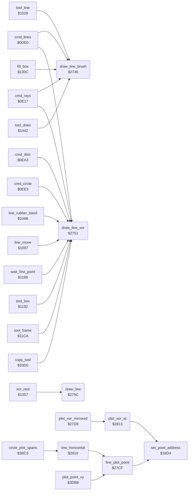

<!-- Generated by c64-docs from knowledge revision 20261025T214623.268-6ar633 and .c64-re-tools/local/generated/src/source-map.json. Do not edit: change the knowledge, generate the source again, then run docs.ts generate. -->
# graphics/bresenham_line.asm: Line Drawing and Mirrored XOR Plot

Range `$2746-$29C6`. Source: [graphics/bresenham_line.asm](../../../../src/graphics/bresenham_line.asm). Index: [the reference](../../index.md).

## Routines

| Routine | Address | Reached from | Summary |
|---|---|---|---|
| [`draw_line_brush`](bresenham_line.md#draw_line_brush) | `$2746` | [`cmd_lines`](../tools/lines.md#cmd_lines), [`cmd_rays`](../tools/rays.md#cmd_rays), [`tool_line`](../tools/line_tool.md#tool_line), [`fill_box`](../tools/box_frame_tool.md#fill_box), [`tool_draw`](../tools/draw_tool.md#tool_draw) | Draws a line from (line_x0,line_y0) to (line_x1,line_y1) with the brush: sets point_routine to $178a (plot_brush), then draw_line. |
| [`draw_line_xor`](bresenham_line.md#draw_line_xor) | `$2751` | [`cmd_lines`](../tools/lines.md#cmd_lines), [`cmd_rays`](../tools/rays.md#cmd_rays), [`cmd_disc`](../tools/circle.md#cmd_disc), [`cmd_circle`](../tools/circle.md#cmd_circle), [`line_rubber_band`](../tools/line_tool.md#line_rubber_band), [`line_move`](../tools/line_tool.md#line_move), [`wait_first_point`](../tools/line_tool.md#wait_first_point), [`tool_box`](../tools/box_frame_tool.md#tool_box), [`tool_frame`](../tools/box_frame_tool.md#tool_frame), [`copy_tool`](../tools/copy.md#copy_tool) | Draws a line from (line_x0,line_y0) to (line_x1,line_y1) with inverted pixels: sets point_routine to $189f (XOR plot, with the mirror points when mirror_mode is set), then draw_line. |
| [`draw_line`](bresenham_line.md#draw_line) | `$275C` | [`xor_rect`](../tools/box_frame_tool.md#xor_rect), [`jt_sample_pad`](../init/entry.md#jt_sample_pad) | Draws a line from (line_x0,line_y0) to (line_x1,line_y1) with the routine at point_routine (Bresenham). |
| [`line_plot_point`](bresenham_line.md#line_plot_point) | `$27CF` | [`line_horizontal`](bresenham_line.md#line_horizontal), [`plot_point_xy`](circle_plot_3c21.md#plot_point_xy) | Plots the point (X,Y) with the routine at point_routine. |
| [`plot_xor_mirrored`](bresenham_line.md#plot_xor_mirrored) | `$27D8` | [`invert_pixel_mirrored`](pixel.md#invert_pixel_mirrored) | Inverts the pixel at (cursor_x,cursor_y) and at the 3 mirror points (159-x,y), (159-x,199-y) and (x,199-y). |
| [`plot_xor_at`](bresenham_line.md#plot_xor_at) | `$2813` | [`plot_xor_mirrored`](bresenham_line.md#plot_xor_mirrored) | Inverts the pixel at (X,Y): gets the bitmap address ($18d4), then $18a7. |
| [`line_horizontal`](bresenham_line.md#line_horizontal) | `$2819` | [`circle_plot_spans`](circle_plot.md#circle_plot_spans) | Horizontal line: sorts the X values, then plots each point from line_x0 to line_x1. |

## Call graph

A solid arrow is a call, a thick arrow a table entry. Rounded nodes are in this file.

## Details

### [`draw_line_brush`](../../../../src/graphics/bresenham_line.asm#L6) `$2746`

*routine*

Draws a line from (line_x0,line_y0) to (line_x1,line_y1) with the brush: sets point_routine to $178a (plot_brush), then draw_line.

- **Called from:** [`cmd_lines`](../tools/lines.md#cmd_lines), [`cmd_rays`](../tools/rays.md#cmd_rays), [`tool_line`](../tools/line_tool.md#tool_line), [`fill_box`](../tools/box_frame_tool.md#fill_box), [`tool_draw`](../tools/draw_tool.md#tool_draw)
- **Jumps to:** [`draw_line`](bresenham_line.md#draw_line)
- **Writes:** [`plot_vector`](../../memory-map.md#plot_vector)

### [`draw_line_xor`](../../../../src/graphics/bresenham_line.asm#L13) `$2751`

*routine*

Draws a line from (line_x0,line_y0) to (line_x1,line_y1) with inverted pixels: sets point_routine to $189f (XOR plot, with the mirror points when mirror_mode is set), then draw_line.

- **Called from:** [`cmd_lines`](../tools/lines.md#cmd_lines), [`cmd_rays`](../tools/rays.md#cmd_rays), [`cmd_disc`](../tools/circle.md#cmd_disc), [`cmd_circle`](../tools/circle.md#cmd_circle), [`line_rubber_band`](../tools/line_tool.md#line_rubber_band), [`line_move`](../tools/line_tool.md#line_move), [`wait_first_point`](../tools/line_tool.md#wait_first_point), [`tool_box`](../tools/box_frame_tool.md#tool_box), [`tool_frame`](../tools/box_frame_tool.md#tool_frame), [`copy_tool`](../tools/copy.md#copy_tool)
- **Jumps to:** [`draw_line`](bresenham_line.md#draw_line)
- **Writes:** [`plot_vector`](../../memory-map.md#plot_vector)

### [`draw_line`](../../../../src/graphics/bresenham_line.asm#L20) `$275C`

*routine*

Draws a line from (line_x0,line_y0) to (line_x1,line_y1) with the routine at point_routine (Bresenham). A vertical or horizontal line plots both end points. Another line plots line_dx or line_dy points: not the end point. Keeps $3e-$41. Changes A, X, Y, cursor_x, cursor_y.

- **Called from:** [`xor_rect`](../tools/box_frame_tool.md#xor_rect)
- **Jumped to from:** [`jt_sample_pad`](../init/entry.md#jt_sample_pad), [`draw_line_brush`](bresenham_line.md#draw_line_brush), [`draw_line_xor`](bresenham_line.md#draw_line_xor)
- **Entry of:** [`entry_jump_table`](../../tables.md#entry_jump_table)
- **Jumps to:** [`line_vertical`](bresenham_line.md#line_vertical), [`line_horizontal`](bresenham_line.md#line_horizontal), [`line_x_major`](bresenham_line.md#line_x_major), [`line_y_major`](bresenham_line.md#line_y_major)
- **Reads:** [`shape_x0`](../../memory-map.md#shape_x0), [`shape_x1`](../../memory-map.md#shape_x1), [`shape_y0`](../../memory-map.md#shape_y0), [`shape_y1`](../../memory-map.md#shape_y1), [`delta_x`](../../memory-map.md#delta_x), [`circle_left_x`](../../memory-map.md#circle_left_x), [`delta_y`](../../memory-map.md#delta_y), [`circle_upper_y`](../../memory-map.md#circle_upper_y), [`line_dx`](../../memory-map.md#line_dx)
- **Writes:** [`line_x`](../../memory-map.md#line_x), [`line_y`](../../memory-map.md#line_y), [`line_x_negative`](../../memory-map.md#line_x_negative), [`line_y_negative`](../../memory-map.md#line_y_negative), [`line_dx`](../../memory-map.md#line_dx), [`line_dy`](../../memory-map.md#line_dy), [`circle_upper_y`](../../memory-map.md#circle_upper_y), [`delta_y`](../../memory-map.md#delta_y), [`circle_left_x`](../../memory-map.md#circle_left_x), [`delta_x`](../../memory-map.md#delta_x)

| Label | Address | Comment |
|---|---|---|
| [`draw_line_test_y`](../../../../src/graphics/bresenham_line.asm#L25) | `$2765` |  |
| [`draw_line_slanted`](../../../../src/graphics/bresenham_line.asm#L31) | `$276E` | A line that is not vertical and not horizontal: keeps $3e-$41 on the stack and gets the distances and directions. |
| [`draw_line_x_back`](../../../../src/graphics/bresenham_line.asm#L55) | `$2797` |  |
| [`draw_line_set_dx`](../../../../src/graphics/bresenham_line.asm#L61) | `$27A0` |  |
| [`draw_line_y_back`](../../../../src/graphics/bresenham_line.asm#L69) | `$27AD` |  |
| [`draw_line_set_dy`](../../../../src/graphics/bresenham_line.asm#L75) | `$27B6` |  |
| [`draw_line_to_y_major`](../../../../src/graphics/bresenham_line.asm#L80) | `$27BF` |  |
| [`draw_line_done`](../../../../src/graphics/bresenham_line.asm#L83) | `$27C2` | Gets $3e-$41 back from the stack and returns. |

### [`line_plot_point`](../../../../src/graphics/bresenham_line.asm#L94) `$27CF`

*routine*

Plots the point (X,Y) with the routine at point_routine. $18d4 gives the bitmap address of the point.
This load has no effect: $18d4 loads A from Y first.

- **Called from:** [`line_horizontal`](bresenham_line.md#line_horizontal), [`plot_point_xy`](circle_plot_3c21.md#plot_point_xy)
- **Calls:** [`set_pixel_address`](pixel.md#set_pixel_address)
- **Jumps to:** [`storage_action`](../../memory-map.md#storage_action)
- **Reads:** [`mirror_mode`](../data/workspace.md#mirror_mode), [`plot_vector`](../../memory-map.md#plot_vector)

### [`plot_xor_mirrored`](../../../../src/graphics/bresenham_line.asm#L99) `$27D8`

*routine*

Inverts the pixel at (cursor_x,cursor_y) and at the 3 mirror points (159-x,y), (159-x,199-y) and (x,199-y). Keeps cursor_x and cursor_y.

- **Jumped to from:** [`invert_pixel_mirrored`](pixel.md#invert_pixel_mirrored)
- **Calls:** [`plot_xor_at`](bresenham_line.md#plot_xor_at)
- **Reads:** [`cursor_y`](../../memory-map.md#cursor_y), [`cursor_x`](../../memory-map.md#cursor_x)
- **Writes:** [`cursor_x`](../../memory-map.md#cursor_x), [`cursor_y`](../../memory-map.md#cursor_y)

### [`plot_xor_at`](../../../../src/graphics/bresenham_line.asm#L133) `$2813`

*routine*

Inverts the pixel at (X,Y): gets the bitmap address ($18d4), then $18a7.

- **Called from:** [`plot_xor_mirrored`](bresenham_line.md#plot_xor_mirrored)
- **Calls:** [`set_pixel_address`](pixel.md#set_pixel_address)
- **Jumps to:** [`invert_pixel`](pixel.md#invert_pixel)

### [`line_horizontal`](../../../../src/graphics/bresenham_line.asm#L137) `$2819`

*label*

Horizontal line: sorts the X values, then plots each point from line_x0 to line_x1. Keeps line_x0 and line_x1.

- **Called from:** [`circle_plot_spans`](circle_plot.md#circle_plot_spans)
- **Jumped to from:** [`draw_line`](bresenham_line.md#draw_line)
- **Calls:** [`line_plot_point`](bresenham_line.md#line_plot_point)
- **Jumps to:** [`draw_line_done`](bresenham_line.md#draw_line_done)
- **Reads:** [`shape_x1`](../../memory-map.md#shape_x1), [`shape_x0`](../../memory-map.md#shape_x0), [`shape_y0`](../../memory-map.md#shape_y0), [`shape_y1`](../../memory-map.md#shape_y1), [`line_dy`](../../memory-map.md#line_dy), [`line_dx`](../../memory-map.md#line_dx), [`line_error`](../../memory-map.md#line_error), [`temp_word`](../../memory-map.md#temp_word), [`temp_word_hi`](../../memory-map.md#temp_word_hi), [`delta_x`](../../memory-map.md#delta_x), [`circle_left_x`](../../memory-map.md#circle_left_x), [`line_x`](../../memory-map.md#line_x) and 7 more
- **Writes:** [`shape_x1`](../../memory-map.md#shape_x1), [`shape_x0`](../../memory-map.md#shape_x0), [`cursor_y`](../../memory-map.md#cursor_y), [`cursor_x`](../../memory-map.md#cursor_x), [`shape_y1`](../../memory-map.md#shape_y1), [`shape_y0`](../../memory-map.md#shape_y0), [`line_error`](../../memory-map.md#line_error), [`delta_y`](../../memory-map.md#delta_y), [`circle_upper_y`](../../memory-map.md#circle_upper_y), [`delta_x`](../../memory-map.md#delta_x), [`circle_left_x`](../../memory-map.md#circle_left_x), [`temp_word`](../../memory-map.md#temp_word) and 4 more

| Label | Address | Comment |
|---|---|---|
| [`line_horizontal_end`](../../../../src/graphics/bresenham_line.asm#L147) | `$2829` |  |
| [`line_horizontal_loop`](../../../../src/graphics/bresenham_line.asm#L150) | `$282D` |  |
| [`line_vertical`](../../../../src/graphics/bresenham_line.asm#L166) | `$2846` | Vertical line: sorts the Y values, then plots each point from line_y0 to line_y1. Keeps line_y0 and line_y1. |
| [`line_vertical_end`](../../../../src/graphics/bresenham_line.asm#L176) | `$2856` |  |
| [`line_vertical_loop`](../../../../src/graphics/bresenham_line.asm#L179) | `$285A` |  |
| [`line_x_major`](../../../../src/graphics/bresenham_line.asm#L195) | `$2873` | Line with line_dx > line_dy: line_two_dy = 2*dy, line_two_dx = -2*dx, line_error = 2*dy - dx. Plots line_dx points. |
| [`line_x_major_plot`](../../../../src/graphics/bresenham_line.asm#L241) | `$28C4` |  |
| [`line_x_major_step_x`](../../../../src/graphics/bresenham_line.asm#L250) | `$28D6` |  |
| [`line_x_major_test`](../../../../src/graphics/bresenham_line.asm#L256) | `$28E0` |  |
| [`line_x_major_add_dy`](../../../../src/graphics/bresenham_line.asm#L259) | `$28E4` |  |
| [`line_x_major_diagonal`](../../../../src/graphics/bresenham_line.asm#L269) | `$28F4` | Step on Y. When line_fill_corners is set, it first plots the corner point (new X, old Y). |
| [`line_x_major_step_y`](../../../../src/graphics/bresenham_line.asm#L277) | `$2903` |  |
| [`line_x_major_sub_dx`](../../../../src/graphics/bresenham_line.asm#L283) | `$290D` |  |
| [`line_y_major`](../../../../src/graphics/bresenham_line.asm#L293) | `$291D` | Line with line_dy >= line_dx: line_two_dx = 2*dx, line_two_dy = -2*dy, line_error = 2*dx - dy. Plots line_dy points. |
| [`line_y_major_plot`](../../../../src/graphics/bresenham_line.asm#L339) | `$296E` |  |
| [`line_y_major_step_y`](../../../../src/graphics/bresenham_line.asm#L348) | `$2980` |  |
| [`line_y_major_test`](../../../../src/graphics/bresenham_line.asm#L355) | `$298A` |  |
| [`line_y_major_add_dx`](../../../../src/graphics/bresenham_line.asm#L358) | `$298E` |  |
| [`line_y_major_diagonal`](../../../../src/graphics/bresenham_line.asm#L368) | `$299E` | Step on X. When line_fill_corners is set, it first plots the corner point (old X, new Y). |
| [`line_y_major_step_x`](../../../../src/graphics/bresenham_line.asm#L376) | `$29AD` |  |
| [`line_y_major_sub_dy`](../../../../src/graphics/bresenham_line.asm#L383) | `$29B7` |  |
