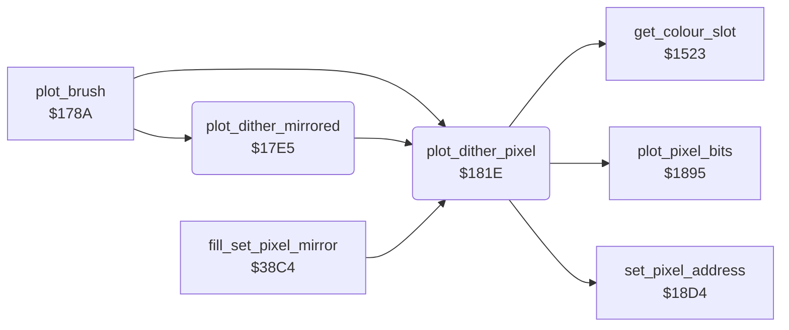

<!-- Generated by c64-docs from knowledge revision 20261024T063910.298-7zz1bw and .c64-re-tools/local/generated/src/source-map.json. Do not edit: change the knowledge, generate the source again, then run docs.ts generate. -->
# graphics/brush_plot.asm: Dither and Mirror Point Plot

Range `$17E5-$1844`. Source: [graphics/brush_plot.asm](../../../../src/graphics/brush_plot.asm). Index: [the reference](../../index.md).

## Call graph

A solid arrow is a call, a thick arrow a table entry, a dotted arrow a jump. Rounded nodes are in this file.

## Names

### [`plot_dither_mirrored`](../../../../src/graphics/brush_plot.asm#L6) `$17E5`

*routine*

Plots the dither pixel (plot_dither_pixel) at 4 points: (X, Y), (159 - X, Y), (159 - X, 199 - Y) and (X, 199 - Y). Input: X = x (0-159), Y = y (0-199). Keeps cursor_x and cursor_y.

- **Called from:** [`plot_brush`](plot_brush.md#plot_brush) [`$17C6`](../../../../src/graphics/plot_brush.asm#L41)
- **Calls:** [`plot_dither_pixel`](brush_plot.md#plot_dither_pixel)
- **Reads:** [`cursor_y`](../../memory-map.md#cursor_y), [`cursor_x`](../../memory-map.md#cursor_x)
- **Writes:** [`cursor_y`](../../memory-map.md#cursor_y), [`cursor_x`](../../memory-map.md#cursor_x)

### [`plot_dither_pixel`](../../../../src/graphics/brush_plot.asm#L41) `$181E`

*routine*

Plots one pixel at X = x (0-159), Y = y (0-199) in the colour of the dither pattern: dither_colours[(y and 1) * 2 + (x and 1)]. $1523 gives the 2-bit value of that colour in the cell, plot_pixel_bits writes it. current_colour does not change.

- **Called from:** [`plot_brush`](plot_brush.md#plot_brush) [`$17C0`](../../../../src/graphics/plot_brush.asm#L38), [`plot_dither_mirrored`](brush_plot.md#plot_dither_mirrored) [`$17F1`](../../../../src/graphics/brush_plot.asm#L15), [`plot_dither_mirrored`](brush_plot.md#plot_dither_mirrored) [`$17FE`](../../../../src/graphics/brush_plot.asm#L22), [`plot_dither_mirrored`](brush_plot.md#plot_dither_mirrored) [`$180B`](../../../../src/graphics/brush_plot.asm#L29), [`plot_dither_mirrored`](brush_plot.md#plot_dither_mirrored) [`$1814`](../../../../src/graphics/brush_plot.asm#L34), [`fill_set_pixel_mirror`](../tools/fill_37d7.md#fill_set_pixel_mirror) [`$38CE`](../../../../src/tools/fill_37d7.asm#L166), [`fill_set_pixel_mirror`](../tools/fill_37d7.md#fill_set_pixel_mirror) [`$38DC`](../../../../src/tools/fill_37d7.asm#L173), [`fill_set_pixel_mirror`](../tools/fill_37d7.md#fill_set_pixel_mirror) [`$38EA`](../../../../src/tools/fill_37d7.asm#L180), [`fill_set_pixel_mirror`](../tools/fill_37d7.md#fill_set_pixel_mirror) [`$38F5`](../../../../src/tools/fill_37d7.asm#L186)
- **Calls:** [`set_pixel_address`](pixel.md#set_pixel_address), [`get_colour_slot`](colour_slots.md#get_colour_slot), [`plot_pixel_bits`](pixel.md#plot_pixel_bits)
- **Reads:** [`pixel_y`](../../memory-map.md#pixel_y), [`pixel_x`](../../memory-map.md#pixel_x), [`temp_word`](../../memory-map.md#temp_word), [`current_colour`](../../memory-map.md#current_colour), [`dither_colours`](../../memory-map.md#dither_colours)
- **Writes:** [`temp_word`](../../memory-map.md#temp_word), [`current_colour`](../../memory-map.md#current_colour)
