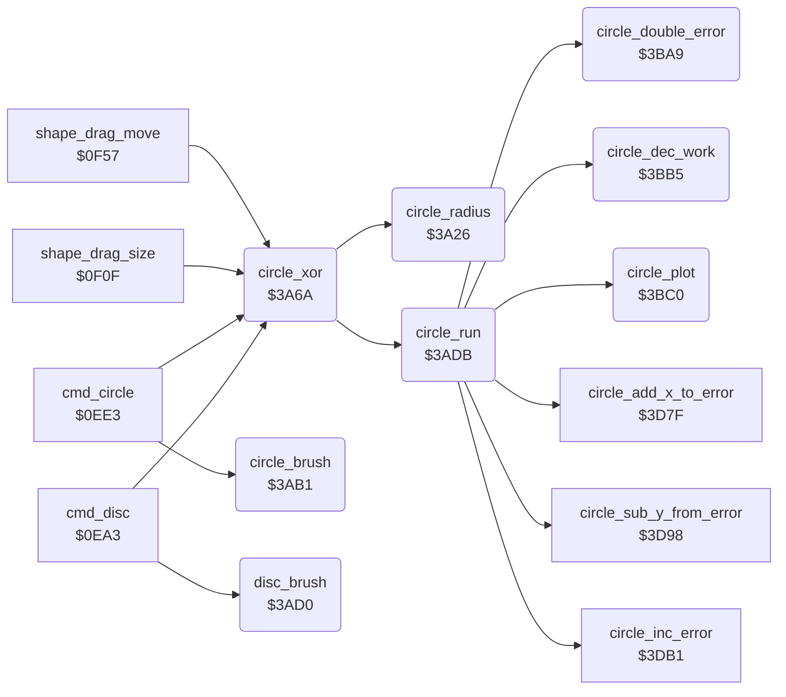

<!-- Generated by c64-docs from knowledge revision 20261025T214623.268-6ar633 and .c64-re-tools/local/generated/src/source-map.json. Do not edit: change the knowledge, generate the source again, then run docs.ts generate. -->
# graphics/circle.asm: Circle and Disc

Range `$3A26-$3BC2`. Source: [graphics/circle.asm](../../../../src/graphics/circle.asm). Index: [the reference](../../index.md).

## Routines

| Routine | Address | Reached from | Summary |
|---|---|---|---|
| [`circle_radius`](circle.md#circle_radius) | `$3A26` | [`circle_xor`](circle.md#circle_xor) | Exchanges the point shape_x0/shape_y0 with shape_x1/shape_y1, so that the circle code uses the second point as the centre. |
| [`circle_xor`](circle.md#circle_xor) | `$3A6A` | [`cmd_disc`](../tools/circle.md#cmd_disc), [`cmd_circle`](../tools/circle.md#cmd_circle), [`shape_drag_size`](../tools/circle.md#shape_drag_size), [`shape_drag_move`](../tools/circle.md#shape_drag_move) | Draws the circle of shape_x0/y0 and shape_x1/y1 with the XOR plot ($189f): the rubber circle of the Circle and Disc tools. |
| [`circle_brush`](circle.md#circle_brush) | `$3AB1` | [`cmd_circle`](../tools/circle.md#cmd_circle) | Draws the circle of shape_x0/y0 and shape_x1/y1 with the brush ($178a). |
| [`disc_brush`](circle.md#disc_brush) | `$3AD0` | [`cmd_disc`](../tools/circle.md#cmd_disc) | Draws the disc of shape_x0/y0 and shape_x1/y1 with the brush: circle_step_vector = $3bc3, which draws 2 lines at each step. |
| [`circle_run`](circle.md#circle_run) | `$3ADB` | [`circle_xor`](circle.md#circle_xor) | Steps through a quarter of the circle with the midpoint method: circle_dy starts at the radius, circle_dx at 0, the error (point_x1/point_y1) at 2 - 2 * radius. |
| [`circle_double_error`](circle.md#circle_double_error) | `$3BA9` | [`circle_run`](circle.md#circle_run) | Writes 2 * circle_error to cursor_x/cursor_y (a 16-bit work value). |
| [`circle_dec_work`](circle.md#circle_dec_work) | `$3BB5` | [`circle_run`](circle.md#circle_run) | Decrements the 16-bit value in cursor_x/cursor_y. |
| [`circle_plot`](circle.md#circle_plot) | `$3BC0` | [`circle_run`](circle.md#circle_run) | Jumps through circle_plot_vector. |

## Call graph

A solid arrow is a call, a thick arrow a table entry. Rounded nodes are in this file.

## Details

### [`circle_radius`](../../../../src/graphics/circle.asm#L6) `$3A26`

*routine*

Exchanges the point shape_x0/shape_y0 with shape_x1/shape_y1, so that the circle code uses the second point as the centre. The radius is the distance of the points in X plus the distance in Y, at most max_y. point_x0 and circle_dy get the radius, circle_dx gets 0.

- **Called from:** [`circle_xor`](circle.md#circle_xor)
- **Reads:** [`shape_y1`](../../memory-map.md#shape_y1), [`shape_y0`](../../memory-map.md#shape_y0), [`shape_x1`](../../memory-map.md#shape_x1), [`shape_x0`](../../memory-map.md#shape_x0), [`temp_word`](../../memory-map.md#temp_word), [`max_y`](../../memory-map.md#max_y)
- **Writes:** [`shape_y0`](../../memory-map.md#shape_y0), [`shape_y1`](../../memory-map.md#shape_y1), [`shape_x0`](../../memory-map.md#shape_x0), [`shape_x1`](../../memory-map.md#shape_x1), [`temp_word`](../../memory-map.md#temp_word), [`point_x0`](../../memory-map.md#point_x0), [`line_dx`](../../memory-map.md#line_dx), [`line_x_negative`](../../memory-map.md#line_x_negative), [`line_dy`](../../memory-map.md#line_dy), [`line_y_negative`](../../memory-map.md#line_y_negative)

| Label | Address | Comment |
|---|---|---|
| [`circle_radius_dx`](../../../../src/graphics/circle.asm#L22) | `$3A42` |  |
| [`circle_radius_sum`](../../../../src/graphics/circle.asm#L31) | `$3A50` |  |
| [`circle_radius_limit`](../../../../src/graphics/circle.asm#L37) | `$3A57` |  |
| [`circle_radius_set`](../../../../src/graphics/circle.asm#L42) | `$3A5D` |  |

### [`circle_xor`](../../../../src/graphics/circle.asm#L51) `$3A6A`

*routine*

Draws the circle of shape_x0/y0 and shape_x1/y1 with the XOR plot ($189f): the rubber circle of the Circle and Disc tools. Keeps the shape points and the circle points ($3e-$41).
circle_step_vector = $3c2e: plots 4 points at each step.

- **Called from:** [`cmd_disc`](../tools/circle.md#cmd_disc), [`cmd_circle`](../tools/circle.md#cmd_circle), [`shape_drag_size`](../tools/circle.md#shape_drag_size), [`shape_drag_move`](../tools/circle.md#shape_drag_move)
- **Calls:** [`circle_radius`](circle.md#circle_radius), [`circle_run`](circle.md#circle_run)
- **Reads:** [`shape_x0`](../../memory-map.md#shape_x0), [`shape_y0`](../../memory-map.md#shape_y0), [`shape_x1`](../../memory-map.md#shape_x1), [`shape_y1`](../../memory-map.md#shape_y1), [`delta_x`](../../memory-map.md#delta_x), [`circle_left_x`](../../memory-map.md#circle_left_x), [`delta_y`](../../memory-map.md#delta_y), [`circle_upper_y`](../../memory-map.md#circle_upper_y)
- **Writes:** [`line_error`](../../memory-map.md#line_error), [`plot_vector`](../../memory-map.md#plot_vector), [`circle_upper_y`](../../memory-map.md#circle_upper_y), [`delta_y`](../../memory-map.md#delta_y), [`circle_left_x`](../../memory-map.md#circle_left_x), [`delta_x`](../../memory-map.md#delta_x), [`shape_y1`](../../memory-map.md#shape_y1), [`shape_x1`](../../memory-map.md#shape_x1), [`shape_y0`](../../memory-map.md#shape_y0), [`shape_x0`](../../memory-map.md#shape_x0)

| Label | Address | Comment |
|---|---|---|
| [`circle_draw_with_plot`](../../../../src/graphics/circle.asm#L68) | `$3A86` |  |

### [`circle_brush`](../../../../src/graphics/circle.asm#L97) `$3AB1`

*routine*

Draws the circle of shape_x0/y0 and shape_x1/y1 with the brush ($178a).

- **Called from:** [`cmd_circle`](../tools/circle.md#cmd_circle)
- **Jumps to:** [`circle_draw_with_plot`](circle.md#circle_draw_with_plot)
- **Reads:** [`shape_x0`](../../memory-map.md#shape_x0), [`shape_y0`](../../memory-map.md#shape_y0), [`shape_x1`](../../memory-map.md#shape_x1), [`shape_y1`](../../memory-map.md#shape_y1)
- **Writes:** [`line_error`](../../memory-map.md#line_error), [`plot_vector`](../../memory-map.md#plot_vector)

| Label | Address | Comment |
|---|---|---|
| [`circle_brush_start`](../../../../src/graphics/circle.asm#L102) | `$3AB9` |  |

### [`disc_brush`](../../../../src/graphics/circle.asm#L117) `$3AD0`

*routine*

Draws the disc of shape_x0/y0 and shape_x1/y1 with the brush: circle_step_vector = $3bc3, which draws 2 lines at each step.

- **Called from:** [`cmd_disc`](../tools/circle.md#cmd_disc)
- **Jumps to:** [`circle_brush_start`](circle.md#circle_brush_start)
- **Writes:** [`line_error`](../../memory-map.md#line_error)

### [`circle_run`](../../../../src/graphics/circle.asm#L124) `$3ADB`

*routine*

Steps through a quarter of the circle with the midpoint method: circle_dy starts at the radius, circle_dx at 0, the error (point_x1/point_y1) at 2 - 2 * radius. It calls the routine of circle_step_vector for each point. That routine ends the loop when circle_dy is 0.

- **Called from:** [`circle_xor`](circle.md#circle_xor)
- **Calls:** [`circle_plot`](circle.md#circle_plot), [`circle_double_error`](circle.md#circle_double_error), [`circle_dec_work`](circle.md#circle_dec_work), [`circle_add_x_to_error`](circle_plot_3c21.md#circle_add_x_to_error), [`circle_inc_error`](circle_plot_3c21.md#circle_inc_error), [`circle_sub_y_from_error`](circle_plot_3c21.md#circle_sub_y_from_error)
- **Reads:** [`point_x0`](../../memory-map.md#point_x0), [`point_x1`](../../memory-map.md#point_x1), [`temp_word`](../../memory-map.md#temp_word), [`point_y1`](../../memory-map.md#point_y1), [`temp_word_hi`](../../memory-map.md#temp_word_hi), [`line_dx`](../../memory-map.md#line_dx), [`line_dy`](../../memory-map.md#line_dy), [`cursor_x`](../../memory-map.md#cursor_x), [`cursor_y`](../../memory-map.md#cursor_y), [`line_x_negative`](../../memory-map.md#line_x_negative), [`line_y_negative`](../../memory-map.md#line_y_negative)
- **Writes:** [`point_y1`](../../memory-map.md#point_y1), [`point_x1`](../../memory-map.md#point_x1), [`temp_word`](../../memory-map.md#temp_word), [`temp_word_hi`](../../memory-map.md#temp_word_hi), [`cursor_x`](../../memory-map.md#cursor_x), [`cursor_y`](../../memory-map.md#cursor_y), [`line_x_negative`](../../memory-map.md#line_x_negative), [`line_y_negative`](../../memory-map.md#line_y_negative), [`line_dy`](../../memory-map.md#line_dy), [`line_dx`](../../memory-map.md#line_dx)

| Label | Address | Comment |
|---|---|---|
| [`circle_loop`](../../../../src/graphics/circle.asm#L145) | `$3AFE` | Circle loop: chooses the next step from the sign of circle_error. |
| [`circle_err_negative`](../../../../src/graphics/circle.asm#L153) | `$3B0B` | Error < 0: t = 2 * error + 2 * circle_y_offset - 1 (in cursor_x/cursor_y). t <= 0: horizontal step, else diagonal step. |
| [`circle_neg_test_low`](../../../../src/graphics/circle.asm#L174) | `$3B30` |  |
| [`circle_step_x`](../../../../src/graphics/circle.asm#L179) | `$3B37` | Horizontal step: circle_x_offset + 1, plot, error + 2 * circle_x_offset + 1. |
| [`circle_step_x_plot`](../../../../src/graphics/circle.asm#L184) | `$3B3D` |  |
| [`circle_step_diagonal`](../../../../src/graphics/circle.asm#L190) | `$3B49` | Diagonal step: circle_x_offset + 1, circle_y_offset - 1, plot, error + 2 * circle_x_offset - 2 * circle_y_offset + 2. |
| [`circle_diag_dec_y`](../../../../src/graphics/circle.asm#L195) | `$3B4F` |  |
| [`circle_diag_dec_y_lo`](../../../../src/graphics/circle.asm#L200) | `$3B55` |  |
| [`circle_step_y`](../../../../src/graphics/circle.asm#L209) | `$3B69` | Vertical step: circle_y_offset - 1, plot, error - 2 * circle_y_offset + 1. |
| [`circle_step_y_lo`](../../../../src/graphics/circle.asm#L214) | `$3B6F` |  |
| [`circle_err_positive`](../../../../src/graphics/circle.asm#L221) | `$3B7D` | Error > 0: t = 2 * error - 2 * circle_x_offset - 1. t <= 0: diagonal step, else vertical step. |
| [`circle_pos_test_low`](../../../../src/graphics/circle.asm#L242) | `$3BA2` |  |

### [`circle_double_error`](../../../../src/graphics/circle.asm#L247) `$3BA9`

*routine*

Writes 2 * circle_error to cursor_x/cursor_y (a 16-bit work value).

- **Called from:** [`circle_run`](circle.md#circle_run)
- **Reads:** [`point_x1`](../../memory-map.md#point_x1), [`point_y1`](../../memory-map.md#point_y1)
- **Writes:** [`cursor_x`](../../memory-map.md#cursor_x), [`cursor_y`](../../memory-map.md#cursor_y)

### [`circle_dec_work`](../../../../src/graphics/circle.asm#L257) `$3BB5`

*routine*

Decrements the 16-bit value in cursor_x/cursor_y. Output: A = the high byte (cursor_y), with the N and Z flags of it.

- **Called from:** [`circle_run`](circle.md#circle_run)
- **Reads:** [`cursor_x`](../../memory-map.md#cursor_x), [`cursor_y`](../../memory-map.md#cursor_y)
- **Writes:** [`cursor_y`](../../memory-map.md#cursor_y), [`cursor_x`](../../memory-map.md#cursor_x)

| Label | Address | Comment |
|---|---|---|
| [`circle_dec_work_lo`](../../../../src/graphics/circle.asm#L261) | `$3BBB` |  |

### [`circle_plot`](../../../../src/graphics/circle.asm#L266) `$3BC0`

*routine*

Jumps through circle_plot_vector. The plot routine ends the circle (it drops the return address of circle_plot) when circle_y_offset is 0.

- **Called from:** [`circle_run`](circle.md#circle_run)
- **Jumps to:** `$0008`
- **Reads:** [`line_error`](../../memory-map.md#line_error)
