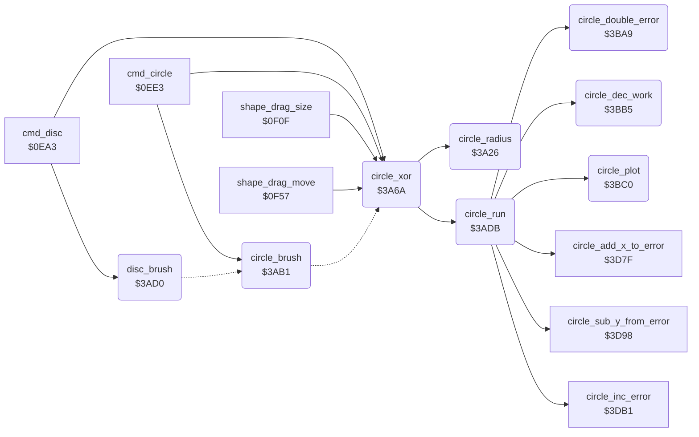

<!-- Generated by c64-docs from knowledge revision 20261024T063910.298-7zz1bw and .c64-re-tools/local/generated/src/source-map.json. Do not edit: change the knowledge, generate the source again, then run docs.ts generate. -->
# graphics/circle.asm: Circle and Disc

Range `$3A26-$3BC2`. Source: [graphics/circle.asm](../../../../src/graphics/circle.asm). Index: [the reference](../../index.md).

## Call graph

A solid arrow is a call, a thick arrow a table entry, a dotted arrow a jump. Rounded nodes are in this file.

## Names

### [`circle_radius`](../../../../src/graphics/circle.asm#L6) `$3A26`

*routine*

Exchanges the point shape_x0/shape_y0 with shape_x1/shape_y1, so that the circle code uses the second point as the centre. The radius is the distance of the points in X plus the distance in Y, at most max_y. point_x0 and circle_dy get the radius, circle_dx gets 0.

- **Called from:** [`circle_xor`](circle.md#circle_xor) [`$3A92`](../../../../src/graphics/circle.asm#L77)
- **Reads:** [`shape_y1`](../../memory-map.md#shape_y1), [`shape_y0`](../../memory-map.md#shape_y0), [`shape_x1`](../../memory-map.md#shape_x1), [`shape_x0`](../../memory-map.md#shape_x0), [`temp_word`](../../memory-map.md#temp_word), [`max_y`](../../memory-map.md#max_y)
- **Writes:** [`shape_y0`](../../memory-map.md#shape_y0), [`shape_y1`](../../memory-map.md#shape_y1), [`shape_x0`](../../memory-map.md#shape_x0), [`shape_x1`](../../memory-map.md#shape_x1), [`temp_word`](../../memory-map.md#temp_word), [`point_x0`](../../memory-map.md#point_x0), [`line_dx`](../../memory-map.md#line_dx), [`line_x_negative`](../../memory-map.md#line_x_negative), [`line_dy`](../../memory-map.md#line_dy), [`line_y_negative`](../../memory-map.md#line_y_negative)

### [`circle_radius_dx`](../../../../src/graphics/circle.asm#L22) `$3A42`

*label*

- **Jumped to from:** [`circle_radius`](circle.md#circle_radius) [`$3A3B`](../../../../src/graphics/circle.asm#L18)

### [`circle_radius_sum`](../../../../src/graphics/circle.asm#L31) `$3A50`

*label*

- **Jumped to from:** [`circle_radius`](circle.md#circle_radius) [`$3A49`](../../../../src/graphics/circle.asm#L27)

### [`circle_radius_limit`](../../../../src/graphics/circle.asm#L37) `$3A57`

*label*

- **Jumped to from:** [`circle_radius`](circle.md#circle_radius) [`$3A53`](../../../../src/graphics/circle.asm#L34)

### [`circle_radius_set`](../../../../src/graphics/circle.asm#L42) `$3A5D`

*label*

- **Jumped to from:** [`circle_radius`](circle.md#circle_radius) [`$3A59`](../../../../src/graphics/circle.asm#L39)

### [`circle_xor`](../../../../src/graphics/circle.asm#L51) `$3A6A`

*routine*

Draws the circle of shape_x0/y0 and shape_x1/y1 with the XOR plot ($189f): the rubber circle of the Circle and Disc tools. Keeps the shape points and the circle points ($3e-$41).
circle_step_vector = $3c2e: plots 4 points at each step.

- **Called from:** [`cmd_disc`](../tools/circle.md#cmd_disc) [`$0EB9`](../../../../src/tools/circle.asm#L17), [`cmd_disc`](../tools/circle.md#cmd_disc) [`$0EBF`](../../../../src/tools/circle.asm#L19), [`cmd_circle`](../tools/circle.md#cmd_circle) [`$0EF9`](../../../../src/tools/circle.asm#L49), [`cmd_circle`](../tools/circle.md#cmd_circle) [`$0EFF`](../../../../src/tools/circle.asm#L51), [`shape_drag_size`](../tools/circle.md#shape_drag_size) [`$0F17`](../../../../src/tools/circle.asm#L62), [`shape_drag_size`](../tools/circle.md#shape_drag_size) [`$0F28`](../../../../src/tools/circle.asm#L71), [`shape_drag_size`](../tools/circle.md#shape_drag_size) [`$0F48`](../../../../src/tools/circle.asm#L90), [`shape_drag_size`](../tools/circle.md#shape_drag_size) [`$0F51`](../../../../src/tools/circle.asm#L95), [`shape_drag_move`](../tools/circle.md#shape_drag_move) [`$0FA7`](../../../../src/tools/circle.asm#L141), [`shape_drag_move`](../tools/circle.md#shape_drag_move) [`$0FB8`](../../../../src/tools/circle.asm#L150), [`shape_drag_move`](../tools/circle.md#shape_drag_move) [`$0FD5`](../../../../src/tools/circle.asm#L167), [`shape_drag_move`](../tools/circle.md#shape_drag_move) [`$1022`](../../../../src/tools/circle.asm#L214)
- **Calls:** [`circle_radius`](circle.md#circle_radius), [`circle_run`](circle.md#circle_run)
- **Reads:** [`shape_x0`](../../memory-map.md#shape_x0), [`shape_y0`](../../memory-map.md#shape_y0), [`shape_x1`](../../memory-map.md#shape_x1), [`shape_y1`](../../memory-map.md#shape_y1), [`delta_x`](../../memory-map.md#delta_x), [`circle_left_x`](../../memory-map.md#circle_left_x), [`delta_y`](../../memory-map.md#delta_y), [`circle_upper_y`](../../memory-map.md#circle_upper_y)
- **Writes:** [`line_error`](../../memory-map.md#line_error), [`line_error+1`](../../memory-map.md#line_error), [`plot_vector`](../../memory-map.md#plot_vector), [`plot_vector+1`](../../memory-map.md#plot_vector), [`circle_upper_y`](../../memory-map.md#circle_upper_y), [`delta_y`](../../memory-map.md#delta_y), [`circle_left_x`](../../memory-map.md#circle_left_x), [`delta_x`](../../memory-map.md#delta_x), [`shape_y1`](../../memory-map.md#shape_y1), [`shape_x1`](../../memory-map.md#shape_x1), [`shape_y0`](../../memory-map.md#shape_y0), [`shape_x0`](../../memory-map.md#shape_x0)

### [`circle_draw_with_plot`](../../../../src/graphics/circle.asm#L68) `$3A86`

*label*

- **Jumped to from:** [`circle_brush`](circle.md#circle_brush) [`$3ACD`](../../../../src/graphics/circle.asm#L115)

### [`circle_brush`](../../../../src/graphics/circle.asm#L97) `$3AB1`

*routine*

Draws the circle of shape_x0/y0 and shape_x1/y1 with the brush ($178a).

- **Called from:** [`cmd_circle`](../tools/circle.md#cmd_circle) [`$0F09`](../../../../src/tools/circle.asm#L55)
- **Jumps to:** [`circle_draw_with_plot`](circle.md#circle_draw_with_plot)
- **Reads:** [`shape_x0`](../../memory-map.md#shape_x0), [`shape_y0`](../../memory-map.md#shape_y0), [`shape_x1`](../../memory-map.md#shape_x1), [`shape_y1`](../../memory-map.md#shape_y1)
- **Writes:** [`line_error`](../../memory-map.md#line_error), [`line_error+1`](../../memory-map.md#line_error), [`plot_vector`](../../memory-map.md#plot_vector), [`plot_vector+1`](../../memory-map.md#plot_vector)

### [`circle_brush_start`](../../../../src/graphics/circle.asm#L102) `$3AB9`

*label*

- **Jumped to from:** [`disc_brush`](circle.md#disc_brush) [`$3AD8`](../../../../src/graphics/circle.asm#L122)

### [`disc_brush`](../../../../src/graphics/circle.asm#L117) `$3AD0`

*routine*

Draws the disc of shape_x0/y0 and shape_x1/y1 with the brush: circle_step_vector = $3bc3, which draws 2 lines at each step.

- **Called from:** [`cmd_disc`](../tools/circle.md#cmd_disc) [`$0ED7`](../../../../src/tools/circle.asm#L31)
- **Jumps to:** [`circle_brush_start`](circle.md#circle_brush_start)
- **Writes:** [`line_error`](../../memory-map.md#line_error), [`line_error+1`](../../memory-map.md#line_error)

### [`circle_run`](../../../../src/graphics/circle.asm#L124) `$3ADB`

*routine*

Steps through a quarter of the circle with the midpoint method: circle_dy starts at the radius, circle_dx at 0, the error (point_x1/point_y1) at 2 - 2 * radius. It calls the routine of circle_step_vector for each point. That routine ends the loop when circle_dy is 0.

- **Called from:** [`circle_xor`](circle.md#circle_xor) [`$3A95`](../../../../src/graphics/circle.asm#L78)
- **Calls:** [`circle_plot`](circle.md#circle_plot), [`circle_double_error`](circle.md#circle_double_error), [`circle_dec_work`](circle.md#circle_dec_work), [`circle_add_x_to_error`](circle_plot_3c21.md#circle_add_x_to_error), [`circle_inc_error`](circle_plot_3c21.md#circle_inc_error), [`circle_sub_y_from_error`](circle_plot_3c21.md#circle_sub_y_from_error)
- **Reads:** [`point_x0`](../../memory-map.md#point_x0), [`point_x1`](../../memory-map.md#point_x1), [`temp_word`](../../memory-map.md#temp_word), [`point_y1`](../../memory-map.md#point_y1), [`temp_word_hi`](../../memory-map.md#temp_word_hi), [`line_dx`](../../memory-map.md#line_dx), [`line_dy`](../../memory-map.md#line_dy), [`cursor_x`](../../memory-map.md#cursor_x), [`cursor_y`](../../memory-map.md#cursor_y), [`line_x_negative`](../../memory-map.md#line_x_negative), [`line_y_negative`](../../memory-map.md#line_y_negative)
- **Writes:** [`point_y1`](../../memory-map.md#point_y1), [`point_x1`](../../memory-map.md#point_x1), [`temp_word`](../../memory-map.md#temp_word), [`temp_word_hi`](../../memory-map.md#temp_word_hi), [`cursor_x`](../../memory-map.md#cursor_x), [`cursor_y`](../../memory-map.md#cursor_y), [`line_x_negative`](../../memory-map.md#line_x_negative), [`line_y_negative`](../../memory-map.md#line_y_negative), [`line_dy`](../../memory-map.md#line_dy), [`line_dx`](../../memory-map.md#line_dx)

### [`circle_loop`](../../../../src/graphics/circle.asm#L145) `$3AFE`

*label*

Circle loop: chooses the next step from the sign of circle_error.

- **Jumped to from:** [`circle_run`](circle.md#circle_run) [`$3B46`](../../../../src/graphics/circle.asm#L188), [`circle_run`](circle.md#circle_run) [`$3B66`](../../../../src/graphics/circle.asm#L207), [`circle_run`](circle.md#circle_run) [`$3B7A`](../../../../src/graphics/circle.asm#L219)

### [`circle_err_negative`](../../../../src/graphics/circle.asm#L153) `$3B0B`

*label*

Error < 0: t = 2 * error + 2 * circle_y_offset - 1 (in cursor_x/cursor_y). t <= 0: horizontal step, else diagonal step.

- **Jumped to from:** [`circle_run`](circle.md#circle_run) [`$3B06`](../../../../src/graphics/circle.asm#L150)

### [`circle_neg_test_low`](../../../../src/graphics/circle.asm#L174) `$3B30`

*label*

- **Jumped to from:** [`circle_run`](circle.md#circle_run) [`$3B2B`](../../../../src/graphics/circle.asm#L171)

### [`circle_step_x`](../../../../src/graphics/circle.asm#L179) `$3B37`

*label*

Horizontal step: circle_x_offset + 1, plot, error + 2 * circle_x_offset + 1.

- **Jumped to from:** [`circle_run`](circle.md#circle_run) [`$3B29`](../../../../src/graphics/circle.asm#L170), [`circle_run`](circle.md#circle_run) [`$3B32`](../../../../src/graphics/circle.asm#L176)

### [`circle_step_x_plot`](../../../../src/graphics/circle.asm#L184) `$3B3D`

*label*

- **Jumped to from:** [`circle_run`](circle.md#circle_run) [`$3B39`](../../../../src/graphics/circle.asm#L181)

### [`circle_step_diagonal`](../../../../src/graphics/circle.asm#L190) `$3B49`

*label*

Diagonal step: circle_x_offset + 1, circle_y_offset - 1, plot, error + 2 * circle_x_offset - 2 * circle_y_offset + 2.

- **Jumped to from:** [`circle_run`](circle.md#circle_run) [`$3B02`](../../../../src/graphics/circle.asm#L148), [`circle_run`](circle.md#circle_run) [`$3B2D`](../../../../src/graphics/circle.asm#L173), [`circle_run`](circle.md#circle_run) [`$3B34`](../../../../src/graphics/circle.asm#L177), [`circle_run`](circle.md#circle_run) [`$3B9B`](../../../../src/graphics/circle.asm#L238), [`circle_run`](circle.md#circle_run) [`$3BA4`](../../../../src/graphics/circle.asm#L244)

### [`circle_diag_dec_y`](../../../../src/graphics/circle.asm#L195) `$3B4F`

*label*

- **Jumped to from:** [`circle_run`](circle.md#circle_run) [`$3B4B`](../../../../src/graphics/circle.asm#L192)

### [`circle_diag_dec_y_lo`](../../../../src/graphics/circle.asm#L200) `$3B55`

*label*

- **Jumped to from:** [`circle_run`](circle.md#circle_run) [`$3B51`](../../../../src/graphics/circle.asm#L197)

### [`circle_step_y`](../../../../src/graphics/circle.asm#L209) `$3B69`

*label*

Vertical step: circle_y_offset - 1, plot, error - 2 * circle_y_offset + 1.

- **Jumped to from:** [`circle_run`](circle.md#circle_run) [`$3B9F`](../../../../src/graphics/circle.asm#L241), [`circle_run`](circle.md#circle_run) [`$3BA6`](../../../../src/graphics/circle.asm#L245)

### [`circle_step_y_lo`](../../../../src/graphics/circle.asm#L214) `$3B6F`

*label*

- **Jumped to from:** [`circle_run`](circle.md#circle_run) [`$3B6B`](../../../../src/graphics/circle.asm#L211)

### [`circle_err_positive`](../../../../src/graphics/circle.asm#L221) `$3B7D`

*label*

Error > 0: t = 2 * error - 2 * circle_x_offset - 1. t <= 0: diagonal step, else vertical step.

- **Jumped to from:** [`circle_run`](circle.md#circle_run) [`$3B08`](../../../../src/graphics/circle.asm#L151)

### [`circle_pos_test_low`](../../../../src/graphics/circle.asm#L242) `$3BA2`

*label*

- **Jumped to from:** [`circle_run`](circle.md#circle_run) [`$3B9D`](../../../../src/graphics/circle.asm#L239)

### [`circle_double_error`](../../../../src/graphics/circle.asm#L247) `$3BA9`

*routine*

Writes 2 * circle_error to cursor_x/cursor_y (a 16-bit work value).

- **Called from:** [`circle_run`](circle.md#circle_run) [`$3B0B`](../../../../src/graphics/circle.asm#L154), [`circle_run`](circle.md#circle_run) [`$3B7D`](../../../../src/graphics/circle.asm#L222)
- **Reads:** [`point_x1`](../../memory-map.md#point_x1), [`point_y1`](../../memory-map.md#point_y1)
- **Writes:** [`cursor_x`](../../memory-map.md#cursor_x), [`cursor_y`](../../memory-map.md#cursor_y)

### [`circle_dec_work`](../../../../src/graphics/circle.asm#L257) `$3BB5`

*routine*

Decrements the 16-bit value in cursor_x/cursor_y. Output: A = the high byte (cursor_y), with the N and Z flags of it.

- **Called from:** [`circle_run`](circle.md#circle_run) [`$3B26`](../../../../src/graphics/circle.asm#L169), [`circle_run`](circle.md#circle_run) [`$3B98`](../../../../src/graphics/circle.asm#L237)
- **Reads:** [`cursor_x`](../../memory-map.md#cursor_x), [`cursor_y`](../../memory-map.md#cursor_y)
- **Writes:** [`cursor_y`](../../memory-map.md#cursor_y), [`cursor_x`](../../memory-map.md#cursor_x)

### [`circle_dec_work_lo`](../../../../src/graphics/circle.asm#L261) `$3BBB`

*label*

- **Jumped to from:** [`circle_dec_work`](circle.md#circle_dec_work) [`$3BB7`](../../../../src/graphics/circle.asm#L259)

### [`circle_plot`](../../../../src/graphics/circle.asm#L266) `$3BC0`

*routine*

Jumps through circle_plot_vector. The plot routine ends the circle (it drops the return address of circle_plot) when circle_y_offset is 0.

- **Called from:** [`circle_run`](circle.md#circle_run) [`$3ADB`](../../../../src/graphics/circle.asm#L125), [`circle_run`](circle.md#circle_run) [`$3B3D`](../../../../src/graphics/circle.asm#L185), [`circle_run`](circle.md#circle_run) [`$3B57`](../../../../src/graphics/circle.asm#L202), [`circle_run`](circle.md#circle_run) [`$3B71`](../../../../src/graphics/circle.asm#L216)
- **Jumps to:** `$0008`
- **Reads:** [`line_error`](../../memory-map.md#line_error)
