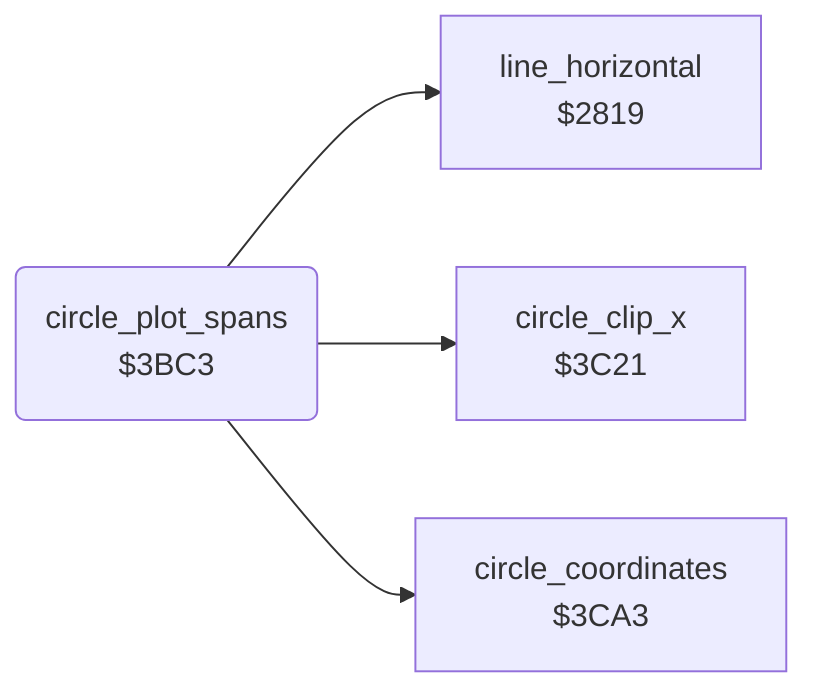

<!-- Generated by c64-docs from knowledge revision 20261025T214623.268-6ar633 and .c64-re-tools/local/generated/src/source-map.json. Do not edit: change the knowledge, generate the source again, then run docs.ts generate. -->
# graphics/circle_plot.asm: Circle and Disc Plot Routines

Range `$3BC3-$3C1F`. Source: [graphics/circle_plot.asm](../../../../src/graphics/circle_plot.asm). Index: [the reference](../../index.md).

## Routines

| Routine | Address | Reached from | Summary |
|---|---|---|---|
| [`circle_plot_spans`](circle_plot.md#circle_plot_spans) | `$3BC3` |  | Plot routine of the disc: draws the row circle_y_down and the row circle_y_up from circle_x_right to circle_x_left with the span routine at $2819. |

## Call graph

A solid arrow is a call, a thick arrow a table entry. Rounded nodes are in this file.

## Details

### [`circle_plot_spans`](../../../../src/graphics/circle_plot.asm#L6) `$3BC3`

*routine*

Plot routine of the disc: draws the row circle_y_down and the row circle_y_up from circle_x_right to circle_x_left with the span routine at $2819. It skips a row outside 0-draw_max_y. It keeps shape_x0, shape_y0 and shape_x1. When circle_y_offset is 0, it returns from the caller of circle_plot.

- **Calls:** [`circle_coordinates`](circle_plot_3c21.md#circle_coordinates), [`circle_clip_x`](circle_plot_3c21.md#circle_clip_x), [`line_horizontal`](bresenham_line.md#line_horizontal)
- **Reads:** [`shape_x0`](../../memory-map.md#shape_x0), [`shape_y0`](../../memory-map.md#shape_y0), [`shape_x1`](../../memory-map.md#shape_x1), [`delta_x`](../../memory-map.md#delta_x), [`delta_y`](../../memory-map.md#delta_y), [`max_y`](../../memory-map.md#max_y), [`circle_left_x`](../../memory-map.md#circle_left_x), [`circle_upper_y`](../../memory-map.md#circle_upper_y), [`line_dy`](../../memory-map.md#line_dy), [`line_dx`](../../memory-map.md#line_dx)
- **Writes:** [`shape_x0`](../../memory-map.md#shape_x0), [`max_y`](../../memory-map.md#max_y), [`shape_y0`](../../memory-map.md#shape_y0), [`shape_x1`](../../memory-map.md#shape_x1)

| Label | Address | Comment |
|---|---|---|
| [`circle_spans_row_up`](../../../../src/graphics/circle_plot.asm#L27) | `$3BEC` |  |
| [`circle_spans_restore`](../../../../src/graphics/circle_plot.asm#L41) | `$3C09` |  |
| [`circle_spans_return`](../../../../src/graphics/circle_plot.asm#L53) | `$3C1C` |  |
| [`circle_spans_end`](../../../../src/graphics/circle_plot.asm#L55) | `$3C1D` | Drop the return address of circle_plot: the circle is complete. |
