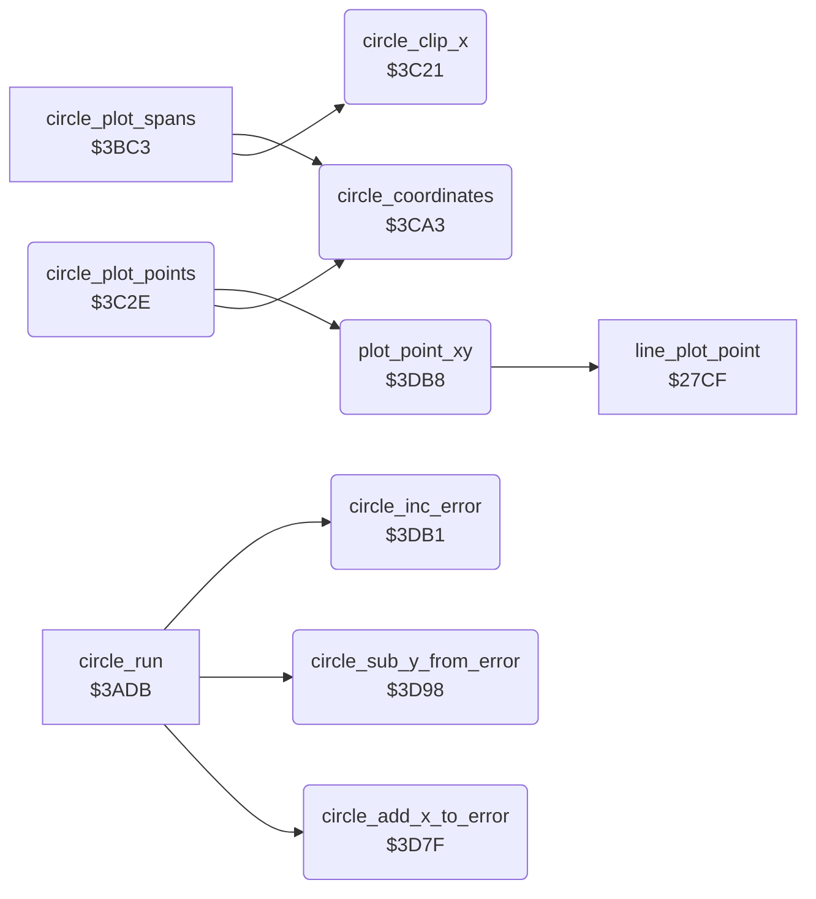

<!-- Generated by c64-docs from knowledge revision 20261025T214623.268-6ar633 and .c64-re-tools/local/generated/src/source-map.json. Do not edit: change the knowledge, generate the source again, then run docs.ts generate. -->
# graphics/circle_plot_3c21.asm

Range `$3C21-$3DCB`. Source: [graphics/circle_plot_3c21.asm](../../../../src/graphics/circle_plot_3c21.asm). Index: [the reference](../../index.md).

## Routines

| Routine | Address | Reached from | Summary |
|---|---|---|---|
| [`circle_clip_x`](circle_plot_3c21.md#circle_clip_x) | `$3C21` | [`circle_plot_spans`](circle_plot.md#circle_plot_spans) | Clips a circle X coordinate. |
| [`circle_plot_points`](circle_plot_3c21.md#circle_plot_points) | `$3C2E` |  | Plot routine of the circle outline: plots the four points (circle_x_right, circle_y_down), (circle_x_right, circle_y_up), (circle_x_left, circle_y_down) and (circle_x_left, circle_y_up) with plot_point_xy. |
| [`circle_coordinates`](circle_plot_3c21.md#circle_coordinates) | `$3CA3` | [`circle_plot_spans`](circle_plot.md#circle_plot_spans), [`circle_plot_points`](circle_plot_3c21.md#circle_plot_points) | Calculates the four circle coordinates from the centre (shape_x0, shape_y0), circle_x_offset and circle_y_offset: circle_x_right/left = shape_x0 +/- 3/4 * circle_x_offset, circle_y_down/up = shape_y0 +/- circle_y_offset. |
| [`circle_add_x_to_error`](circle_plot_3c21.md#circle_add_x_to_error) | `$3D7F` | [`circle_run`](circle.md#circle_run) | circle_error = circle_error + 2 * circle_x_offset. |
| [`circle_sub_y_from_error`](circle_plot_3c21.md#circle_sub_y_from_error) | `$3D98` | [`circle_run`](circle.md#circle_run) | circle_error = circle_error - 2 * circle_y_offset. |
| [`circle_inc_error`](circle_plot_3c21.md#circle_inc_error) | `$3DB1` | [`circle_run`](circle.md#circle_run) | circle_error = circle_error + 1. |
| [`plot_point_xy`](circle_plot_3c21.md#plot_point_xy) | `$3DB8` | [`circle_plot_points`](circle_plot_3c21.md#circle_plot_points) | Plots the current brush at X = X register, Y = Y register with the plot routine at $27cf. |

## Call graph

A solid arrow is a call, a thick arrow a table entry. Rounded nodes are in this file.

## Details

### [`circle_clip_x`](../../../../src/graphics/circle_plot_3c21.asm#L6) `$3C21`

*routine*

Clips a circle X coordinate. Input A: X, $fe (below 0) or $ff (above draw_max_x). Output A: 0 for $fe, draw_max_x for $ff, else X.

- **Called from:** [`circle_plot_spans`](circle_plot.md#circle_plot_spans)
- **Reads:** [`max_x`](../../memory-map.md#max_x)

| Label | Address | Comment |
|---|---|---|
| [`circle_clip_x_high`](../../../../src/graphics/circle_plot_3c21.asm#L10) | `$3C27` |  |
| [`circle_clip_x_done`](../../../../src/graphics/circle_plot_3c21.asm#L15) | `$3C2D` |  |

### [`circle_plot_points`](../../../../src/graphics/circle_plot_3c21.asm#L18) `$3C2E`

*routine*

Plot routine of the circle outline: plots the four points (circle_x_right, circle_y_down), (circle_x_right, circle_y_up), (circle_x_left, circle_y_down) and (circle_x_left, circle_y_up) with plot_point_xy. It skips a point outside the drawing area. When circle_y_offset is 0, it returns from the caller of circle_plot.

- **Calls:** [`circle_coordinates`](circle_plot_3c21.md#circle_coordinates), [`plot_point_xy`](circle_plot_3c21.md#plot_point_xy)
- **Reads:** [`delta_x`](../../memory-map.md#delta_x), [`max_x`](../../memory-map.md#max_x), [`delta_y`](../../memory-map.md#delta_y), [`max_y`](../../memory-map.md#max_y), [`circle_upper_y`](../../memory-map.md#circle_upper_y), [`circle_left_x`](../../memory-map.md#circle_left_x), [`line_dy`](../../memory-map.md#line_dy), [`line_dx`](../../memory-map.md#line_dx)
- **Writes:** [`max_x`](../../memory-map.md#max_x), [`max_y`](../../memory-map.md#max_y)

| Label | Address | Comment |
|---|---|---|
| [`circle_point_right_up`](../../../../src/graphics/circle_plot_3c21.asm#L33) | `$3C4A` |  |
| [`circle_point_left_down`](../../../../src/graphics/circle_plot_3c21.asm#L47) | `$3C63` |  |
| [`circle_point_left_up`](../../../../src/graphics/circle_plot_3c21.asm#L61) | `$3C7C` |  |
| [`circle_points_test_end`](../../../../src/graphics/circle_plot_3c21.asm#L75) | `$3C95` |  |
| [`circle_points_return`](../../../../src/graphics/circle_plot_3c21.asm#L81) | `$3C9F` |  |
| [`circle_points_end`](../../../../src/graphics/circle_plot_3c21.asm#L83) | `$3CA0` | Drop the return address of circle_plot: the circle is complete. |

### [`circle_coordinates`](../../../../src/graphics/circle_plot_3c21.asm#L88) `$3CA3`

*routine*

Calculates the four circle coordinates from the centre (shape_x0, shape_y0), circle_x_offset and circle_y_offset: circle_x_right/left = shape_x0 +/- 3/4 * circle_x_offset, circle_y_down/up = shape_y0 +/- circle_y_offset. A coordinate below 0 becomes $fe, a coordinate above draw_max_x or draw_max_y becomes $ff.
temp_word = 3 * circle_x_offset.

- **Called from:** [`circle_plot_spans`](circle_plot.md#circle_plot_spans), [`circle_plot_points`](circle_plot_3c21.md#circle_plot_points)
- **Reads:** [`line_x_negative`](../../memory-map.md#line_x_negative), [`line_y_negative`](../../memory-map.md#line_y_negative), [`temp_word`](../../memory-map.md#temp_word), [`temp_word_hi`](../../memory-map.md#temp_word_hi), [`shape_x0`](../../memory-map.md#shape_x0), [`max_x`](../../memory-map.md#max_x), [`circle_left_x`](../../memory-map.md#circle_left_x), [`shape_y0`](../../memory-map.md#shape_y0), [`line_dx`](../../memory-map.md#line_dx), [`line_dy`](../../memory-map.md#line_dy), [`max_y`](../../memory-map.md#max_y), [`circle_upper_y`](../../memory-map.md#circle_upper_y)
- **Writes:** [`temp_word`](../../memory-map.md#temp_word), [`temp_word_hi`](../../memory-map.md#temp_word_hi), [`delta_x`](../../memory-map.md#delta_x), [`max_x`](../../memory-map.md#max_x), [`circle_left_x`](../../memory-map.md#circle_left_x), [`delta_y`](../../memory-map.md#delta_y), [`max_y`](../../memory-map.md#max_y), [`circle_upper_y`](../../memory-map.md#circle_upper_y)

| Label | Address | Comment |
|---|---|---|
| [`circle_coord_right_neg`](../../../../src/graphics/circle_plot_3c21.asm#L122) | `$3CDA` |  |
| [`circle_coord_right_max`](../../../../src/graphics/circle_plot_3c21.asm#L130) | `$3CE7` |  |
| [`circle_coord_left`](../../../../src/graphics/circle_plot_3c21.asm#L138) | `$3CF3` |  |
| [`circle_coord_left_hi`](../../../../src/graphics/circle_plot_3c21.asm#L149) | `$3D07` |  |
| [`circle_coord_left_max`](../../../../src/graphics/circle_plot_3c21.asm#L155) | `$3D10` |  |
| [`circle_coord_down`](../../../../src/graphics/circle_plot_3c21.asm#L164) | `$3D1E` |  |
| [`circle_coord_down_hi`](../../../../src/graphics/circle_plot_3c21.asm#L177) | `$3D34` |  |
| [`circle_coord_down_max`](../../../../src/graphics/circle_plot_3c21.asm#L183) | `$3D3D` |  |
| [`circle_coord_down_store`](../../../../src/graphics/circle_plot_3c21.asm#L192) | `$3D4E` |  |
| [`circle_coord_up`](../../../../src/graphics/circle_plot_3c21.asm#L194) | `$3D50` |  |
| [`circle_coord_up_hi`](../../../../src/graphics/circle_plot_3c21.asm#L206) | `$3D64` |  |
| [`circle_coord_up_max`](../../../../src/graphics/circle_plot_3c21.asm#L212) | `$3D6D` |  |
| [`circle_coord_done`](../../../../src/graphics/circle_plot_3c21.asm#L222) | `$3D7E` |  |

### [`circle_add_x_to_error`](../../../../src/graphics/circle_plot_3c21.asm#L225) `$3D7F`

*routine*

circle_error = circle_error + 2 * circle_x_offset.

- **Called from:** [`circle_run`](circle.md#circle_run)
- **Reads:** [`line_x_negative`](../../memory-map.md#line_x_negative), [`line_y_negative`](../../memory-map.md#line_y_negative), [`point_x1`](../../memory-map.md#point_x1), [`temp_word`](../../memory-map.md#temp_word), [`point_y1`](../../memory-map.md#point_y1), [`temp_word_hi`](../../memory-map.md#temp_word_hi)
- **Writes:** [`temp_word`](../../memory-map.md#temp_word), [`temp_word_hi`](../../memory-map.md#temp_word_hi), [`point_x1`](../../memory-map.md#point_x1), [`point_y1`](../../memory-map.md#point_y1)

### [`circle_sub_y_from_error`](../../../../src/graphics/circle_plot_3c21.asm#L242) `$3D98`

*routine*

circle_error = circle_error - 2 * circle_y_offset.

- **Called from:** [`circle_run`](circle.md#circle_run)
- **Reads:** [`line_dx`](../../memory-map.md#line_dx), [`line_dy`](../../memory-map.md#line_dy), [`point_x1`](../../memory-map.md#point_x1), [`temp_word`](../../memory-map.md#temp_word), [`point_y1`](../../memory-map.md#point_y1), [`temp_word_hi`](../../memory-map.md#temp_word_hi)
- **Writes:** [`temp_word`](../../memory-map.md#temp_word), [`temp_word_hi`](../../memory-map.md#temp_word_hi), [`point_x1`](../../memory-map.md#point_x1), [`point_y1`](../../memory-map.md#point_y1)

### [`circle_inc_error`](../../../../src/graphics/circle_plot_3c21.asm#L259) `$3DB1`

*routine*

circle_error = circle_error + 1.

- **Called from:** [`circle_run`](circle.md#circle_run)
- **Reads:** [`point_x1`](../../memory-map.md#point_x1), [`point_y1`](../../memory-map.md#point_y1)
- **Writes:** [`point_x1`](../../memory-map.md#point_x1), [`point_y1`](../../memory-map.md#point_y1)

| Label | Address | Comment |
|---|---|---|
| [`circle_inc_error_done`](../../../../src/graphics/circle_plot_3c21.asm#L263) | `$3DB7` |  |

### [`plot_point_xy`](../../../../src/graphics/circle_plot_3c21.asm#L266) `$3DB8`

*routine*

Plots the current brush at X = X register, Y = Y register with the plot routine at $27cf. cursor_x and cursor_y do not change.

- **Called from:** [`circle_plot_points`](circle_plot_3c21.md#circle_plot_points)
- **Calls:** [`line_plot_point`](bresenham_line.md#line_plot_point)
- **Reads:** [`cursor_x`](../../memory-map.md#cursor_x), [`cursor_y`](../../memory-map.md#cursor_y)
- **Writes:** [`cursor_x`](../../memory-map.md#cursor_x), [`cursor_y`](../../memory-map.md#cursor_y)
